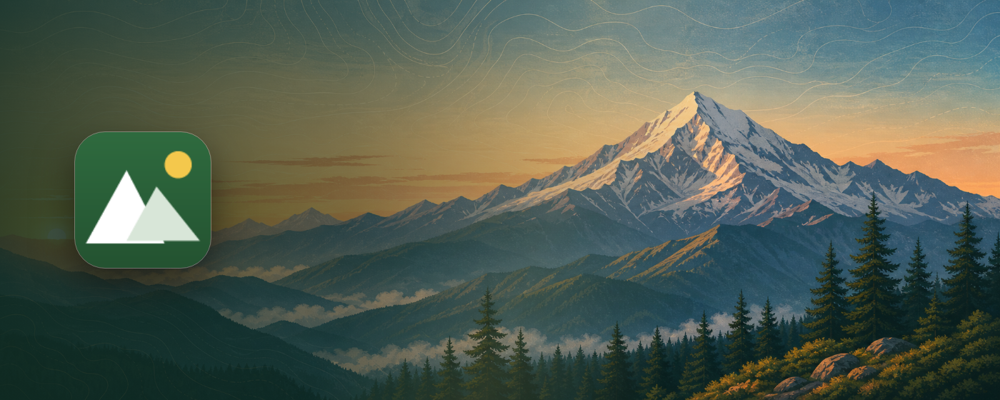
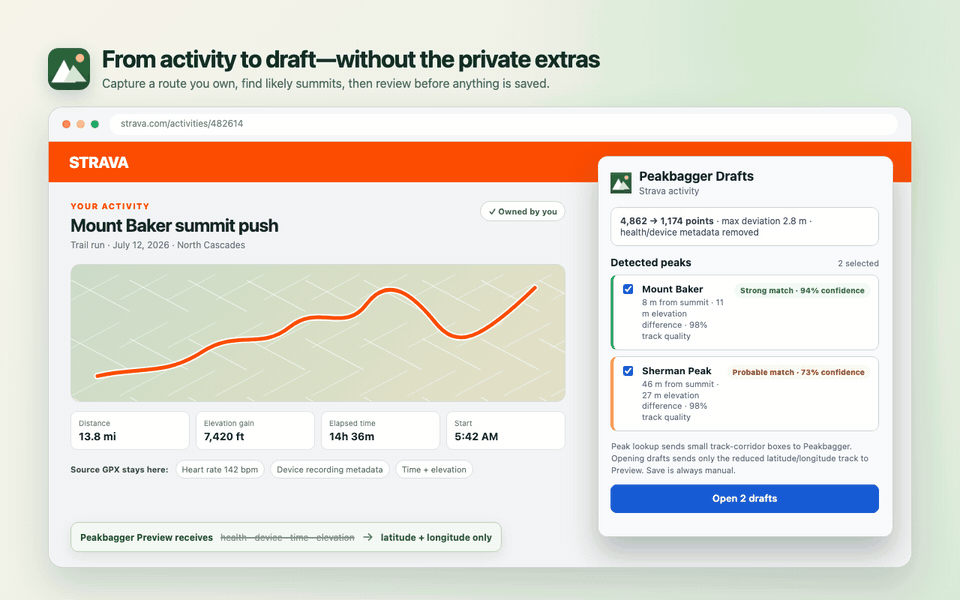
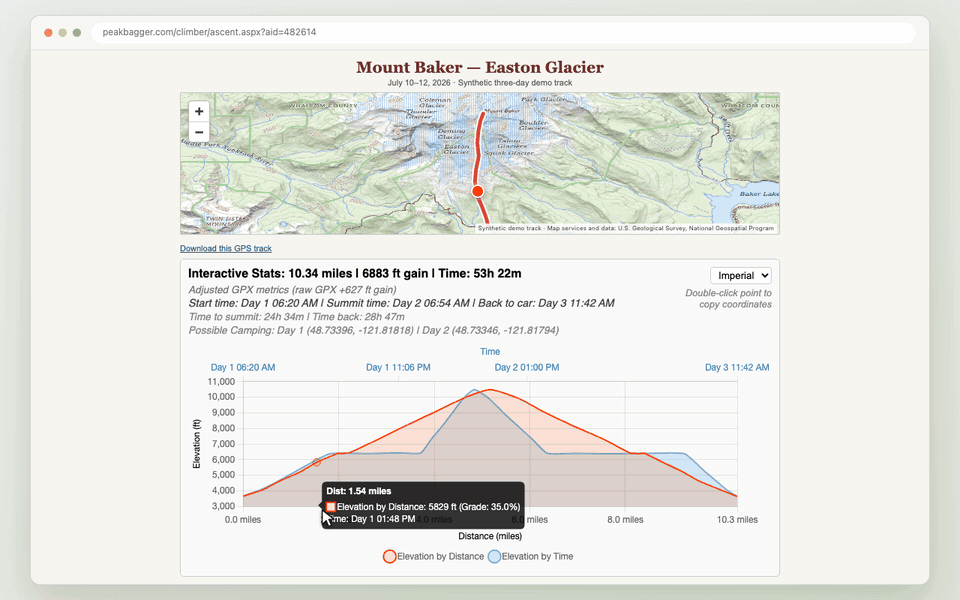
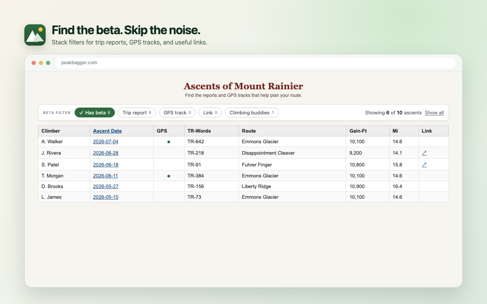
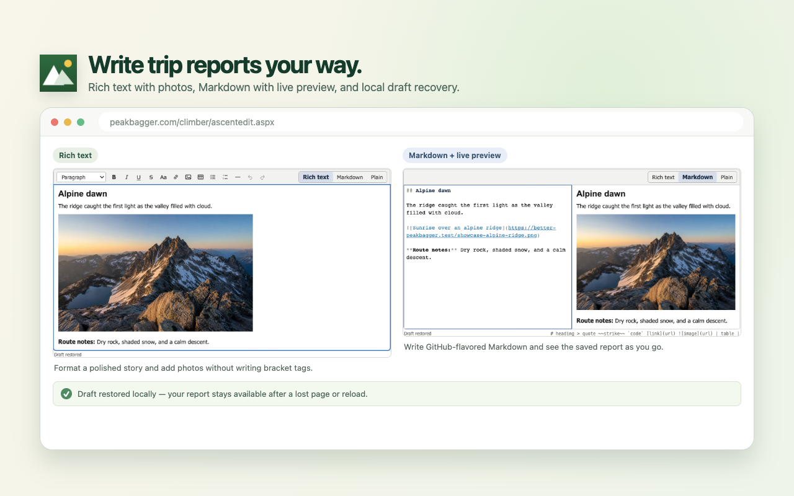
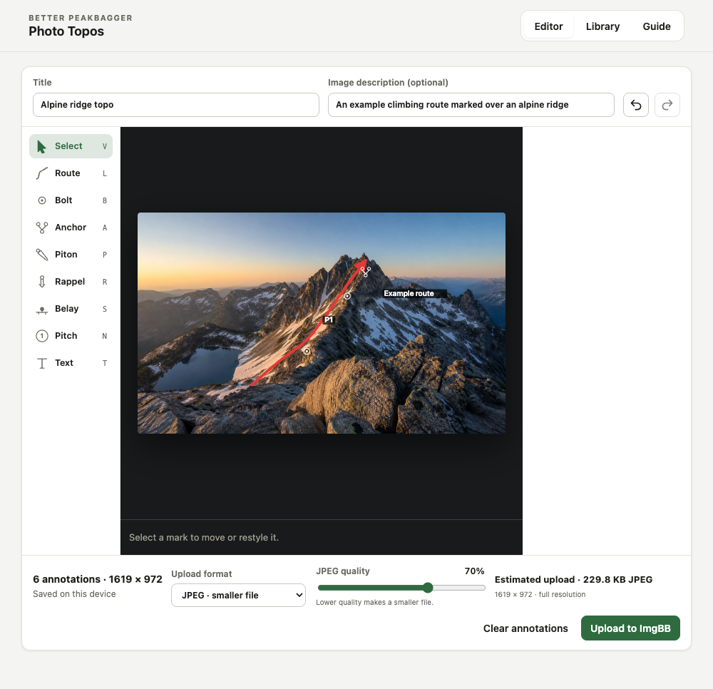
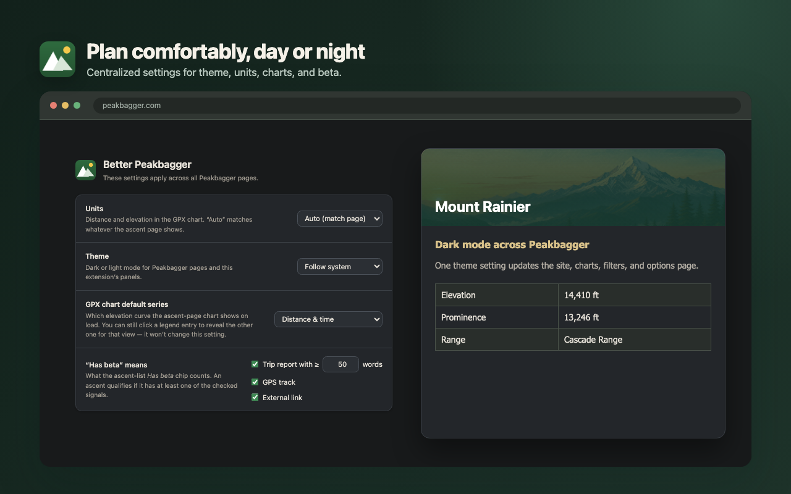

# Better Peakbagger

**Spend less time wrestling with Peakbagger and more time planning the next summit.**

Plan your next climb with free summit weather and 3D terrain. Relive past trips
with historical weather and interactive GPX charts. Turn Garmin and Strava
activities—or a GPX file you already have—into review-ready ascent drafts.

Better Peakbagger brings all of this to [Peakbagger](https://www.peakbagger.com/),
along with faster beta discovery, rich-text and Markdown trip reports, reusable
photo topos, optional GitHub backup, and a polished dark theme.

[](https://chromewebstore.google.com/detail/better-peakbagger/kndjohodnpdoejmjkiiakejfehoodedn)
[](https://addons.mozilla.org/en-US/firefox/addon/better-peakbagger/)

Works with Chrome, Edge, Brave, and Firefox. No userscript manager required.
No analytics or telemetry.



## Install

Choose the official listing for your browser:

- [Chrome Web Store](https://chromewebstore.google.com/detail/better-peakbagger/kndjohodnpdoejmjkiiakejfehoodedn) — Chrome, Edge, and Brave
- [Firefox Add-ons](https://addons.mozilla.org/en-US/firefox/addon/better-peakbagger/) — Firefox

Most features appear automatically when you visit Peakbagger. To capture an
activity, open an activity you own on Garmin Connect or Strava and click the
Better Peakbagger icon. Settings are available from the extension's Details or
Preferences page.

## Feature tour

### Free summit weather: past climbs and the next two weeks

Look ahead to your next summit—or back at a memorable climb—with free weather
data built right into Peakbagger. Powered by [Open-Meteo](https://open-meteo.com/),
an [open-source weather project](https://github.com/open-meteo/open-meteo).
No weather account, API key, or subscription required.

- **More than two weeks ahead.** Peak pages offer an **up to 16-day forecast**
  with temperature ranges, rain/snow totals, and wind. Expand any day for hourly
  charts or a horizontal Conditions table with feels-like temperatures, rain/snow,
  wind, gusts, and wind direction in summit-local time.
- **The past sixteen days at a glance.** Switch to **Past 16 days** to put
  recent summit weather beside the forecast. Each view has a model selector;
  **GFS** is the initial default and each view remembers your last model locally.
  **Models & source details** lists last updates and estimated next updates.
- **Weather for your ascent day.** Saved ascents show historical summit weather,
  with archives reaching back to **1940**, Open-Meteo archive **Best Match**, and alternatives
  where available. Browse adjacent archive days without changing the saved ascent
  date. Expand **Hourly weather** for charts and a horizontal Conditions table;
  a timed GPX can preview or pin the corresponding hour. No GPX needed.

These are model estimates. Coverage varies by date, location, and model;
incomplete hours stay labelled. Longer-range and mountain forecasts can be
inaccurate, so check local mountain forecasts before your climb. Historical
data describes the summit, not conditions along your route. See the
[historical weather guide](docs/ascent-weather.md) and
[summit forecast guide](docs/peak-weather.md).

### Explore the mountain in free 3D


See how a route follows the ridgeline, climbs a face, or crosses a basin.
Explore ascent tracks and peak maps in interactive 3D at true vertical scale,
using open [Mapterhorn](https://mapterhorn.com/) elevation data and compatible
Peakbagger basemaps. Turn 3D on when you want it; cached terrain makes return
visits faster. An experimental OpenFreeMap style offers another way to explore.
Resize a peak's Dynamic Map by dragging its handle or using the arrow keys;
the size is remembered locally, and double-clicking the handle resets it.

**Sentinel-2 (experimental)** adds recent satellite imagery to both the native
2D map and 3D view through Microsoft Planetary Computer. Choose a capture from
the last 30 days and see its date, estimated map coverage, and cloud cover across
the full satellite images. Clouds or gaps may still obscure covered areas.

> Special thanks to [Mapterhorn](https://mapterhorn.com/) for providing
> free, open-access global elevation data that makes this possible.

### Turn an activity into ascent drafts

Log the climb without retyping the trip. Open your activity on Garmin Connect
or Strava, click Better Peakbagger, and choose from explained **Strong** and
**Probable** summit matches. Route details and a privacy-reduced track are
prepared for GPS Preview—even for a multi-peak day. You review every draft
and save each ascent yourself.



### Turn a GPX file into a climb log

Choose a GPX from your watch, a friend, or a mapping app
on Peakbagger's **Add Ascent** form. Better Peakbagger calculates route details,
finds summits along the track, and can prepare drafts for the whole multi-peak
trip. Large files are fitted to Peakbagger's point limit without sending the
original file elsewhere. You review each draft before saving.

### Relive the route, one chart point at a time



Follow a GPX chart and watch the map move with you. Explore route metrics,
grades, mountain-local timing, and multi-day details; select a point by pointer
or keyboard to copy its coordinates. Make the track easier to read with custom
colors, width, and outline that carry through to Full Screen GPS maps.

Tracks with missing elevation or timestamps still get the most useful view
their data supports, with visible gaps instead of invented measurements.
Suspect segments get an explained, reversible interpretation; original
downloads and transfers stay unchanged. See the
[track data guide](docs/gpx-data-quality.md#resulting-chart).

### Take a saved route to your favorite mapping app

Take a track worth following straight from a saved ascent to **Gaia
GPS**, **onX Backcountry**, **AllTrails**, or **CalTopo**. After a one-time access
grant, the exact saved GPX opens in the destination's import preview, ready for
your review and confirmation. Choose which apps appear and their order in
**Settings → Map & GPX chart → Send GPX**.

Your mapping app's membership and file limits still apply: onX needs Premium
or Elite and a GPX under 4 MB; AllTrails accepts uploads up to 20 MB. Better
Peakbagger does not copy account credentials or keep the GPX in extension
storage. See the [Gaia](docs/gaia-import.md), [onX](docs/onx-import.md), and
[CalTopo](docs/caltopo-import.md) handoff guides.

### Plan around the Sun and Moon

Check sunrise, sunset, Moon phase, and the direction of the Sun and Moon right
on a peak map or GPX route. Times follow the mountain's local timezone, and the
calculator works entirely offline. Select a recorded GPX point or use the time
slider to explore another moment at the same location.

Rise and set times assume a level horizon; terrain shadows, weather, smoke,
and actual direct light are outside the model. See the
[Sun and Moon guide](docs/sun-position.md).

### Find useful ascent beta faster

Skip the scrolling and get to the reports that help you plan. Filter and sort
ascent lists by trip report, GPS track, external link, or favorite climber,
without reloading the page. Combine filters, see live counts, and keep your
preferred order.

Follow your Peakbagger Buddy List or build a searchable favorites list. Hide
reports from climbers you choose to ignore, with a temporary reveal when you
want another look. Ignores stay local unless you choose GitHub backup or enable
two-way sync on this device. See the [climber lists guide](docs/climber-lists.md).
Hover over a climber name for quick Favorite, Ignore, and Buddy actions, or
open the adjacent **⋯** button with the keyboard or touch. Buddy changes are
confirmed against the native profile; uncertain results offer a status check.



### Write trip reports, not bracket tags

Tell the story with rich text or GitHub-flavored Markdown, complete with tables,
media, syntax highlighting, and live preview. Better Peakbagger handles the
square-bracket format for you. Device-local autosave and a dedicated draft
workspace help you pick up where you left off; Plain mode keeps the native
textarea available for unsupported legacy markup. See the
[supported syntax and safety contract](https://github.com/wilmtang/better-peakbagger/blob/main/docs/trip-report-editor.md).



### Draw and reuse photo topos

Show the line, mark the crux, and share the beta. Draw routes, curves, labels,
and climbing symbols over a photo, then insert a flattened, metadata-free
JPEG or PNG into your report. Your original stays unchanged, and a searchable
local library keeps editable projects and published versions ready to reuse.

Upload directly to ImgBB with your own API key. The saved key remains in
device-local extension storage. The background worker uses it for report-photo
uploads and gives it only to the exact packaged photo page for a direct ImgBB
upload; it is never exposed to Peakbagger, another website, GitHub, browser sync,
or status UI. Settings exports include it only when you choose **Include saved
credentials**.

Photo sources are limited to 128 MiB encoded, 64 megapixels decoded, and
16,384 pixels per side. Editable project bundles are limited to 40 MiB;
ImgBB decides upload size separately. Optional GitHub recovery can preserve the
catalog and annotation projects. See the
[photo workflow and privacy boundaries](https://github.com/wilmtang/better-peakbagger/blob/main/docs/photo-topo-editor.md).



### Keep a copy of your climbing history

Your climbing history deserves a copy you control. Back up one ascent or your
full history to your own GitHub repository, with readable Markdown trip reports,
JSON ascent details, and Peakbagger's stored GPX files. Keep later edits in sync,
and optionally preserve settings, favorite climbers, and photo-library recovery
data through the same connection. Each backup is optional and never changes
an ascent on Peakbagger.

### Bring the rest of your planning into reach

Jump from a peak page to location-aware forecasts, recent satellite imagery,
modeled snow depth, and fire or smoke information. Planning links open the
supported service at the mountain you're researching.

### Make Peakbagger easier on the eyes

Give Peakbagger a polished dark theme, follow your system appearance, or stay
with light mode. Set your preferred maps, chart styles, and feature options in
one place, then export your settings for safekeeping. **Settings → General → Units**
offers a default plus separate distance, elevation, temperature, precipitation,
and wind choices—for example, miles and feet with Celsius. Sun & Moon and
weather cards each have a display toggle.

Exports leave credentials out by default. Choosing **Include saved credentials**
adds your ImgBB API key and GitHub connection to an unencrypted file; keep it
private.



## Privacy by design

There is no Better Peakbagger account, analytics, telemetry, advertising, or
developer data server. Raw Garmin or Strava GPX is processed on the activity
page and never sent to the developer. Third-party services receive only the
data needed for the features you use, including summit coordinates for automatic
weather cards and backups or track transfers you authorize. See
[Privacy and data handling](PRIVACY.md) for what is sent, when, and how long
it is kept.

## FAQ

### Is this an official Peakbagger extension?

No. Better Peakbagger is an independent passion project. Ideas and bug reports
are welcome in [GitHub Issues](https://github.com/wilmtang/better-peakbagger/issues)
and the [discussion board](https://github.com/wilmtang/better-peakbagger/discussions).
**Settings → About** links to feedback, bug reports, source code, the license,
and the rating page for your browser's store.

### How can Better Peakbagger offer 3D maps for free? What's the catch?

Most elevation data is public or openly licensed; the costly part is turning it
into map tiles and serving them at scale. Better Peakbagger renders 3D locally
with open-source [MapLibre](https://maplibre.org/projects/gl-js/) and uses
public terrain tiles from
[Mapterhorn](https://mapterhorn.com/), a project supported by grants, sponsors,
and donated infrastructure. Better Peakbagger runs no map server and has no
subscription, advertising, or sale of user data.

The trade-off is relying on community-supported services without guaranteed
availability. Better Peakbagger reuses a bounded local elevation cache and may
show less distant detail at steep angles to limit traffic. After you enable 3D,
tile providers receive the area viewed and ordinary request data such as your
IP address. You can disable 3D at any time; Peakbagger's 2D maps remain
available.

### Does Better Peakbagger place extra demand on Peakbagger or bypass its protections?

Some features make additional requests, so zero impact would be misleading.
Activity capture searches small areas along the route; the GPX Analyzer reads
the track linked from an ascent page; 3D requests Peakbagger's nearby-peak feed
after the camera settles; and Buddy or backup features read only the account
data they need. Buddy data is cached for seven days, and full-profile backups
are explicit, read Peakbagger ascents one at a time, and skip existing backups
by default.

Better Peakbagger is an interactive client, not a crawler. It uses your normal
signed-in session through a Peakbagger page, without requesting permission to
read cookie values, and stops or pauses for rate limits or human checks. It
never solves CAPTCHAs, rotates identities or proxies, or evades blocks.

### Why doesn't Better Peakbagger update Peakbagger ascents automatically?

There is no safe, reliable hook for a small independent extension to receive new
activities automatically. [Strava requires a subscription][strava-api] to
create an API application, even when the developer reads only their own data.
The [Garmin Connect Developer Program][garmin-api] is limited to approved
business and enterprise integrations. An unattended workaround would require
brittle login automation and another copy of sensitive activity data.

Better Peakbagger instead works through the provider page you already opened
and signed in to. A toolbar click grants temporary access to that one activity;
the extension never receives your password or keeps permanent Garmin or Strava
access.

Summit matching is also evidence, not certainty, and an ascent log is your
record. Better Peakbagger does the repetitive work, then stops before Save so
you can review every ascent.

[strava-api]: https://developers.strava.com/docs/getting-started/
[garmin-api]: https://developer.garmin.com/gc-developer-program/program-faq/

### Can it capture any Garmin or Strava activity?

No. You must be signed in, the activity must belong to your account, and the
page must provide unambiguous ownership signals. Better Peakbagger fails closed
if it cannot verify those conditions. You must click the toolbar icon for each
capture; the extension does not keep permanent provider access.

### What should I do when a capture stops?

Follow the one action shown in the popup. Depending on the cause, Better
Peakbagger will ask you to reload the activity, sign in, return to the provider,
open the exact Peakbagger human-check page, wait until a rate limit passes, try
again after a temporary outage, or use a shorter track. After completing a
sign-in, reload, or human check, return to the activity and click the extension
again; the new click rechecks the page instead of replaying the old failure.
Better Peakbagger never solves a CAPTCHA or retries through a stated cooldown.

### What do Strong and Probable mean for a captured activity?

They describe the evidence that your recorded route encountered a summit—not a
claim that you reached it. Better Peakbagger compares closest approach, the
track's elevation near the summit, whether it forms a local high point, and
track quality. **Strong** means several signals agree and is selected by
default. **Probable** means the route is close enough to consider but the
evidence is weaker or ambiguous, so it is never selected automatically. Review
both before opening drafts, and review every draft before Save.

### Which third-party services can receive my information?

Better Peakbagger has no developer data server, account, analytics, advertising,
or telemetry. Garmin or Strava is accessed only after your toolbar click, and
the raw activity GPX is processed on that page rather than sent to the
developer.

Optional services are contacted only for the feature you use. Map tiles are
requested from Mapterhorn and your selected map provider after you enable 3D.
GitHub receives only the backups you authorize for your chosen repository.
ImgBB receives a flattened image only when you provide an API key and choose
**Upload & insert**. Gaia or onX receives the saved ascent GPX only when you
click that destination's **Send** button. Remote report media contacts its host when displayed. See
[Privacy and data handling](PRIVACY.md) for the complete field-level list.

### Will Better Peakbagger add a developer-run server or telemetry in the future?

There are no plans to. Running a reliable service costs money and creates a
long-term maintenance commitment, so Better Peakbagger is designed to work
without a developer-run data server or telemetry. This is also why it favors
backups you control: if Peakbagger or Better Peakbagger ever disappears, your
backed-up trip reports can remain in your GitHub repository.

If a future feature truly requires a service, it will not be introduced
silently. The feature will require your explicit choice, collect and retain
only the data it needs, and be documented in the README and privacy policy
before you use it.

## Development

Start with the
[architecture and design guide](https://github.com/wilmtang/better-peakbagger/blob/main/docs/architecture.md),
then use the
[development workflow](https://github.com/wilmtang/better-peakbagger/blob/main/docs/development.md)
and
[browser-store release guide](https://github.com/wilmtang/better-peakbagger/blob/main/docs/releasing.md).
Focused design notes and archived investigations are maintained in the
[developer documentation index](https://github.com/wilmtang/better-peakbagger/blob/main/docs/README.md).

Install locked dependencies with `npm ci`. Runtime source is bundled into
`dist/`; load, test, lint, verify, and package `dist/`, never the repository
root.

```sh
npm test
npm run test:scale
npm run lint
npm run verify:browsers
```

## License

[AGPL-3.0-or-later](LICENSE). Third-party license notices and project credits are in
[ACKNOWLEDGEMENTS.md](ACKNOWLEDGEMENTS.md).
