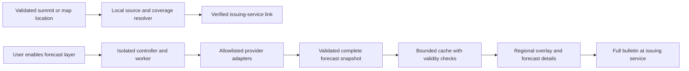

# Avalanche forecast links and regional map layer

Status: first-release source links implemented on October 12, 2026; exact zone
links and regional overlays remain proposed. Requested scope: worldwide, where
issuing organizations publish public avalanche forecasts. The implementation
ledger below records the initial source set and remaining proof gaps.

## Findings and recommendation

Start with a location-aware **Avalanche forecasts** link in the existing peak
planning-links section. Add a regional forecast overlay later, provider by
provider. Both should lead to the issuing service's full bulletin. Avoid calling
either feature an avalanche *risk* assessment for the mountain or route.

1. **A summit coordinate identifies a place, not its avalanche risk.** Regional
   forecasts, static terrain exposure, and route-specific assessment are
   different products. Slope angle alone misses overhead exposure and runout.
   Weather estimates cannot substitute for snowpack observations and a published
   bulletin. The [EAWS spatial and temporal guidance](https://www.avalanches.org/standards/setting-the-spatial-and-temporal-scale/)
   describes the scale at which forecasts apply; the
   [ATES definition](https://avalanche.org/avalanche-encyclopedia/terrain/avalanche-terrain-exposure/avalanche-terrain-exposure-scale-ates/)
   separates landscape exposure from changing snowpack conditions.
2. **The current extension already has the right first integration point.**
   [peak-links.js](../../src/maps/peak-links.js) validates the explicitly labelled
   WGS84 decimal coordinates, anchors an inset to the native Links section, and
   adds Windy, Copernicus, and country-gated AirNow links. Its external anchors
   already use `noopener noreferrer`. Adding an avalanche source here avoids
   another card, weather request, or map lifecycle dependency.
3. **Country selection is only a gateway lookup.** The current Nation reader
   uses the first matching row and treats the whole value as one country. That
   is insufficient for border mountains, duplicate rows, or multiple countries.
   A country's forecast website is useful even when an exact zone cannot be
   resolved, but the UI must say so. Never choose the nearest zone and claim it
   covers the summit.
4. **A worldwide layer needs several maintained data adapters.** The researched
   sources have different formats, coverage, temporal semantics, and delivery
   terms. A reachable JSON URL is not a sufficient integration contract. For
   example, the [Avalanche.org API entry page](https://api.avalanche.org/)
   explicitly asks third parties to contact the organization for permission.
5. **Existing projects substantially reduce discovery work, but are not drop-in
   extension modules.** The European map uses OpenLayers; Better Peakbagger uses
   page-owned Leaflet and an extension-owned MapLibre frame. Reuse source
   registries, schemas, and design lessons before considering application code.

| Approach | Benefit | Additional burden | Recommendation |
| --- | --- | --- | --- |
| Source link chosen from summit location and country | Worldwide routing without background third-party traffic | Maintain verified destinations; some sites require the user to select a zone | First release |
| Exact zone link resolved locally from published boundaries | Opens the relevant issuing service more directly | Dataset rights, boundary updates, overlap and border handling | Incremental enhancement |
| Official regional forecast overlay | Compare forecast regions while planning | Live fetches, permissions, expiry, attribution, two renderers, provider maintenance | Later, opt-in |
| Terrain or route risk model | Much more specific-looking output | Separate scientific validation, high-quality terrain, runout and uncertainty modelling | Outside this feature |

## Existing projects already doing related work

These are projects and products inspected during this investigation, not
endorsements of their safety or independent verification of their forecasts.

| Project | What already exists | Relevance to Better Peakbagger |
| --- | --- | --- |
| [CalTopo](https://training.caltopo.com/all_users/overlays/overlay-desc) | US/Canada regional forecast overlay with validity and links to full forecasts; the overlay fades away when zooming in | Closest mature UX precedent: preserve regional scale instead of implying slope precision. Existing CalTopo GPX handoff can complement this feature; it does not establish a documented URL to enable the avalanche layer. |
| [Gaia GPS](https://www.gaiagps.com/maps/source/avalanche-forecast/) | Forecast overlay from US and Canadian organizations, including zone details and expiry | Confirms the source-data model is practical. Its commercial layer is a product reference, not permission to reuse its tiles. |
| [EAWS bulletin map](https://github.com/simon04/eaws-bulletin-map) | Open-source European bulletin map, also embedded on the [official EAWS homepage](https://www.avalanches.org/); GPL-3.0-or-later | Best immediate European link target and JavaScript reference. Its source supports a geographic `bbox` query parameter. Uses OpenLayers, not the extension's renderers. |
| [ALBINA / Avalanche.report](https://github.com/albina-euregio/albina-website) | Open-source issuing-service website for Tyrol, South Tyrol, and Trentino, with neighboring bulletins; AGPL-3.0 | Reference for CAAML, time and elevation presentation. Its website is not a worldwide forecast feed. |
| [pyAvaCore](https://github.com/fridlmue/pyAvaCore) | Python parser used by ALBINA and the EAWS map to normalize multiple European services; GPL-3.0 | Useful provider inventory and format reference. A Python service would add infrastructure that the link feature does not need. |
| [Varsom](https://www.varsom.no/en/about/regobs/) | Norwegian warnings, observations, and separate terrain layers | Good precedent for distinguishing observations, terrain, and forecasts. Relevant national source and possible later API adapter. |
| [onX ATES](https://www.onxmaps.com/backcountry/app/features/avalanche-terrain-exposure-scale) | Terrain exposure mapping using more than slope angle | Demonstrates why a homemade slope mask should not be labelled an official forecast or route assessment. |
| [Skitourenguru](https://info.skitourenguru.ch/download/intro/Intro_EN.pdf) | Route assessment combining bulletin and terrain data | A separate, considerably larger modelling product; not an algorithm to recreate from a summit coordinate. |
| [WHUMPF](https://github.com/Londopy/whumpf) | MIT-licensed project projecting bulletin parameters onto 3D terrain | Especially close to the proposed 3D idea, but its current README says real DEM attribute output and browser exercise of the ported layers remain unproven. Study its adapter design; do not treat it as a validated terrain engine. |
| [Open Avalanche Project](https://github.com/scottcha/OpenAvalancheProject) | Open-source forecasting research and a [2019 global region experiment](https://blog.openavalancheproject.org/posts/20190620_a-global-avalanche-region-map/) that explicitly mentions using Peakbagger range names | A direct Peakbagger connection already exists in related research. The global experiment identifies potential avalanche regions; it is not a current worldwide official danger feed. |

Live GitHub metadata was also read: EAWS map last push June 25, 2026; ALBINA
October 12; pyAvaCore October 7; WHUMPF October 1. These dates establish recent
repository activity, not production readiness. No inspected project was run or
independently audited. The scoped search did not establish an existing
Peakbagger browser extension implementing this feature; that is not proof none
exists.

## Worldwide source strategy

Here, “official” means the published product of the issuing government service
or identified professional public forecast organization. Record that distinction
in the provider registry. An aggregator may help find the bulletin, but must
preserve attribution and link to the issuer. Coverage is geographic and seasonal;
country membership never proves that a forecast covers every mountain.

| Location | First-release destination | Data/layer assessment |
| --- | --- | --- |
| United States, including Alaska | [Avalanche.org](https://avalanche.org/) | [NAC documentation](https://github.com/NationalAvalancheCenter/Avalanche.org-Public-API-Docs) specifies a GeoJSON map layer with zone, issuer, danger, validity, and forecast URL. Obtain the requested permission before integrating the feed or redistributing boundaries. No map-centering URL was established in this research. |
| Canada | [Avalanche Canada map](https://avalanche.ca/map) | [Public API documentation](https://docs.avalanche.ca/) separates current forecast areas, metadata, and full products. Join current areas to current metadata/product IDs; do not pin a changing forecast to an old region slug. Review the [data-sharing policy](https://avalanche.ca/data-sharing-policy). |
| European forecast areas | [EAWS](https://www.avalanches.org/) and its linked bulletin map | [EAWS members](https://www.avalanches.org/about/) supplies issuing-service links. [EAWS regions](https://gitlab.com/eaws/eaws-regions) provides geometry and source metadata; its LICENSE is CC0. Bulletin rights and delivery terms remain provider-specific. Some member services or dates have no machine-readable bulletin. |
| Switzerland | [White Risk](https://whiterisk.ch/en/conditions), or the EAWS map near the summit | [SLF data service](https://www.slf.ch/en/services-and-products/slf-data-service/) publishes CAAML and region geometry under CC BY 4.0, requires visible source attribution, and states infrastructure restrictions. Confirm the intended client-delivery arrangement before a layer rollout. |
| Norway / Svalbard forecast areas | [Varsom avalanche warnings](https://www.varsom.no/en/avalanches/avalanche-warnings/) | [NVE API documentation](https://api.nve.no/doc/snoeskredvarsel/) documents version 6.3.2, JSON/XML, and NLOD licensing. A strong later adapter candidate. Regobs observations are a different product. |
| Scotland | [SAIS](https://www.sais.gov.uk/) | Six forecast areas; use region lookup only with verified boundaries. Do not present SAIS as coverage for all UK mountains. |
| Iceland | [Icelandic Met Office avalanche pages](https://gottvedur.is/snjoflod/en/) | The [old official portal](https://en.vedur.is/avalanches/forecast/) points to this replacement. Keep a direct national link even if the European aggregator is unavailable. API contract not established here. |
| New Zealand | [NZ Avalanche Advisory](https://www.avalanche.net.nz/) | The [issuing service](https://www.avalanche.net.nz/about-us/what-is-the-avalanche-advisory) identifies 13 public forecast regions. Exact region URL patterns exist, but stable coordinate resolution and a supported redistribution/API contract remain to be verified. Link first. |
| Japan | [Japan Avalanche Network bulletins](https://data.nadare.jp/avalanche_informations/?locale=ja) | The issuing site lists specific forecast areas, not all of Japan. Retain the issuer's language and validity; API and polygon contract not established here. Link first. |
| Australian Alps in Victoria / NSW | [Mountain Safety Collective reports](https://mountainsafetycollective.org/backcountry-conditions-reports) | Professional public reports include several alpine hazards. [MSC's integration announcement](https://mountainsafetycollective.org/blog/msc-skida-backcountry-app) confirms an API is available to integrators; schema and usage arrangement were not established here. Label as backcountry conditions, not an avalanche-only government forecast. |
| Indian Himalayan forecast districts | [DGRE avalanche bulletin directory](https://drdo.gov.in/drdo/en/documents/avalanche-warning-bulletin?page=0) | [Government bulletins](https://drdo.gov.in/drdo/sites/default/files/avalanche_warning_bulletin/DGRE_AWB_14-Mar-2026.pdf) exist with district and altitude applicability. Configure the directory gateway even when it lists no current entries, as requested by the owner; available bulletins remain the issuer's responsibility. Do not substitute a dated PDF or imply peak coverage. Preserve DGRE's terminology rather than assuming its numbers equal NAADS/EAWS categories. |
| Other locations | No source-specific link until a verified issuer is added | This investigation is a worldwide architecture and initial source set, not an exhaustive world inventory. Additional services, including South America and other Asian ranges, need issuer, destination, coverage, and usage verification. “Source not configured” must not imply “no avalanche danger.” |

For the European link registry, source-review country aliases for Andorra,
Austria, Czech Republic, Finland, France, Germany, Iceland, Italy, Norway,
Poland, Romania, Slovakia, Slovenia, Spain, Sweden, Switzerland, Ukraine, and
the UK/Scotland distinction. Validate national destinations against the member
directory; do not assume the aggregator supports every member and date.

### Location-link contracts

- Canada: a [published issuing-site URL](https://avalanche.ca/map?lat=54.676769&lng=-121.451121)
  uses `lat` and `lng`; for the
  existing Garibaldi fixture the candidate is
  [this centered map URL](https://avalanche.ca/map?lat=49.850562&lng=-123.004672).
  This is parameter evidence, not a browser-verified center or selected zone.
- Europe: inspected [route.ts](https://github.com/simon04/eaws-bulletin-map/blob/master/src/route.ts)
  and [main.ts](https://github.com/simon04/eaws-bulletin-map/blob/master/src/main.ts)
  accept `bbox=west,south,east,north` in longitude/latitude degrees and fit the
  view to it. Example: `?bbox=9.5,46.2,10.1,46.8`. This centers an area; it does
  not pin the summit or prove zone coverage. Leave the date to the provider;
  never silently substitute an old ascent date.
- Other services: use the verified gateway URL until coordinate or region
  parameters are documented and exercised. Do not invent query strings.
- A bbox is navigation context only. Clamp latitude, handle wrapped longitude,
  and fall back to the gateway if a destination cannot represent a wrapped box.
  Never use these navigation rectangles as forecast coverage polygons.

## First-release interaction and implementation boundary

Add one quiet entry using [peak-links.css](../../src/maps/peak-links.css):

```text
Better Peakbagger links
    Avalanche forecasts — Avalanche Canada ↗
    Find the regional bulletin for this peak.
    Windy summit forecast
    ...
```

The label names the destination. The detail says “Find” when the target is a
gateway or centered map. Only a verified polygon match may use “Regional
forecast for this peak.” On border summits, show both relevant issuing sources
when known; deduplicate a shared aggregator. Keep the entry visible year-round,
since season dates and summer snow differ across regions. No danger badge is
shown in this phase, and no weather-based snow or latitude gate decides safety.

Resolve locally; ordinary third-party navigation occurs only when the user
opens the link. Do not prefetch, embed a remote iframe, request geolocation, or
send a peak ID, climber identity, ascent date, or GPX. Coordinates included in a
link become visible to its destination when opened. Retain the existing anchor
privacy behavior and update [PRIVACY.md](../../PRIVACY.md) during implementation.
No new host permissions or settings are needed for ordinary links.

The first implementation is confined to the existing peak-links entry and a
pure, locally maintained source registry. Implemented files:

```text
src/avalanche/avalanche-links.js       provider registry and safe URL builders
src/avalanche/avalanche-location.js    strict Nation parsing, if needed
test/avalanche/avalanche-links.test.mjs
```

Keep the coordinate/Links anchoring invariants. Parse only the peak-details
table's own Nation row, require uniqueness, and recognize multiple countries
from independently delimited native values. Reject ambiguous values rather than
substring matching. Add synthetic border and malformed fixtures before relying
on an unobserved live markup variant. Preserve existing AirNow coverage and
existing links; this task does not justify unrelated parser refactoring.

Unknown source handling should be concise: “No forecast source configured for
this location.” That describes extension coverage, not the snow conditions.
Do not silently link every unsupported mountain to a US or European service.
For arbitrary map points, a later offline coverage lookup is required because
there is no reliable Nation row for the clicked coordinate.

## Later official regional forecast layer

The control should be **Avalanche forecasts**, independent of the basemap and
off until selected. Start on peak-page 2D/3D maps; expand to BigMap and ascent
pages only after lifecycle and time-context tests. On historical ascent pages,
label the layer “Current avalanche forecasts”; do not imply historical coverage.

Use translucent regional polygons behind routes and markers, a compact legend,
issuer attribution, and an accessible details panel with one **Open full
forecast** action. Keep source warnings and validity prominent. Use the issuer's
published overview rating and documented period, while retaining elevation,
aspect, and AM/PM distinctions in details. If an overview must be derived, state
its aggregation rule and have the adapter verified; never silently take the
first rating or assign a regional maximum as the summit's rating.

Reduce fill prominence at close zoom and keep the forecast link available.
Validate the fade threshold per provider and actual map viewport; CalTopo is a
UX precedent, not a universal threshold specification. Slope-angle shading,
ATES, runout modelling, and observations remain separate layers/products.

| State | Presentation |
| --- | --- |
| Current, rated product | Issuer's danger label, valid interval, region, full forecast link |
| Current information without a rating | Neutral styling, “Information available · No rating,” source link |
| Known zone but no current product | Outline/neutral state, “No current forecast,” source link |
| Expired or withdrawn product | Remove danger fill; retain source and explicit expired/withdrawn status |
| Future product | Explicit future validity; never present as current |
| Outside verified coverage | “Outside mapped forecast coverage” |
| Fetch, schema, or partial-source failure | “Forecast unavailable”; preserve coverage identity, remove unverified rating |
| Registry or boundary ambiguity | “Coverage could not be determined”; offer relevant gateways |

Successful complete coverage lookup is required before declaring a point outside
coverage. Zero, negative numbers, missing fields, and unknown enums never become
Low danger. Do not guess “out of season” unless the issuer explicitly says so.

### Architecture



- **Fetching:** a dedicated worker service accepts a provider ID and bounded
  area/product identifiers, never an arbitrary page-supplied URL. Use optional,
  provider-specific origins if worker fetch access requires them. Permission
  denial retains the plain link. Avoid embedded API secrets and broad wildcard
  access. Respect each provider's supported delivery arrangement; if a relay is
  required, make that a separate infrastructure/privacy decision.
- **Normalization:** keep provider/zone/product identity, publication time,
  explicit valid interval, source timezone, full URL, product type, warnings,
  rating bands and their aspect/elevation/time scope, geometry provenance, and
  attribution. Preserve named treeline bands; do not invent global altitude
  cutoffs. Retain the provider's scale identifier; equal numbers alone do not
  prove equivalent categories.
- **Atomicity:** Canada's areas and metadata must form a consistent snapshot.
  A mismatch or missing product is an incomplete result, not a coverage gap.
  Preserve holes and MultiPolygons, split antimeridian bounds, return all exact
  boundary/overlap matches, and distinguish coordinate uncertainty from a
  confident containment result.
- **Caching:** single-flight by provider, language, coverage revision, and
  product period. Keep a small session cache; provider polygons do not require
  persisting a user's location. Use provider cadence/backoff and conditional
  requests when supported. Cache freshness never extends bulletin validity.
  Recheck validity while a tab stays open, after suspension, and on BFCache
  restore. Abort on deactivation and reject stale generation responses.
- **Rendering:** follow [sentinel-map.js](../../src/maps/sentinel-map.js) for
  bounded attachment and teardown on the native MAIN-world map. Add a dedicated
  Leaflet pane for forecast polygons rather than altering native layers.
  [terrain-frame-runtime.js](../../src/terrain/terrain-frame-runtime.js) owns
  MapLibre sources/layers. Extend its authenticated coordinator protocol with
  bounded sanitized records; revalidate on both sides. Do not widen the settings
  bridge's privileged write allowlist or add page-world extension API calls.
- **Input safety:** bound response bytes, feature/vertex counts, strings and
  request time; validate coordinates and closed rings. Allowlist issuer HTTPS
  destinations, reject credentials/unexpected origins and redirects, and render
  bulletin text as text. Legacy HTTP URLs in sample feeds require a verified
  HTTPS destination, not automatic trust or silent protocol replacement.

The inspected EAWS map's
[fetchBulletins.ts](https://github.com/simon04/eaws-bulletin-map/blob/master/src/fetchBulletins.ts)
returns empty bulletin fallbacks for several network/schema failures. Its source
registry is informative, but copying that error behavior would lose the
distinction between unavailable data and a successful empty result required here.

## Delivery and verification plan

1. **Worldwide source links:** verify destination behavior, implement the pure
   registry and peak entry, update privacy documentation, add focused tests,
   render the real fixture, and commit this completed unit.
2. **Exact zone links:** add only licensed, versioned boundaries whose IDs map
   to maintained issuer destinations. Europe is a promising first source.
   [Canada's public polygon repository](https://github.com/avalanche-canada/forecast-polygons)
   defines subregions, but GitHub metadata reports a last push in August 2023
   and no detected license. Do not treat it as current dynamic areas or assume
   redistribution rights from its public visibility.
3. **Regional overlays:** qualify one provider contract at a time. Norway and
   Switzerland have documented candidates; the US requires the requested
   permission; Canada needs its live area/product join. Preserve worldwide
   link coverage while layer support expands. Commit each completed adapter or
   renderer unit with its own verification.

Required tests for the link phase: US/Canada, each configured European nation,
NZ, Japan, Australia and India's directory gateway; aliases; border countries;
unknown and duplicate Nation rows; malformed/duplicate coordinates; preservation of existing
links; deduplication; HTTPS/no-referrer anchors; no background third-party
requests. Exact-zone tests additionally cover holes, overlaps, boundary points,
precision uncertainty, antimeridian and missing coverage.

Layer regressions must exercise real provider-format fixtures: rated/unrated,
missing/expired/future/withdrawn products; timezone and DST boundaries; changing
Canadian areas; partial failures; unknown scales; slow/reordered requests;
permission denial/revocation; suspension/restore; and old-map disposal.

Before UI implementation, confirm the intended fixture/extension can load on
the chosen verification surface. Afterward build `dist/`, run focused tests and
real extension verification in Chrome and Firefox. Inspect narrow and standard
peak layouts, light/dark, keyboard focus, legend/detail wrapping, and route/marker
visibility. Layer rendering additionally needs hidden hardware-GPU checks in
both browsers using repository launch guards and HTTPS Peakbagger fixtures.
Report browser, renderer, viewport and unproven native behavior. Do not open or
raise a test window over the user's work.

## Evidence and remaining gates

- **Verified in this investigation:** relevant local source, manifest execution
  worlds, current link styles/tests, public provider documentation, listed
  project source/licensing metadata, EAWS bbox implementation, and EAWS region
  LICENSE. Documentation checks are recorded in the handoff.
- **Intentionally deferred:** live danger badges, permission
  changes, provider contacts, hosted infrastructure, slope/runout/route risk
  modelling, and historical avalanche reconstruction.
- **Not yet proven:** browser-visible external map centers and zone selection;
  exhaustive worldwide issuer inventory; live seasonal feed correctness;
  provider-specific redistribution/delivery arrangements where unresolved;
  exact zone joins; real UI layout, native focus and assistive-technology behavior
  of the proposed feature. No product behavior or project test suite was claimed
  verified by browsing its README.

The preferred decision is therefore **worldwide links now, official regional
overlays incrementally**, with source links retained wherever an overlay cannot
be safely supported.

## First-release implementation ledger — October 12, 2026

### Fixed and verified

- Added the quiet peak planning entry with a packaged registry. US and Canada,
  the listed European nations, NZ, Japan, India, and Australia resolve locally. Border
  values separated by native line breaks, commas, semicolons, or slashes retain
  all known sources in native order; shared aggregators are deduplicated.
- Nation rows must be unique and belong directly to the coordinate row's table.
  Missing, duplicate, nested, malformed, and unknown values report extension
  coverage explicitly. Existing Windy, Copernicus, native map links, and AirNow
  coverage remain; AirNow additionally handles recognized border countries.
- Canada uses the published `lat`/`lng` navigation parameters; supported EAWS
  map countries use its documented `bbox`. Wrapped or polar boxes fall back to
  the EAWS gateway. No zone selection, ascent date, or coverage polygon is
  inferred. Duplicate decimal-coordinate values fail closed.
- Rechecked destination pages and the EAWS member directory and map source.
  Norway, Switzerland, and Iceland retain direct national gateways. Romania
  uses the EAWS issuing-service directory because it is absent from the map's
  default region list. SAIS explicitly names Scotland; MSC names backcountry
  conditions and limits its detail to Victoria and New South Wales.
- India now links to the DGRE directory regardless of current entries, following
  the owner's first-release correction. Its detail says “Find avalanche warning
  bulletins for Indian Himalayan districts”; no dated bulletin or peak-specific
  coverage is inferred. Registry and shipped-bundle regressions cover this
  gateway and mixed India/unsupported-country borders.
  DGRE follow-up verification: rebuilt `dist/`, 43 focused link/manifest/document
  tests passed, changed-file ESLint and `git diff --check` passed. The real
  extension's India entry rendered in hidden Chrome 153.0.8010.12 and Firefox
  157.0.1 at 390 × 900 and 1280 × 900, light/dark, normal and doubled text;
  screenshots showed no clipping and hover/press/focus geometry stayed stable.
  No forecast WebGL layer or native window/focus behavior was exercised.
- Links retain HTTPS and `noopener noreferrer`; the shipped-bundle tests reject
  automatic fetches, privileged messaging, or geolocation. No new permissions
  or settings were added. README and PRIVACY.md describe routing and URL data.
- Built `dist/`; focused avalanche, existing link, and manifest tests passed
  **39/39**. The complete rebuilt suite initially passed 2716/2717 while an
  unrelated concurrent npm-script/documentation change was incomplete; after
  that change settled, the full suite rerun passed **2717/2717**. Focused ESLint
  (including both modified browser verifiers), `git diff --check`, documentation
  tests (3/3), and web-ext lint passed; web-ext retained six existing owned
  warnings and added none.
- Real unpacked-extension verifiers passed in **hidden Chrome for Testing
  153.0.8010.12** and **hidden Firefox 157.0.1**, each at **1000 × 760**. HTTPS
  masked peak fixtures were separately rendered in both browsers at exact
  **390 × 900** and **1280 × 900**, light/dark, for Canada, US/Canada borders,
  shared European sources, Australia, and unknown locations. Screenshots were
  inspected, text had no internal overflow, keyboard outlines were visible, and
  panel/link geometry stayed within 1 CSS pixel across hover, pressed, and
  keyboard focus states. Border and Australian entries also passed at doubled
  panel text size (26px) at 390 × 900 in both themes and browsers. These are
  native HTML/CSS surfaces, with no forecast
  WebGL layer. Disposable profiles, servers, and certificates were removed;
  exact owned process paths were checked after teardown.

### Intentionally not changed

- Unconfigured countries get a coverage message, including the unsupported side
  of mixed borders. A directory's lack of current entries does not disable a
  configured gateway, and no old PDF substitutes for a current directory.
- No exact-zone resolver, danger badge, feed integration, regional map layer,
  permission request, setting, provider contact, or runtime third-party request.
  These remain separate later releases with the contracts described above.

### Changed but not fully proven

- Live Canada and EAWS navigation opened their map controls and retained the
  parameters. The basemap captures remained blank, so a browser-visible center
  or selected zone was **not** established. Canada reported hardware ANGLE Metal
  on Apple M3 Pro; this does not prove the destination finished rendering. URL
  construction is covered by tests and published parameter/source evidence.
- Exact native border markup beyond the masked single-country pages remains
  unobserved; multiple-country and malformed variants are synthetic regression
  fixtures. Undelimited or annotated country prose deliberately remains unknown.
- No exhaustive worldwide inventory, seasonal bulletin correctness, native
  window/focus placement, screen-reader speech, or native browser-zoom proof is
  claimed. Hidden protocol focus and screenshots establish only the checked
  page behavior and layouts. Links have no pending/success/error transaction.
