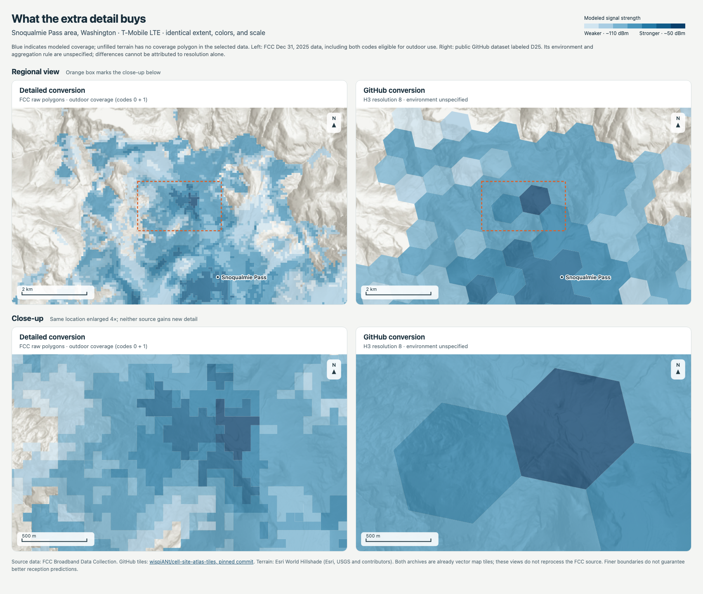

# FCC cell coverage on Cloudflare: storage and free-tier investigation

**Repository boundary:** standalone server tooling is now available in the local
`better-peakbagger-server` checkout. See the [extraction and deployment boundary](../server-repository.md).
The research assets and existing experiment paths remain here during concurrent
compaction work; the repositories are not automatically synchronized.

Updated October 25, 2026. **The detailed national T-Mobile LTE conversion is
3.315 GB; the public GitHub H3 counterpart is 109.2 MB. The comparison below
shows the additional boundary detail and smaller coverage gaps.** Different
representations, retained semantics and native zooms account for the difference;
they are not interchangeable compression settings. The GitHub inventory totals
826.9 MB across all three carriers and resolutions, or 583.7 MB for r8 alone.
The local batch was stopped at **122 of 460 verified source archives and one
of nine national archives**; a later explicit request resumed it on `build-host`.
It remains unfinished. The extension runtime is unchanged; the remote build
workspace and approved storage are described below. At the independent VPS
handoff, **125 of 460** source conversions were verified, all imported output
hashes matched, and both remote jobs were active.

## October 25: resumed conversion on build-host

The user approved moving the build to `build-host`, adding a removable **200 GiB
Balanced Persistent Disk** at approximately **USD 20/month (USD 0.66/day)**,
and securely exporting the supplied FCC credential to a private mode-600 file.
The boot disk was not expanded. The new data disk is mounted at
`/mnt/fcc-tiles`; it remains billable until deleted. See the
[deployment record](experiments/fcc-browser-coverage/full-conversion/vps-deployment.json)
and [remote runbook](experiments/fcc-browser-coverage/full-conversion/README.md#remote-execution-on-build-host).

This is an `e2-medium` with two shared vCPUs, 4 GiB RAM and no GPU. The resumed
service uses one converter with two encoder threads, a two-CPU quota and a
2,400 MiB memory ceiling. It survives SSH disconnects, stops on fatal errors,
and runs national assembly after source conversion. Existing receipts and
10.36 GB of verified outputs are reused, with checksums required before final
assembly. Local converters remain stopped. Native Linux tests and a real
4,455-feature FCC source conversion passed; largest-state memory and total
runtime remain unproven.

The first 246 downloaded sources had **17,263,051,949 compressed ZIP bytes**
and **50,204,299,264 uncompressed GeoPackage bytes**. These were partial totals,
not the size of the complete 460-file corpus. T-Mobile's complete 156-file
portion alone was 5,972,005,474 ZIP bytes and 30,371,549,184 GeoPackage bytes.
The independent remote survey measures missing sizes using at most 64 KiB of
each ZIP plus HTTP Content-Range totals, sharing the downloader's rate limiter.
It avoids extrapolating from unequal states/providers. Its complete result is
recorded when every selected archive has a receipt or size proof.

The [handoff status](experiments/fcc-browser-coverage/full-conversion/vps-handoff-status.json)
records both service processes parented by VPS PID 1, all 71 imported output
files verified by SHA-256, persistent unit files and boot-target links. No Mac
process, tunnel, shared mount or open SSH connection is required. The last
handoff size measurement covered 314/460 sources (40,233,276,569 ZIP bytes and
91,554,205,696 GeoPackage bytes), still a partial total. The user will request
a fresh status later; no reminder or Codex monitoring automation was created.

The remote data audit will verify all selected IDs, source-feature totals,
archive checksums, catalog agreement and every unique gzip tile payload.
Browser/GPU verification remains a separate proof obligation. No tile upload,
hosted coverage endpoint or shipped map layer was added by moving the build.

## October 25: detailed conversion and rendered comparison

Authenticated FCC bulk downloads succeeded with the supplied API token. The
earlier anonymous edge 403 is historical evidence, not a current block on this
experiment. The selected corpus is AT&T, Verizon and T-Mobile LTE and both 5G
speed tiers (7/1 and 35/3 Mbps), retaining the original environment and signal
fields. Its 460 listed state/provider/technology files would produce nine
national carrier/technology archives. Credentials, complete PMTiles and source
ZIPs remain outside Git.

The [stopped run snapshot](experiments/fcc-browser-coverage/full-conversion/run-snapshot.json)
records 246 downloads, 122 verified source conversions representing 5,197,020
features, and one completed national archive. These are the local stop-point
figures; the later approved VPS resume has its own progress record above.
Incomplete local intermediates are retained.

### Actual detail: Snoqualmie Pass, T-Mobile LTE



[Full-size comparison](experiments/fcc-browser-coverage/comparison/comparison.png)
· [Four-times enlarged close-up](experiments/fcc-browser-coverage/comparison/close-up.png)
· [Local HTML page](experiments/fcc-browser-coverage/comparison/index.html)
· [Comparison code and reproduction](experiments/fcc-browser-coverage/comparison/README.md)
· [Tile ranges and browser evidence](experiments/fcc-browser-coverage/comparison/comparison-evidence.json)

Both sides show actual decoded geometry over the same Esri hillshade, bounds,
signal colors, opacity and scale. Left is the FCC December 31, 2025 raw-polygon
conversion at native zoom 12. Right is the pinned GitHub T-Mobile LTE H3 r8
product at native maximum zoom 10. The regional view has a zoom-12 footprint;
the close-up enlarges the same geometry four times to a zoom-14 footprint.
Overzoom does not create new source detail.

The detailed product retains small gaps and irregular signal boundaries where
the compact product uses broad hexagons. However, the public product does not
document its environment selection, aggregation rule or independently verified
original FCC vintage. Signal disagreements cannot all be assigned to spatial
resolution; finer modeled shapes do not prove better reception predictions.

**Corrected environment interpretation:** the FCC's
[field specification](https://help.bdc.fcc.gov/hc/en-us/articles/6047425308187-Formatting-Mobile-Broadband-Availability-Coverage-Maps)
defines `0` as outdoor stationary **only**, and `1` as **both** in-vehicle
mobile and outdoor stationary. The final outdoor comparison includes **0 and
1**, with stronger signal bins drawn after weaker bins. An initial code-0-only
render omitted eligible outdoor coverage and was replaced before delivery.
The conversion itself retained both codes. An in-vehicle overlay selects 1.

The final static comparison was visually inspected in hidden Chrome for
Testing 156.0.8078.4 at **1704 × 1440**, using SVG composition, one raster
thread and no WebGL. Six local zoom-12 tiles and one public zoom-10 tile supply
both views. The public archive needed only **7,634 bytes in three ranges**,
plus two cached terrain images. All four terrain-image loads and browser errors
were checked. The owned browser, server, disposable profile and certificate
were removed; no converter was started for this comparison.

### What made the detailed product larger

| T-Mobile LTE, United States | Public GitHub r8 | Detailed conversion |
| --- | ---: | ---: |
| Stored PMTiles bytes | 109,192,608 | 3,315,322,831 |
| Native maximum zoom | 10 | 12 |
| Geometry | H3 resolution-8 cells | Raw coverage polygons, quantized to MVT |
| Retained fields | `dbm` | All eight source coverage fields |
| Environment selection | Not documented | Both original codes retained |

The detailed output is about **30.4 times larger**. Extra geometry, attributes,
environment distinctions, repeated tile-pyramid geometry and conservative
encoder settings all contribute. Their individual byte contributions have not
been isolated in a controlled experiment; size does not imply a proportional
benefit to the map user.

The configuration uses zooms 4–12, identical-attribute coalescing, no feature
or tile-size dropping, no tiny-polygon reduction and no shared-node
simplification. Overview geometry is too heavy for an assumed lightweight
product: the largest compressed T-Mobile LTE tile is **13,726,587 bytes** at
zoom 5. Zooms 11–12 account for 1,146,609,610 payload bytes; omitting those zooms
alone would still leave about **2.17 GB**. See the
[directory-derived sizes by zoom](experiments/fcc-browser-coverage/full-conversion/tmobile-lte-zoom-sizes.json).
Overview performance and a compact production policy remain open.

Four workers, each launching a two-thread encoder, caused severe CPU
contention reported by the user. Every converter, downloader, assembler,
catalog/audit watcher and owned verification browser was stopped. The
checked-in research copies default to **one worker and one encoder thread**;
scheduling priority is not a CPU cap. A future local resume needs an explicit
instruction and a resource budget. Reading or updating this report must not
silently restart the batch.

### Code, completed evidence and remaining decisions

The [conversion code and reproduction notes](experiments/fcc-browser-coverage/full-conversion/README.md)
include the downloader, source validator/encoder, national assembler, portable
catalog, status reader, browser verifier, exhaustive payload audit, pinned
dependencies, selected public inventory and regression fixtures. The
[comparison code](experiments/fcc-browser-coverage/comparison/README.md) includes
the bounded tile reader/SVG renderer, hidden screenshot tool, small cached
inputs, HTML, SVG panels and both PNGs. This is research tooling outside the
extension build. Repository copies use portable paths and corrected environment
labels; the stopped local jobs were not modified or relaunched.

The completed national archive assembled all 52 selected T-Mobile LTE sources
and passed 1,295 independent source-point classification checks. The
[payload audit](experiments/fcc-browser-coverage/full-conversion/archive-audits.json)
verified its SHA-256 and every one of **177,217 unique gzip tile payloads**.
The [national browser check](experiments/fcc-browser-coverage/full-conversion/national-browser-results.json)
rendered three selected source classifications in Washington, California and
New York in hidden Chrome 156.0.8078.4 at **960 × 640**, with Apple M3 Pro /
ANGLE Metal hardware WebGL. This used local HTTPS range serving. It does not
prove complete polygon equivalence, real reception, external latency, extension
integration, native focus or visible window placement. Its exact-environment
sample filter is a source-classification check, not a complete outdoor overlay.

The source-count gate exposed an upstream discrepancy: FCC file 1859332 lists
8,836 records, but fresh GeoPackage and Shapefile downloads each contain 8,793.
The repeated package hash and SQLite integrity check match. The code retains
every actual row and records the difference. See the
[source-format probe](experiments/fcc-browser-coverage/full-conversion/source-count-discrepancy-probe.json).

Before restarting a national build, measure a controlled regional compromise:
preserve useful hiking-scale boundaries, simplify overview tiles, retain needed
styling/selection fields, and verify gaps, islands, environment eligibility and
request sizes. The visual difference supports this measurement; it does not
select a final configuration.

The FCC's [license and attribution page](https://broadbandmap.fcc.gov/about?version=dec2025)
states that public BDC availability data are free of copyright restriction,
supporting redistribution of this mobile coverage conversion. CostQuest's
location Fabric has separate licensing and is not included. Credit FCC BDC,
preserve dates, identify the conversion, and follow the
[FCC API terms](https://www.fcc.gov/reports-research/developers/api-terms-service)
without implying endorsement.

For GitHub, an index can resolve versioned archive URLs; PMTiles already has
the internal tile-to-range index. The
[browser hosting probe](experiments/fcc-browser-coverage/full-conversion/github-hosting-probe.json)
read a raw archive's index and two nonempty tiles successfully. The tested
Release asset supports HTTP ranges but lacks browser CORS. Ordinary GitHub
files have a **100 MiB** limit and Release assets must be **under 2 GiB**;
this 3.315 GB archive exceeds both. Geographic shards, a range-forwarding
Worker or R2 serving require separate verification. An index does not remove
storage or bandwidth constraints. See [file limits](https://docs.github.com/en/repositories/working-with-files/managing-large-files/about-large-files-on-github),
[Release limits](https://docs.github.com/en/repositories/releasing-projects-on-github/about-releases)
and [bandwidth policy](https://docs.github.com/en/site-policy/acceptable-use-policies/github-acceptable-use-policies#9-excessive-bandwidth-use).

### Evidence ledger

- **Fixed and verified:** authenticated source access; explicit source-count
  discrepancy handling; complete-group assembly; four small regression tests;
  national T-Mobile LTE hashes/payloads and sampled geometry; three local
  hardware-WebGL source cases; corrected two-view static comparison with
  outdoor codes 0 and 1.
- **Intentionally not changed:** local conversion remains stopped; credentials
  and full data stay outside Git; no extension feature, permission, bucket,
  Worker, DNS or public upload was added. The later approved VPS resume is
  described separately above.
- **Changed but not fully proven:** research scripts and a local catalog exist;
  the local stop point left 338 sources and eight national outputs unfinished.
  Current remote progress is tracked separately. Public
  derivative provenance, national footprint, optimized overview behavior,
  resource-bounded resume, live hosting and product integration remain open.

## Follow-up: public prebuilt coverage tiles found on GitHub

GitHub code search found
[wispiANt/cell-site-atlas-tiles](https://github.com/wispiANt/cell-site-atlas-tiles),
which the earlier general web searches missed. The pinned
[manifest](https://github.com/wispiANt/cell-site-atlas-tiles/blob/28f72437259d20268dd89a0686a05c0c0b507a19/fcc-coverage/tiles/sources.json)
lists 96 actual PMTiles for AT&T, Verizon and T-Mobile, LTE and 5G-NR, with
variants named `r6`, `r7` and `r8`. Every manifest path exists in the
nontruncated GitHub tree; these are normal binary Git blobs, not LFS pointers.
The following are actual inventory byte sums, not estimates:

| Carrier, LTE plus 5G | All three resolution variants | r8 variant alone |
| --- | ---: | ---: |
| AT&T | 267,958,930 bytes | 188,654,150 bytes |
| Verizon | 268,958,859 bytes | 189,251,052 bytes |
| T-Mobile | 289,991,491 bytes | 205,787,871 bytes |
| **Total** | **826,909,280 bytes (826.9 MB)** | **583,693,073 bytes (583.7 MB)** |

The repository declares
[CC0 1.0](https://github.com/wispiANt/cell-site-atlas-tiles/blob/28f72437259d20268dd89a0686a05c0c0b507a19/LICENSE).
Its data commit on July 3, 2026 says
["D25 5G-NR + LTE, res 6/7/8"](https://github.com/wispiANt/cell-site-atlas-tiles/commit/788fd16fb8c1f2f591add6dd09b29aef5add7eb1).
The October 4 update added the license, not new coverage data. Treat `D25` as
the publisher's label; the original FCC source dates and transformation
methodology have not been independently established. Neither repository size
nor the existence of national-looking bounds proves complete US coverage.

Six small binary range reads, one r8 shard per carrier/technology, returned
HTTP 206 with CORS `*`, correct PMTiles v3 magic, and total file lengths matching
the Git inventory. Their headers report zooms 3–10, gzip-compressed MVT, a
`coverage` layer and a numeric `dbm` property. Sample shard bounds include parts
of the western US and, in some cases, Alaska/Hawaii. We did not download the
whole 826.9 MB or verify the complete national footprint and semantic accuracy.
The October 25 follow-up adds bounded tile decoding, sampled H3 geometry checks
and the Snoqualmie Pass render. Higher zoom viewing would overzoom
this product rather than reveal new native detail. It is not interchangeable
with a freshly generated full-detail FCC product.

The [inventory](experiments/fcc-browser-coverage/public-pmtiles-inventory.json)
records the commit, every file's size and Git blob ID, the complete source
manifest and grouped totals. The [six probes](experiments/fcc-browser-coverage/public-pmtiles-probes.json)
record response sizes, CORS, header metadata and bounds. Each recorded initial
range read was 16,384 bytes. These prove an accessible prebuilt candidate
exists and provide a concrete hosting size. No FCC account is needed to
retrieve these public derivative archives. Source validation and product-level
renderer/hosting checks remain necessary before selecting a runtime provider.

A second concrete example,
[jebowe3/nc_cell_signal_strength_map](https://github.com/jebowe3/nc_cell_signal_strength_map/tree/0becc44005765a5c49cc8174f345aa3ac073bef3/data),
contains North Carolina PMTiles: AT&T 17,606,084 bytes, T-Mobile 19,500,723 bytes
and Verizon 18,986,165 bytes, or 56,092,972 bytes combined. Its map credits both
FCC and CoverageMap.com; downstream data reuse and vintage require separate
verification. It is a state-specific example, not a second national corpus.

## Findings

1. **There is no single size for "FCC tiles."** Our documented FCC source is
   bulk coverage data; we would build our own tiles. Country/state, carriers,
   LTE/5G speed thresholds, outdoor/in-vehicle modes, hexagons versus coverage
   footprints, retained attributes and zoom levels all change the output.
   Keeping several historical snapshots multiplies stored data. Original ZIP,
   decoded database, GeoJSON, MBTiles and PMTiles sizes are different measures.
2. **The available real sample is small, and its provenance limits remain.**
   We converted the previously retained 2,799-hexagon Sedona sample to PMTiles
   and decoded every output tile. At the highest generated zoom, every source
   feature ID and its selected attributes remained present. This is a bounded
   FCC-derived government mirror sample, without an established reporting date
   or carrier field, not an original FCC carrier/state archive or US census.
   Do not extrapolate its bytes per feature or area to a national total.
3. **R2's included usage can cover a small public deployment.** Standard storage
   includes 10 GB-month, 1 million Class A operations and 10 million Class B
   operations per month; Internet egress is free. Additional standard storage
   costs $0.015/GB-month, writes $4.50/million and reads $0.36/million, subject
   to billing-unit rounding. These allowances are shared with other R2 usage
   in the account. R2 onboarding includes a subscription checkout, and usage
   above the allowances is billable; this is not a guaranteed zero-spend cap.
   See [pricing](https://developers.cloudflare.com/r2/pricing/) and
   [onboarding](https://developers.cloudflare.com/r2/get-started/).
4. **Worker requests can become the tighter free limit.** Workers Free allows
   100,000 requests per day across the account, 10 ms CPU per HTTP request and
   128 MB memory per isolate. A user's map session can request many tiles.
   Cache hits that pass through the Worker still count as Worker requests;
   caching primarily saves storage reads and work. A cold PMTiles tile can
   require more than one R2 range read, so tile requests are not a reliable
   one-to-one estimate of Class B usage. The free Worker limit and cold-request
   CPU behavior must be measured in a real deployment. See
   [limits](https://developers.cloudflare.com/workers/platform/limits/),
   [Workers pricing and caching](https://developers.cloudflare.com/workers/platform/pricing/)
   and [PMTiles storage requests](https://docs.protomaps.com/pmtiles/cloud-storage).
5. **Static Pages hosting has different constraints.** Pages Free and Workers
   Free static assets allow 20,000 files and 25 MiB per file. Pure Workers static
   asset requests are free and unlimited, but requests invoking Worker code
   use Workers quotas. A small regional set of individual MVT files may fit.
   A large single PMTiles file cannot be uploaded as one static asset. Pages
   also documents returning HTTP 200 rather than 206 for range requests, so
   Pages is not the recommended host for a PMTiles archive. A sharded archive
   design would need its own range, CORS and client-routing verification.
   See [Pages limits](https://developers.cloudflare.com/pages/platform/limits/),
   [Pages serving behavior](https://developers.cloudflare.com/pages/configuration/serving-pages/),
   [Workers asset limits](https://developers.cloudflare.com/workers/platform/limits/#static-assets)
   and [asset billing](https://developers.cloudflare.com/workers/static-assets/billing-and-limitations/).

## Measured tile sizes

[measure-tiles.py](experiments/fcc-browser-coverage/measure-tiles.py) uses the
retained ZIP pinned by the earlier [source manifest](experiments/fcc-browser-coverage/source-manifest.json).
Its narrowly scoped reader checks the fixture's exact GeoPackage/WKB variant.
It is not a general FCC archive reader. Tippecanoe 2.79.0 was built locally from
the official tagged source archive (source directory revision `68ab8dc`, archive
SHA-256 `cc17b9db1b598babe08696e59dd05167a449b91c95fbad106cba22a3223cfc81`).
No global tool or repository runtime dependency was installed.

| Same 2,799 source features | Bytes | Tiles |
| --- | ---: | ---: |
| Earlier local GeoPackage fixture | 770,048 | n/a |
| Earlier ZIP of that fixture | 226,005 | n/a |
| PMTiles, zooms 6–12, H3 ID plus coverage fields | 324,394 | 27 |
| PMTiles, zooms 6–14, H3 ID plus coverage fields | 520,691 | 198 |
| PMTiles, zooms 6–14, coverage fields without H3 string | 344,310 | 198 |

Coverage fields were `technology`, `mindown`, `minup`, and `environmnt`.
All configurations kept numeric feature IDs. Increasing the maximum zoom from
12 to 14 increased this sample's bytes by about 61%; removing the H3 string at
zoom 14 reduced bytes by about 34%. A tile pyramid can exceed the source ZIP
because geometries recur across zoom levels and tile boundaries. These are
observations on this sample, not universal compression ratios.

Feature dropping, tile-size limits, line simplification and tiny-polygon
reduction were disabled for this experiment. Tile coordinate quantization and
clipping still occur. ID and attribute preservation does not prove exact
geometry/coverage equivalence, correct low-zoom appearance, absence of seams,
or production tile sizes. Dissolving adjacent cells with identical semantics
was not tested. A production build needs boundary, holes and small-island
checks before choosing simplification or aggregation.

The three completed builds and their decode assertions passed. The first
validation attempt incorrectly treated decoded layer collections as features;
the assertion traversal was corrected, and the complete experiment reran.
The [result JSON](experiments/fcc-browser-coverage/tile-size-results.json) records
commands, hashes, tile counts and checks. This earlier Sedona measurement did
not include browser rendering, HTTP range serving, R2 upload, cache hits, live
latency or Cloudflare CPU measurement; the October 25 follow-up separately adds
local range serving and renders for the national/public candidate comparison.
Commands in that JSON shorten temporary paths for readability. Build-path
metadata can change archive sizes by a few bytes; the table records the final
completed run. Its three PMTiles files are retained locally under the earlier
ignored experiment artifact directory's `tiles/` subdirectory.

## Storage budget rather than an unsupported national estimate

A proposed initial scope could be three named US carriers, each with one LTE
and one 5G outdoor coverage definition: six logical layers. This excludes
alternate speed thresholds, in-vehicle layers, voice and historical releases.
Multiple logical layers can share one archive; the following arithmetic uses
an assumed average size per layer, not a measured national size.

| Assumed size per layer | Six layers, one release | Six layers, two releases |
| --- | ---: | ---: |
| 500 MB | 3 GB | 6 GB |
| 1 GB | 6 GB | 12 GB |
| 2 GB | 12 GB | 24 GB |

For those example total storage levels, steady-state Standard storage alone
would cost approximately $0/month at 3 or 6 GB, $0.03/month at 12 GB, or
$0.21/month at 24 GB, assuming the full 10 GB allowance is otherwise unused.
These examples exclude requests, Worker charges, domain registration and build
compute. Cloudflare averages daily peak stored bytes over the billing period;
old/new release overlap and backups also consume storage. See
[storage billing](https://developers.cloudflare.com/r2/pricing/#storage-usage).

For a conservative zero-storage-charge target, keep all hosted objects below
8 GB and leave the remaining allowance for release overlap and other usage.
For six equal layers that is about 1.33 GB each for one release or 0.67 GB each
when keeping two releases continuously. This is a proposed budget, not proof
that the selected US data fits. Keep source ZIPs and intermediate databases
locally; only publish the final tiles and a small version manifest.

Example request arithmetic: if a viewing session makes 100 Worker tile
requests, 1,000 sessions exhaust a 100,000-request day. At 500 requests per
session, only 200 sessions do. Those are hypothetical workloads, before other
Workers on the account, retries, metadata requests or preflights. Measure actual
map sessions rather than equating one pan or visitor to one request.

## Recommended deployment and next measurement

```text
FCC authenticated bulk downloads
  → local machine or separate CI build
  → versioned PMTiles + manifest in R2 Standard
  → tile-serving Worker + edge cache
  → Leaflet / MapLibre clients
```

[Protomaps documents this exact R2/Worker architecture](https://docs.protomaps.com/deploy/cloudflare).
Build the tiles offline; the free Worker should locate and serve prebuilt bytes,
not unzip and tile state-sized datasets. The documented Protomaps guide budgets
Workers Paid at $5/month. Starting with Workers Free is conditional on the
quota and CPU checks above; deployment compatibility with the free plan has not
been proven by our local build.

Use an owned custom domain for the production cache. Protomaps documents that
its Worker cache needs a zone rather than `workers.dev`, and Cloudflare marks
public `r2.dev` URLs as rate-limited development endpoints. Domain registration
may be an additional cost if no suitable domain is already owned. For a browser
that reads PMTiles directly, verify byte-range HTTP 206 and CORS, including
Range/If-Match and exposed ETag. Direct R2 through a custom domain avoids Worker
invocations, but huge archives have cache constraints: Cloudflare's Free/Pro/
Business CDN maximum cacheable object size is 512 MB, and requesting a small
range does not bypass the complete-object limit. Serving small extracted MVT
responses through the Worker avoids relying on caching the entire archive.
See [public buckets](https://developers.cloudflare.com/r2/buckets/public-buckets/),
[range behavior](https://developers.cloudflare.com/cache/reference/range-requests/)
and [cache limits](https://developers.cloudflare.com/cache/concepts/default-cache-behavior/).

The next useful source measurement is one official Washington carrier/LTE
archive, followed by representative larger/fragmented states and finally the
complete selected US build. Record source vintage, bytes, peak build disk/RAM,
zoom/detail policy, total PMTiles bytes and largest tile. Verify source identity
and geometry behavior rather than selecting settings only to hit a size target.
The October 25 follow-up above supersedes this original next step: authenticated
downloads and one national layer are now verified, while the remaining batch
is stopped. Full-corpus size still cannot be confirmed until that corpus is
built; the public prebuilt candidate provides a separately measured alternative.

Before a hosted trial, review the source download terms, preserve attribution
and dates, make the FCC token a build-only secret, serve only allowlisted
archives, configure caching/CORS, and account for viewed-area network requests
in the product's privacy documentation. Set usage alerts and verify any
available hard spending control before promising a permanent zero-dollar
service. A free allowance alone does not impose a spending cap. No account,
subscription, bucket, DNS, Worker or external publication was changed here.

## Reproduce the local measurement

Build `tippecanoe` and `tippecanoe-decode` from
[the official 2.79.0 release](https://github.com/felt/tippecanoe/releases/tag/2.79.0)
in a disposable directory (`make -j 3 tippecanoe tippecanoe-decode`, without
`make install`). From the repository root, with the earlier retained sample:

```sh
tile_output=$(mktemp -d /tmp/bpb-fcc-tiles.XXXXXX)
python3 docs/plans/experiments/fcc-browser-coverage/measure-tiles.py \
  browser-evidence/fcc-browser-coverage-2026-10-24/sample.zip \
  "$tile_output" /absolute/path/to/temporary/tippecanoe
```

An empty output directory and the earlier exact ZIP hash are required. Missing
source archives, wrong schemas, failed builds, empty output and lost IDs fail
the run. To test with newly obtained FCC originals, first implement and validate
their actual schema; this fixture reader deliberately rejects them.
