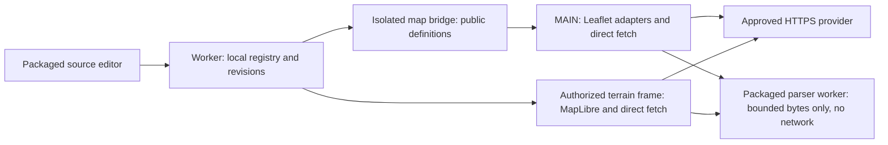

# Custom map overlays: direct raster and vector sources

Status: proposed design, October 25, 2026. Documentation only; no custom-source
runtime, source editor, parser worker or new permission has been implemented.

## Decision

Let users save their own **raster tiles, vector tiles and GeoJSON overlays** and
enable them from the existing **Overlays** menu on peak, ascent, Full Screen and
standalone native maps. Preserve the selection when switching between 2D and
supported 3D. Keep the existing basemap picker separate.

Use **direct HTTPS requests to the user's selected providers**. There is no
BPB/Gaia/third-party proxy, no background-worker tile relay and no new optional
host permission to work around CORS. A source must work with ordinary browser
cross-origin requests in the renderer that uses it. In particular, a successful
extension-origin request alone does not prove it works in Peakbagger's page.

Vector support means both **MVT/PBF tiles** for large datasets and **GeoJSON**
for smaller collections. A vector URL supplies geometry, not a finished map;
users also choose the source layers and a simple appearance. The first release
supports points, lines and polygons with the same style semantics in both
renderers. Arbitrary MapLibre styles, text labels and icon resources are a
separate follow-up, rather than a hidden limitation that only appears in 2D.

## Findings that shape the design

| Current evidence | Design consequence |
| --- | --- |
| [Map-layer schema](../../src/settings/settings-schema.js) enumerates five built-in IDs. [The control](../../src/maps/map-layer-control.js) also has built-in labels and feature-specific branches. | Add a typed custom-source collection beside the built-in IDs. Do not turn every unknown page-supplied ID into an accepted provider. |
| [Native raster overlays](../../src/maps/map-overlay-leaflet.js) use Leaflet canvas grid layers; [terrain overlays](../../src/terrain/terrain-overlays.js) use MapLibre raster sources and a packaged protocol. | Reuse their lifecycle and layer-order owners, with separate custom adapters. A URL field alone is insufficient. |
| [Wildfire 2D](../../src/maps/wildfire-leaflet.js) and [wildfire 3D](../../src/terrain/terrain-wildfires.js) already render GeoJSON geometry in both engines. | GeoJSON can use the existing libraries. Keep provider-specific wildfire validation and semantics out of the generic source feature. |
| Leaflet itself does not decode MVT. MapLibre does, and the installed dependency tree includes `@mapbox/vector-tile` and `pbf` transitively. | MVT needs a packaged native-map decoder/render adapter. Declare any directly imported packages explicitly; do not depend on incidental transitive installation. |
| [Terrain style validation](../../src/terrain/terrain-style.js) deliberately trusts only OpenFreeMap resources. | Preserve that policy. Custom vector overlays need their own restricted schema; do not widen the trusted basemap style loader to arbitrary hosts/styles. |
| [Camera conversion](../../src/terrain/terrain-camera.js) offsets Leaflet and MapLibre zoom by one. Raster and vector sources also have different logical tile-size conventions. | Derive canonical tile coordinates and style zoom consistently. Copying `map.getZoom()` into both adapters would request different detail levels at the same view. |
| [Tile loading](../../src/maps/map-overlay-tiles.js) already omits credentials/referrers, limits bodies, cancels obsolete work and distinguishes rate limits. | Extract a small reusable transport boundary where necessary; preserve built-in provider behavior and avoid an unrelated loader rewrite. |
| [Layer bridge](../../src/maps/map-layer-bridge.js), [typed protocol](../../src/maps/map-layer-protocol.js) and [Full Screen handoff](../../src/background/map-layer-handoff.js) reject unrecognized data. | Extend these contracts explicitly. Configuration, session selection and remote feature data are different payloads. |
| [Privacy policy](../../PRIVACY.md) promises no developer-operated data server. [Settings portability](../settings-storage-and-sync.md) uses explicit export/sync inventories. | Direct requests preserve the server boundary. Store source definitions locally in a separate registry and exclude them from existing generic settings exports/backups. |

The UI proposal applies the repository's
[UI/UX skill](../../.agents/skills/ui-ux-pro-max/SKILL.md): reuse existing controls,
make network work explicit, validate near the field and reserve feedback space.

## Supported source contract

| Source type | Accepted input | Appearance | Initial scope |
| --- | --- | --- | --- |
| Raster tiles | XYZ/TMS URL template, or raster TileJSON | Existing opacity control; 256/512-pixel PNG, JPEG or WebP tiles | Included |
| Vector tiles | MVT `.pbf`/`.mvt` URL template, or vector TileJSON | Selected `source-layer` IDs; polygon fill/outline, line and point-circle rules | Included |
| GeoJSON | HTTPS URL returning an RFC 7946 FeatureCollection | The same point/line/polygon rules, without `source-layer` | Included, bounded whole-file fetch |
| Full MapLibre style | Style JSON plus its tile, glyph and sprite dependencies | Potentially labels, icons, expressions and many source layers | Follow-up; reject clearly in the initial editor |
| PMTiles, MBTiles, WMS, general WMTS, KML, GPX, ArcGIS feature queries | Archive, capability document, file or query service | Requires another adapter | Deferred; a WMTS endpoint is usable only if it already fits the supported Web Mercator XYZ/TMS template |

Tiled sources use the standard Web Mercator grid. A `.pbf` extension alone does
not establish that the response is MVT. GeoJSON coordinates are longitude,
latitude in WGS 84; do not guess or silently reproject another CRS. Discard
altitude for these flat overlays; GeoJSON Z is not a terrain/extrusion instruction.

These are **overlays**, not custom basemaps. An opaque raster can obscure the
base; Preview and opacity make that visible. The feature does not change native
basemap selection, terrain elevation, routes or peak markers.

Use integer native zoom limits from 0 through 22 with minimum no greater than
maximum, source opacity from 0 through 100, line/outline widths from 0.5 through
12 CSS pixels, and point radii from 1 through 16 CSS pixels. Validate colors as
literal RGB/RGBA values; accept no CSS variables, URLs or arbitrary CSS. Generate
internal source/layer IDs from the source UUID and rule index, never from a
provider label. One pure schema owns all of these bounds.

## User experience

### Add and preview

1. **Overlays → Add custom overlay** opens an extension-owned editor associated
   with that map. **Manage custom overlays** in Settings opens the same editor
   without a map target. Map opening and Settings listing perform no provider
   request; remote work starts only with **Preview** or explicit enablement.
2. Show **Name**, **Source type** and **URL**. Offer **Raster tiles**, **Vector
   tiles** and **GeoJSON** explicitly; a pasted suffix may suggest a type but
   cannot silently change it. Accept templates or TileJSON for the tiled types.
3. **Details** contains native tile zoom range, tile size where applicable,
   reversed Y for TMS, optional bounds, and attribution text/link. Read metadata
   only after Preview. Fill absent metadata with visibly described form defaults
   (initial tiled suggestion: 0–18), not an assertion of provider availability.
4. Vector sources add an **Appearance** section. TileJSON `vector_layers` can
   populate selectable layer names; otherwise let the user enter a layer ID.
   An explicitly requested sample tile can suggest IDs. An empty sample cannot
   establish that an ID is invalid everywhere. GeoJSON needs no layer-name field.
5. **Preview on map** renders the draft in the initiating map without saving it,
   fitting bounds, scrolling the page or moving the camera. Changing URL/type
   ends the old preview; changing appearance reuses validated data when possible.
   Settings without a map target offers **Save**; it does not invent a location
   or open a third-party map. Preview requires an existing map chosen by the user.
6. **Save** validates and atomically persists the definition. A syntactically
   valid source can be saved despite a failed/empty preview; show the current
   result and never label it verified. Save alone does not enable a new remote
   source. If Preview was already on, Save may keep that explicitly enabled
   layer active for the current map. Cancel restores the previous saved state.

Use the existing panel tokens and controls. The editor runs in a packaged
extension frame so the host page cannot write the registry through a general
settings message. The map's outer page owns its placement; do not add a second
full map for preview. The editor must not receive GPX, account data or an entire
page snapshot. It needs an opaque initiating-map handle and typed preview replies.

### Use and manage

- Place a **Custom** group after the built-in rows. Reuse visibility checkbox,
  disclosure, opacity, status and anchored Retry. Start at 60% opacity; save
  appearance/opacity per source, while enabled state remains map-session-only.
  Map-menu opacity changes are a narrow preference patch, not a definition edit.
- New sources append above older custom sources, below built-in informational
  vectors, routes and markers. Use one fixed order across renderer switches.
  Defer arbitrary drag ordering; removal/re-enable must not reorder a source.
- The detail shows type, attribution and provider host names, plus **Edit** and
  **Remove**. Do not expose a full token-bearing URL in the ordinary layer row.
  Removal stops work and deletes the definition; it does not affect provider data.
- Editing an enabled source publishes a new source revision. Retire old data
  before showing the edited source as loaded; a new URL must never inherit the
  old provider's pixels or successful status. Cancelled editing preserves the
  saved definition and selection.
- Switching 2D/3D preserves selection and appearance, but the renderer being
  hidden stops requests and decoder work. Custom layers do not bypass 3D consent.
  An unsupported source in one mode gets explicit feedback, not silent removal.
- Definitions are device-local. Do not auto-enable a newly discovered definition
  in another tab, after reload or on another device.

### Stable feedback and accessibility

Use compact states: **Loading**, **Partly loaded**, **Lower detail**, **Zoom in**,
**Outside bounds**, **No data returned**, **Check URL / CORS**, **Couldn't load**
and **Source too large**.
Successful empty data means only that the provider returned no features/pixels,
not that a location is safe or a dataset has complete coverage.

Reserve a noninteractive status region and keep Preview, Save and Retry anchored
through pending/success/error. Allow long messages to wrap without clipping.
Choose a bounded scrollable editor body with an anchored footer; at narrow widths
or 200% zoom, focused fields and actions must remain reachable. Do not grow the
menu on each tile completion. Busy action dimensions and keyboard focus stay
stable; guard duplicate pointer, keyboard and form activation even when using
`aria-disabled` to retain focus. Other layers remain usable.

Name every input, expose type/visibility/busy states, associate field errors,
announce aggregate status without per-tile chatter and respect reduced motion.
Escape closes the editor and restores its trigger; it does not change the
existing rule that Escape leaves the Overlays menu expanded. Only an explicit
Preview/visibility action starts provider access, never typing or validation.

## Direct-request and CORS policy

Each active renderer owns its requests. Native 2D fetches from the Peakbagger
MAIN world; 3D fetches from the packaged terrain frame. The extension worker
owns registry mutations and handoff authorization, **not provider fetching**.
A parser helper may receive downloaded bytes locally; it makes no network
request and is not a tile relay or a CORS workaround.

Use `mode: 'cors'`, `credentials: 'omit'`, `referrerPolicy: 'no-referrer'` and
`redirect: 'error'` for metadata, images, MVT and GeoJSON. Stream-limit the body,
then decode/validate before publication. No `no-cors` opaque-response workaround,
cookie forwarding, custom Authorization headers, header rewriting, remote
script/SDK, fallback proxy, permission prompt or HTTP downgrade is available.

Opening a raster in an ordinary image tab is insufficient evidence: the
existing canvas path and WebGL require readable image data. Recommend providers
serve public resources with `Access-Control-Allow-Origin: *`. A provider that
only allows `www.peakbagger.com` may fail in the extension frame. Preview results
must identify the tested mode; checking 3D may occur only after existing consent.
Existing unrelated host grants must not become a recovery path. Test a clean
profile and one with BC/transfer grants to catch accidental dependence on them.

### CORS and source-configuration error prompts

A source that cannot be accessed must produce an explicit, actionable prompt
after **Preview**, enablement or Reload. Do not leave a blank map, a permanent
spinner or a generic failure that never mentions CORS. This applies to raster
tiles, TileJSON, MVT and GeoJSON, including cases where metadata succeeds but
the tile endpoint is configured differently.

Browsers do not expose the detailed reason for a failed CORS request to ordinary
JavaScript; the browser's developer console has the useful diagnosis. A rejected
fetch can also mean DNS, TLS, blocking software or another transport problem.
Therefore the normal runtime prompt explicitly mentions **possible CORS
misconfiguration** without asserting a confirmed cause:

> **Couldn't load this source**
>
> Check the URL and the provider's CORS settings. The source must allow browser
> access from this map.

In the editor, place that feedback below the URL/preview result with
`aria-describedby`; in the Overlays menu show **Check URL / CORS** and the same
explanation in the expanded detail. Include the affected provider host, resource
kind (metadata, raster tile, vector tile or GeoJSON) and tested mode (2D or 3D),
without a query string or key. If only part of an overlay failed, retain
**Partly loaded** and put the URL/CORS guidance in its detail.

Offer **How to fix**, **Edit source** and **Retry** as appropriate to the owning
surface. The inline prompt remains readable until dismissed or replaced by a
new result; it is not a transient toast or a blocking alert repeated per tile.
Opening the detail/help does not fetch again, move the camera or steal focus.
Reserve its feedback area so asynchronous failure does not move the active
Preview/Retry control. Announce the aggregate failure once through the existing
status region, without treating every failed tile as another announcement.

**How to fix** expands concise guidance:

1. Check the URL template, HTTPS endpoint, selected format and native zoom range.
2. For a public source, configure its server to return the appropriate
   `Access-Control-Allow-Origin` response header. `*` supports these anonymous
   public requests across both map origins; a restrictive configuration must
   allow the actual requesting origin. Metadata and tile endpoints both need
   compatible headers, including any relevant error responses. BPB cannot add
   that permission from its client, and offers no proxy or permission fallback.
3. If the user does not control the server, use the provider's browser-compatible
   endpoint or contact the provider. Opening the image URL successfully does not
   establish CORS compatibility. Link to the browser-console troubleshooting
   guide for the exact blocked request/reason; never request a token-bearing URL
   or raw console dump for diagnostics.

The ordinary fetch path cannot reliably produce a **Blocked by CORS** diagnosis.
Use that stronger wording only if a future trusted diagnostic surface actually
supplies a specific browser reason; do not infer it from `TypeError`, a response
status of zero, an unreadable header or successful image embedding. A successful
2D load also cannot clear an unresolved 3D-origin error, or the reverse.

Malformed input remains an inline field-validation error before requests.
Readable HTTP 401/403, 404/410, 429, invalid payloads and oversized sources keep
their specific handling rather than all becoming CORS errors. An ambiguous
fetch rejection pauses that source's pending batch and asks for explicit Retry;
it is an exception to automatic transient retry, preventing a misconfigured
source from generating repeated requests/prompts. Known retryable HTTP failures
retain the existing bounded retry policy. Abort/obsolete completions are silent.

Retry replaces the prompt with pending feedback and clears the error only when
the relevant data actually validates and renders; a sent request, successful
metadata read or saved definition is insufficient. Saving a source after a
failed Preview remains allowed, but preserves the failed/unchecked result and
does not silently enable it.

### URLs, metadata and credentials

- Accept absolute public HTTPS URLs with no userinfo or fragment and bounded
  length. Templates accept only `{z}`, `{x}`, `{y}` initially; reversed Y is a
  separate scheme field. Query-string templates are valid. Preserve query order
  and encoding; never append a page URL, route, coordinate or account identifier.
  Do not guess `{s}`, `{quadkey}`, WMS bounds or undocumented placeholders.
- Reject local files, `data:`, `blob:`, JavaScript URLs, localhost, IP literals
  and obvious local-only hostnames. Do not claim hostname validation prevents
  every private-network/DNS-rebinding case; browser network controls still apply.
- Fetch the explicit metadata URL only. Accept bounded TileJSON 2.x/3.x fields:
  type-selected `tiles`, `scheme`, native zoom, bounds, attribution and vector
  layer IDs. Tile endpoints must be absolute and independently validated.
  Do not follow TileJSON `data`, `grids`, `template` or arbitrary metadata links.
  A complete MapLibre style pasted as TileJSON gets a specific unsupported-format
  error rather than recursively loading its dependencies.
- Metadata that names another tile origin pauses before tile requests. Show the
  resulting host list in the editor; the next explicit Preview/enable action
  approves that immutable endpoint set. Persist that set with the source. A
  later metadata refresh cannot silently add a host; require review in Edit.
- Initial support is for public/browser-distributable URLs. Query API keys may
  be retained if required by such a provider, but are **not secret**: native-map
  requests and configuration can be observed by the Peakbagger page. Say this
  beside the URL when applicable. Do not support confidential tokens, account
  cookies or credential-required sources under a promise of secrecy.
- Definitions, previews and raw responses are excluded from analytics,
  diagnostics, browser sync, GitHub/settings backups and generic export. Errors
  use source ID and host only; redact all query values. A future dedicated
  transfer feature needs explicit handling of keys, provider hosts and activation.
- Render names/attribution as text. An optional attribution link must pass HTTPS
  validation and use safe link attributes. Do not execute provider HTML or
  convert arbitrary feature properties into HTML, links or popups.

Providers still receive IP address, ordinary request metadata and requested
tile areas, or a request for the whole GeoJSON file. Direct access does not grant
a licence or bypass provider authentication, rate limits or usage terms. This
feature performs no bulk/offline download or predictive prefetch.

## Configuration, storage and trust boundaries

Use a pure **custom-overlay-schema** module imported by the settings schema and
every reader. It owns URL/template validation, source types, styles, zoom bounds
and limits. The existing settings schema remains the shared entry point for
map configuration validation; do not copy bounds into each renderer or add
custom-source writes to the analyzer's page-world preference allowlist.

Proposed local registry key: `bpbCustomMapOverlaysV1`. One record contains a
schema version, monotonically increasing registry revision and ordered source
definitions. The worker serializes registry writes. Only the packaged editor's
validated sender may create/edit/remove definitions. An isolated bridge can
read the public render projection; page messages cannot mutate the registry.

Keep map-menu opacity overrides in a separate local preference record,
`bpbCustomMapOverlayPreferencesV1`, validated by the same pure schema. The
isolated map bridge may forward only a numeric opacity for an existing advertised
source ID, through its trusted input handler. That operation cannot change a URL,
style rule, origin, source revision or activation. Its worker mutation is
serialized and updates only that preference. This preserves saved opacity
without turning a MAIN-world settings message into a definition editor or
restarting tile requests on every slider event. Remove orphan preferences when
deleting a source; exclude this record from generic settings exports as well.

Illustrative normalized MVT definition (new contract, not existing code):

```json
{
  "id": "custom:0537a032-271c-4d11-9b8c-0edc566b47c1",
  "revision": 1,
  "name": "Local trails",
  "kind": "mvt",
  "source": {
    "tiles": ["https://tiles.example.com/trails/{z}/{x}/{y}.pbf"],
    "scheme": "xyz",
    "minNativeZoom": 8,
    "maxNativeZoom": 14,
    "bounds": [-125, 45, -116, 50]
  },
  "approvedOrigins": ["https://tiles.example.com"],
  "attribution": { "text": "Example trail data", "url": "https://example.com/data" },
  "appearance": {
    "opacity": 60,
    "rules": [
      { "sourceLayer": "trails", "geometry": "line", "color": "#26734d", "width": 2 }
    ]
  }
}
```

Raster definitions add `tileSize: 256 | 512` and have no vector rules. GeoJSON
definitions have one data URL and rules without `sourceLayer`; native tile zoom
does not apply. Store the user-entered TileJSON URL separately from its validated
endpoint snapshot so later refresh can detect changed hosts. No script, function,
raw style object, HTML or fetched geometry belongs in the registry.

Registry edits use the source ID/revision the editor read; a stale editor gets
**This overlay changed. Reload its settings.** instead of overwriting newer
work. A failed read is unavailable, not an empty registry eligible to overwrite
saved sources. Commit the complete record before publishing success. Cross-tab
storage events revalidate and update definitions, preserving each tab's existing
enablement for surviving IDs. New IDs remain off; deleted IDs cancel immediately.
An edited ID gets a new resource generation in all tabs that enabled it.
Name/style-only edits can adopt already validated data into that generation only
after matching an exact data identity (kind, endpoint snapshot, scheme, native
range and bounds). URL/type/origin changes cannot reuse the old payload. Opacity
preferences are independent of source revisions and never invalidate tile data.

Session snapshots add bounded `custom` selection entries containing only
`id`, `sourceRevision` and `enabled`; appearance comes from the registry and
validated local opacity preferences.
Status replies include those identities plus session/render generation. Unknown
IDs, duplicate IDs, stale revisions or mismatched generations cannot paint or
change status. A missing/deleted source in a handoff remains unavailable; do not
substitute a similarly named source or activate a changed definition silently.

Resolve the selected definitions from extension-owned storage for the authorized
map/terrain session. Do not accept raw URLs/styles injected into a layer snapshot
as authority. The render projection reaching MAIN is intentionally public and
revalidated. The worker performs configuration and authorization work only;
it never accepts an arbitrary `fetch this URL` message.

The existing one-use, 30-second Full Screen handoff carries only selected custom
IDs/revisions alongside built-in state. It carries no URL, token, tiles, feature
collection, bounds or GPX. The destination resolves definitions locally and
refetches directly after matching the handoff. Unrelated maps start with layers
off. Schema absence in an older handoff means no custom selection.

## Rendering architecture



These are proposed responsibilities, not a new shared global. Add focused
custom-source modules behind the existing map session owners.

### Raster

Use a custom Leaflet grid layer backed by the direct image client and a
MapLibre raster source backed by the same bounded transport semantics. Keep
image decode, cancellation, per-source status and alpha intact. Custom work
must not enter built-in BC permission routes or borrow built-in cooldown keys.

For MapLibre, a packaged custom protocol can fetch/decode the actual provider
URL and return validated bytes. That protocol is an in-browser adapter, not a
remote proxy. Its URL contains source ID/revision and canonical coordinates;
the authorized registry projection supplies the provider template.

### GeoJSON

Fetch the whole collection once per active session/revision, not on every pan.
Validate off the UI thread, then publish atomically. Support Point, MultiPoint,
LineString, MultiLineString, Polygon and MultiPolygon. Initially reject
GeometryCollection, foreign CRS and unsplit antimeridian-crossing segments with
a clear compatibility error. Preserve polygon holes; never draw a world-spanning
ring by guessing its intended wrap. Empty collections and null feature geometry
are valid; null geometry paints nothing. Validate finite RFC coordinate ranges
and handle the Web Mercator latitude envelope explicitly in both adapters.

Native maps use `L.geoJSON` with canvas paths/circle markers; terrain uses
MapLibre GeoJSON sources and generated fill/line/circle layers. Do not create
thousands of DOM marker nodes. Style changes reuse validated geometry; Reload
fetches a new whole collection and replaces the old one only after validation.
No implicit BBOX query, service pagination or periodic refresh is inferred.

### MVT vector tiles

Use a packaged MVT/PBF parser in a terminable worker. Native maps render decoded
tile geometry into a Leaflet canvas GridLayer with the shared style rules;
the data remains vector input even though the final 2D pixels are canvas.
Terrain uses native MapLibre vector sources and generated layers, after the
bounded tile client validates the response. Do not flatten the dataset into a
single unbounded GeoJSON collection or run a second MapLibre map over Leaflet.

For native maps, host the decoder worker in a small extension-owned helper frame
and communicate through an owner-scoped MessagePort/isolated bridge. The helper
accepts bounded bytes and parse IDs only: no URL, network, storage or script
operation. A terrain frame can host its own worker. This avoids assuming the
Peakbagger page's CSP permits blob workers or cross-origin Worker constructors.
Establish this packaged loading/teardown path in a browser spike before promising
MVT delivery. It is independent of the 3D feature gate and makes no provider call.

Validate protobuf structure, finite coordinates, layer extent, commands, counts
and property sizes. Keep only selected layer geometry and allowlisted style
inputs; never publish a half-decoded tile as success. Worker timeout/termination
must recover without blocking unrelated overlays. A valid zero-feature tile or
an absent sublayer in one tile is empty data, not proof of a broken source ID.
Benchmark the extra validation before MapLibre's own decode; do not silently
drop that boundary to make a benchmark pass.

The style vocabulary is data, not executable expressions: up to 16 rules with
geometry type, exact MVT layer ID, color, polygon fill opacity, outline/line
width, and point radius. Fixed styles apply to all features matching a rule.
No feature-property expressions, functions, text/icons, remote fonts/sprites,
extrusions or provider plugins in the initial release. Show this limitation in
the editor before Preview; a raw MapLibre style cannot be partially accepted.

Compile those rules separately for Leaflet canvas and MapLibre. Use the same
paint order, CSS-pixel sizes, point placement and effective opacity (source
opacity multiplied by rule opacity). Opacity zero stops provider work. Avoid
making lines/points thicker merely because a tile was overzoomed. Test polygon
winding/holes, clipping, buffered geometry and seams at every supported boundary.

Place custom content below built-in wildfire/SNOTEL information, native route,
peak and highlight layers; never consume their clicks or change their data.
Initial custom geometry is noninteractive. No feature popups or inferred
navigation/access/forecast claims are included. Preserve the existing 3D layer
placement policy around basemap labels and document its actual rendered result.

## Zoom, missing tiles and geographic coverage

Store **native tile availability** separately from **display visibility**.
The maximum available tile level does not cap the user's map zoom. Leaflet's
`maxNativeZoom` and MapLibre's source `maxzoom` support overzooming; setting a
MapLibre layer's `maxzoom` instead would hide the overlay at that limit.

| Condition | Contract |
| --- | --- |
| Beyond declared maximum native zoom | Reuse the maximum native tile. Raster detail becomes softer; vector strokes/points retain CSS-pixel sizes. Do not request nonexistent higher levels. |
| Below minimum native zoom | Request nothing and show **Zoom in**. Do not underzoom a high-resolution source into a large tile-download operation. |
| Outside declared bounds | Request nothing and show **Outside bounds**. Without bounds, do not invent a worldwide-coverage claim. |
| HTTP 404/410 inside the declared range | Try at most two coarser parent levels, never below the source minimum. Deduplicate parent work shared by siblings. If usable, show **Lower detail**; otherwise leave the gap clear and report partial/unavailable tiles. |
| Successful transparent raster or valid empty MVT tile | Keep it empty. Transparency/zero features can be meaningful. Do not infer missing data by scanning pixel colors or feature counts. |
| 401/403, 429, CORS/network error, malformed/oversized data | Preserve the actual failure category. Do not launch parent fallback or change the configured range to hide it. |

Parent fallback crops the correct child region from a raster ancestor. MVT
fallback transforms/clips geometry to the child footprint and re-evaluates style
at the current display scale. A MapLibre protocol must not return unchanged
parent PBF bytes under a child coordinate: that places geometry incorrectly.
Have the parser worker re-encode the validated transformed tile for the requested
canonical coordinate, using an explicitly declared, packaged encoder; native
canvas consumes the same transformed geometry. Include encoder cost and
seam/holes correctness in the MVT delivery gate, not an unmeasured assumption.
Resolve canonical parent X/Y before applying TMS Y reversal. Key caches by
source revision, canonical coordinate and content kind;
do not mix wrapped-world copies or stale templates. Parent 404/410s get only the
same bounded search, not a recursive unbounded retry tree. Cache absence only
briefly in session memory; explicit Retry clears it after cooldowns permit.

Do not claim this synthesizes a missing middle level with new detail. A provider
returning a blank placeholder image as HTTP 200 remains a limitation. Gaia's
historically described overzooming has the same blank-tile pitfall; its help
article does not promise general intermediate-level repair. For providers with
an explicit missing-tile signal, a future reviewed adapter can use that signal.

Canonical tile selection must account for the existing Leaflet/MapLibre zoom
offset, raster `tileSize` and MVT's logical grid. Use one pure tested mapping
policy, including fractional zoom and wrapped longitude. TMS changes tile row
addressing, not feature latitude or geometry. TileJSON layer zoom metadata is
also distinct from the overall source range; changing it cannot resurrect
features absent from the provider data.

## Resource limits and lifecycle

Initial engineering budgets below are proposed guardrails, not measured capacity
or a reason to silently truncate data. Put them in one shared schema and tune
them only with explicit fixture/performance evidence.

| Resource | Proposed initial limit |
| --- | --- |
| Saved/active custom sources | 20 saved; 3 enabled per map |
| Registry / URL / name | 256 KiB serialized; 4,096 URL characters; 80 name characters |
| Tile endpoints / approved origins | At most 4 equivalent endpoints and 4 origins per source; use one endpoint per canonical tile, not four requests |
| TileJSON | 256 KiB streamed body, bounded depth/fields, no recursive metadata |
| Raster tile | 4 MiB body; declared 256/512 dimensions and at most a documented 2× pixel-ratio variant |
| MVT tile | 2 MiB decoded HTTP body; 32 data layers, 10,000 features, 100,000 vertices, bounded tags/strings/command counts |
| GeoJSON collection | 5 MiB body, 10,000 features, 100,000 positions, bounded properties/depth |
| Network queue | 4 concurrent / 64 queued custom requests per active map, shared fairly among its sources |
| Decoder | 2 active jobs per map; 2-second hard deadline per job, terminable; no synchronous UI-thread fallback |
| Decoded retention | 32 MiB accounted tile bytes/geometry per map, LRU eviction; bound vertex totals and canvas/texture ownership as well |
| Request deadline | 15 seconds including body consumption, cancelled when its owner is retired |

Require proper HTTP Content-Encoding for compressed tiles; count the body bytes
after browser decompression. Do not add an unbounded second decompression path
for a gzip file with missing headers. Header content length is advisory; enforce
stream limits. Abort metadata, network bodies, decoder jobs, queued work and
timeouts on source edit/removal, disablement, renderer handoff, navigation and
page suspension. Keep only the active visible renderer doing provider work.

Use one automatic retry only for bounded transient transport/server failures,
following the existing request utilities. Honor provider Retry-After and retain
the longest cooldown per origin across sources and renderer switches. A failing
provider must not exhaust the queue or disable unrelated providers. Explicit
Retry requests failed work, guards repeated activation and preserves ready tiles.
GeoJSON Reload retains the last validated collection with **Refresh failed**
if replacement fails; editing a source never retains old-provider data as new.

No feature-owned durable tile/GeoJSON cache is added. Use bounded memory and the
ordinary browser HTTP cache; do not promise that browser caching never writes
to disk. Clearing/removing a source releases BPB's own decoded resources but
cannot erase provider responses from the browser's general cache.

## Integration plan and independent commits

Each step is a coherent implementation unit with its own checks. Preserve
unrelated working-tree changes. Do not call the feature complete after only
the raster step; GeoJSON and MVT are part of this design's requested scope.

1. **Source schema and local registry.** Add pure typed validation and atomic
   editor-only mutations; extend session snapshot/handoff readers, ID/revision
   resolution and stale-edit tests. No provider requests yet.
2. **Direct transport and raster adapters.** Add bounded direct CORS loading,
   origin review, zoom/bounds semantics, rate limits and parent fallback in both
   renderers. Keep the feature unreleased until the editor/activation path exists.
3. **Editor and menu management.** Add the packaged editor, local listing,
   preview transaction and stable row controls; verify real extension loading
   and narrow/zoomed layouts before claiming the UI implemented.
4. **GeoJSON overlays.** Add the shared geometry/style contract, bounded parser
   worker, native/terrain adapters and atomic refresh. Verify holes, Multi*
   geometry, invalid CRS/dateline rejection and no HTML/property execution.
5. **MVT overlays.** Prove the packaged native-map decoder path first, explicitly
   declare/audit parser dependencies, then implement shared styles, canonical
   grids, source-layer selection, clipped parent fallback and both adapters.
   Do not expose an enabled MVT option until both modes and teardown pass.
6. **Release contract and complete verification.** Update [map layers](../map-layers.md),
   [architecture](../architecture.md), [privacy](../../PRIVACY.md), storage/export
   inventories, dependency acknowledgements and packaging where actually changed.
   Archive this proposal with its completed/intentional/unproven ledger intact.

The [build configuration](../../scripts/build-config.mjs) owns all new bundles,
decoder workers and copied assets; the [manifest](../../manifest.json) owns
execution worlds and any narrowly necessary packaged web-accessible resources.
Do not add wildcard remote host access. Keep the MAIN bundle free of extension
APIs. New packaged frames/worker boot need actual unpacked-extension verification;
jsdom cannot establish execution-world, CSP or worker startup behavior.

## Verification and acceptance gates

Before UI implementation, demonstrate that the intended hidden browser harness
can load the real `dist/` extension, packaged editor/helper frame and faithful
HTTPS Peakbagger fixture. Use existing browser launch guards and hardware GPU
rules. Do not start a browser or modify runtime solely to claim this design doc
has visual proof; those are implementation gates.

| Boundary | Required evidence |
| --- | --- |
| Pure schema/storage | Unknown IDs/types, hostile URLs, query preservation, malformed/deep JSON, oversized metadata, duplicate IDs, stale editors, failed startup/storage, serialized writes and corrupt-record preservation |
| Direct requests | CORS success and denial from actual Peakbagger and extension origins; no new permission/proxy/worker fetch; credentials/referrers absent; redirects rejected; metadata cannot silently add a host |
| CORS/configuration prompts | Denied metadata and denied tiles after successful metadata; raster/MVT/GeoJSON; mode-specific and partial failures; visible URL/CORS help, Edit/Retry and one accessible announcement; generic fetch rejection does not falsely claim confirmed CORS, repeat requests or become empty data; known HTTP errors retain their specific copy |
| Tile selection | Both raster sizes, fractional zoom, maximum overzoom, below-minimum silence, TMS rows, equal-view 2D/3D canonical coordinates, bounds and antimeridian copies |
| Missing tiles | 404/410 parent crop/clip, two-level stop, shared-parent deduplication, no fallback on 200-transparent/empty, auth/rate limits/network/invalid data, truthful lower-detail/partial status |
| Vector correctness | Real packaged parser plus real Leaflet/MapLibre; MVT layer IDs, missing/empty sublayers, polygon holes, buffered tile seams, overzoom stroke widths, Multi* data and shared opacity/style ordering |
| Untrusted input/performance | Corrupt protobuf, pathological commands/tags/geometry, large decompressed bodies, hard parser termination, memory/queue caps, responsive controls and recovery after a terminated job |
| Lifetime | Rapid enable/disable, edit/remove while pending, stale completions, pan/zoom cancellation, repeated Retry, hidden tab, BFCache, native iframe replacement and repeated 2D/3D transitions |
| Persistence/handoff | Saved definitions survive reload while enablement resets; one-use 30-second Full Screen selection; deleted/edited/missing IDs stay unavailable; definitions/keys/data excluded from settings/GitHub exports |
| UI stability | Idle → pending → success/error → retry with slow/partial replies, long names/errors, keyboard and repeated activation; compare actions, heading, following native content and scroll, not only the button |

Run interaction/render checks in Chrome and Firefox at desktop and 375 CSS-pixel
widths, light/dark and 100%/200% browser zoom. Include a high-DPI raster case and
pitched terrain. Inspect intermediate states and actual pixels; verify zero
custom pixels when disabled and route/marker priority when enabled. For any
reproduced regression, show the assertion fails on the unfixed behavior before
the fix when practical. Reject unknown verifier selections and zero-case runs.

Use deterministic CORS-enabled/denied metadata, images, GeoJSON and MVT fixtures;
the fixture server records requests/origins so tests can reject unexpected hosts
and assert cookies and referrers are absent. Wait for visible conditions instead
of fixed sleeps. Keep live provider probes small/read-only and separate from
fixture coverage. Report browser/version, hidden or visible execution, viewport,
renderer/GPU, stubbed
provider behavior, unresolved native focus/accessibility proof and exact teardown.

Run focused model/transport/renderer tests, the full suite and lint when runtime
is implemented, plus `npm run verify -- chrome` after loader/build/manifest
changes and the broader browser/terrain checks appropriate to the final change.
Documentation-only validation for this proposal is recorded below separately.

## Design ledger and outstanding evidence

### Fixed and verified

- No runtime finding is claimed fixed. Current map, schema, bridge, storage,
  privacy, build and vector-style owners were inspected to ground this proposal.
- The installed dependency tree was inspected: MVT/PBF parsers are present
  transitively through MapLibre, not declared as direct application imports.
- Documentation validation: `node --test test/project/documentation.test.mjs`
  passed all three checks (target extraction, heading slugs, and repository-wide
  relative links/maintained paths). Runtime and browser tests were not run for
  this documentation-only change.

### Intentionally not changed

- No runtime, manifest permission, build asset, provider request path or public
  privacy promise changes in this documentation task.
- Initial scope excludes custom basemaps, arbitrary style imports, labels/icons,
  feature popups, private authenticated sources, archives and offline downloads.
  GeoJSON and MVT are included implementation work, not deferred substitutes.
- Direct-only access intentionally leaves non-CORS providers unsupported.

### Changed but not fully proven

- This proposal and its active-plan index entry are documentation changes only.
  Browser compatibility, CORS behavior, parser performance/worker delivery,
  rendered parity, fallback quality and UI stability remain unimplemented and
  unproven. Proposed numerical budgets require measurement before release.
- Remote style support may later need a different shared rendering strategy for
  labels/collision/sprites. Do not promise full MapLibre style compatibility by
  relaxing the simple-rule parser or only supporting it in 3D.

## References

- [Gaia: adding a TMS source](https://help.gaiagps.com/hc/en-us/articles/115003639068-Adding-a-TMS-Map-Source)
  — reference workflow for URL, native zoom range and Preview; not evidence that
  Gaia accepts the vector formats proposed here.
- [MapLibre sources](https://maplibre.org/maplibre-style-spec/sources/) and
  [layer properties](https://maplibre.org/maplibre-style-spec/layers/)
  — source versus display zoom, MVT source layers and supported layer types.
- [TileJSON 3.0](https://github.com/mapbox/tilejson-spec/tree/master/3.0.0)
  — endpoint/metadata discovery, including vector layer IDs.
- [MVT 2.1 specification](https://github.com/mapbox/vector-tile-spec/tree/master/2.1)
  and [vector-tile-js](https://github.com/mapbox/vector-tile-js)
  — encoded tile data and decoder API; these do not supply a Leaflet renderer.
- [Leaflet reference](https://leafletjs.com/reference.html) and
  [GeoJSON RFC 7946](https://datatracker.ietf.org/doc/html/rfc7946)
  — native geometry rendering, coordinate conventions and dateline cutting.
- [CORS](https://developer.mozilla.org/en-US/docs/Web/HTTP/Guides/CORS) and
  [WebGL textures](https://developer.mozilla.org/en-US/docs/Web/API/WebGL_API/Tutorial/Using_textures_in_WebGL#cross-domain_textures)
  — why ordinary image display is insufficient for these rendering paths.
- [CORS error diagnosis](https://developer.mozilla.org/en-US/docs/Web/HTTP/Guides/CORS/Errors)
  and [missing Allow-Origin header](https://developer.mozilla.org/en-US/docs/Web/HTTP/Guides/CORS/Errors/CORSMissingAllowOrigin)
  — browser-console troubleshooting, JavaScript diagnosis limits and public-source
  server configuration for the inline error guidance.
- [Gaia's historical overzoom explanation](https://www.reddit.com/r/GaiaGPS/comments/io8zu4)
  — September 2020 firsthand explanation of lower-resolution fallback and the
  blank-successful-tile exception; not a test of today's Gaia implementation.
