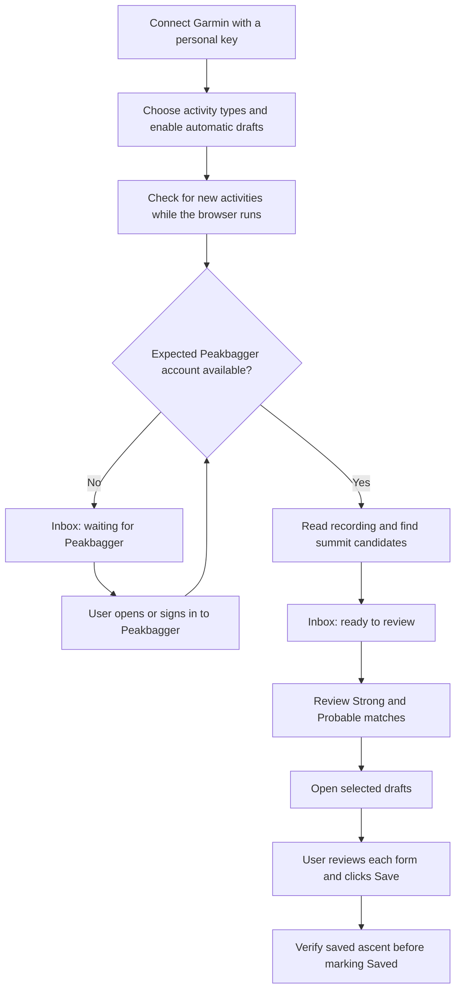

# Garmin Personal API and automatic draft inbox

Status: research and proposed workflow, October 22, 2026. Runtime implementation
has not started. Source review used commit `61b07643`. The user authorized a
bounded read-only test of their personal key; no key, token, activity identifier,
activity name, coordinate, or original activity file is included in this plan.

## Recommendation

Use a device-local personal-key connection for a personal-use prototype. It can
discover activities, download their recordings, and prepare summit suggestions
without visiting Garmin activity pages. Present those suggestions in an
**Activity inbox**. Opening Peakbagger forms and saving ascents remain explicit
user actions.

For distribution, resolve Garmin's terms for a free, locally executed,
user-supplied-key extension before treating this as an approved integration.
The public FAQ distinguishes individual personal applications from commercial
multi-user integrations. It does not specifically settle this extension model.
The supplemental terms accepted during key creation were not retrieved.

Business Starter is the alternative for a supported multi-user integration, but
its published push-only delivery implies a hosted receiving service. That would
change Better Peakbagger's current no-developer-server privacy model. Choose it
deliberately rather than assuming it is just another authentication method.

## Verified API findings

Primary sources, checked October 22:

- [Current program tiers](https://developer.garmin.com/gc-developer-program/overview/)
- [Personal API setup](https://developer.garmin.com/gc-developer-program/personal/personal-api/)
- [Personal API FAQ](https://developer.garmin.com/gc-developer-program/personal/personal-faq/)
- [Personal OpenAPI reference](https://developer.garmin.com/gc-developer-program/personal/swagger-docs/)
- [Garmin's Python reference client](https://github.com/garmin/connect-personal-api-python)

| Route | Contract and observed behavior |
| --- | --- |
| `POST /personalapitoken-service/personal-api/personal-api-key/token` | Send `Authorization: ApiKey <key>`. Successful live response was a plain-text JWT, not a JSON token object. |
| `GET /activitylist-service/activities/search/activities` | Bearer authentication; JSON array; offset pagination, date and activity-type filters. A request with `start=0&limit=3&sortOrder=desc` returned three summaries. |
| `GET /activity-service/activity/{activityId}` | Detailed JSON summary and metadata. The live response contained `summaryDTO`, `metadataDTO`, `timeZoneUnitDTO`, and `userProfileId`. This is not a full route-point stream. |
| `GET /download-service/files/activity/{activityId}` | Original activity file in a ZIP. The sampled archive contained one FIT file. The reference does not promise GPX conversion. |

All calls above use `https://personal.connectapi.garmin.com`. Personal access is
pull-only. Keys have a chosen expiry of 30, 90, 180 days, or one year; access
tokens last up to 24 hours. A fresh token is obtained with the key; there is no
refresh-token flow. Deleting the key also invalidates its associated tokens.

The first token attempt, using Python with `Accept: application/json`, returned
406. Garmin's documented curl form succeeded, as did a subsequent complete
read test. This is consistent with content negotiation, but the precise cause
was not isolated. Implement the documented request and handle the token as
text; do not interpret every non-200 response as an invalid key.

### Live sample, with private values omitted

The successful test made one token request, one three-item list request, one
detail request, and one file request. A preceding diagnostic token request also
succeeded; the initial token attempt returned 406. No wellness endpoints,
Peakbagger requests, remote activity mutations, or draft creation were tested.

| Observation | Result |
| --- | --- |
| Activity list | Array; first item had 77 fields |
| Original ZIP | 227,888 bytes; one entry |
| Uncompressed FIT | 630,073 bytes |
| FIT record messages | 4,284 |
| Records with valid latitude and longitude fields | 4,253 |
| Records containing timestamp / elevation fields | 4,284 / 4,284 |
| Structural scan | Reached the declared FIT data boundary exactly |

The structural scanner established field availability, not complete FIT
semantic correctness: CRCs, pause segmentation, unit conversion, and agreement
with the existing Garmin GPX export were not verified. The 31 records without
usable coordinates demonstrate why a parser must not invent positions or bridge
gaps indiscriminately. Raw response bytes stayed in process memory and were
discarded when the test exited. Only field names, types, counts and sizes were
printed. The public OpenAPI schema was inspected separately.

Illustrative field shape below uses invented values, not the user's activity:

```json
{
  "activityId": 123456789,
  "activityName": "Example hike",
  "startTimeLocal": "2026-10-22 08:15:00",
  "startTimeGMT": "2026-10-22 15:15:00",
  "activityType": { "typeKey": "hiking" },
  "distance": 12000.0,
  "duration": 14400.0,
  "elapsedDuration": 15300.0,
  "elevationGain": 900.0
}
```

Distances/elevation are meters and durations are seconds. The local timestamp
has no offset; the GMT string also omits a UTC suffix. Parse them explicitly.
Use the recorded route and the existing shared math to derive Peakbagger
fields; Garmin's aggregate distance/gain is useful for preview, not a replacement
for the current per-encounter calculations.

Activity summaries and original files contain more than the feature needs,
including health measurements and account metadata. The documented search
filters do not offer a response-field projection. Immediately discard unwanted
fields; do not promise that Garmin sends only route data. No activity-only key
scope was established by the reviewed public documentation.

## Findings in this repository

| Finding | Evidence | Design consequence |
| --- | --- | --- |
| Existing capture is tied to a clicked activity tab. | `admitCapture`, `startCapture`, and `cleanupRemovedTab` in [background.js](../../src/background/background.js); [provider-page.js](../../src/capture/provider-page.js) | An alarm cannot safely impersonate a toolbar click or manufacture a source tab ID. Introduce a distinct import coordinator. |
| The analysis engine already consumes narrow parsed fields. | `analyzeTrack` in [background.js](../../src/background/background.js), [capture-core.js](../../src/capture/capture-core.js), [gpx-metrics.js](../../src/gpx/gpx-metrics.js) | Reuse scoring, complete corridor lookup, metrics and reduction after adding a FIT-to-analysis adapter. |
| Prepared jobs and tracks expire after 30 minutes. | [Privacy contract](../../PRIVACY.md#activity-capture), [capture architecture](../architecture.md#deep-dive-garminstrava-capture-and-local-gpx-processing) | Durable inbox suggestions must be distinct from short-lived prepared forms and track payloads. Extending the existing TTL would silently expand retention. |
| Save verification is currently conditional. | `savedDraftContext` requires `waitForSave`; selected multi-summit drafts use this path in [background.js](../../src/background/background.js). | A universal inbox “Saved” state requires verification for single-summit imports too. Tab creation, Preview, or closing a form is insufficient. |
| Background Garmin access and persistent import history are new permissions/data uses. | [manifest](../../manifest.json), [Privacy](../../PRIVACY.md) | Add a separate optional API-origin grant, consent and documented retention. Preserve the existing toolbar path. |
| Feed export is a separate proposed feature. | [Owned activity feed export plan](activity-feed-export.md) | Share analysis and confidence presentation, but do not make API import depend on provider DOM or combine the implementations. |

## User workflow



### 1. Connect, in Settings → Capture & reports

Add a **Garmin connection** subsection using the existing panel typography,
colors and controls. Keep credentials out of the small toolbar popup.

```text
Garmin connection
Prepare Peakbagger drafts from your Garmin activities.

1. Create a personal key in Garmin Connect ↗
2. Paste your key
   [••••••••••••••••••••••••••••] [Show]

The key stays on this device. Better Peakbagger reads activity data.
[Connect Garmin]
```

Link directly to
[Garmin's key page](https://connect.garmin.com/app/settings/personalApiToken).
Use a labeled password field with paste enabled, no autocomplete or spellcheck,
and an accessible Show/Hide action. Never read the clipboard automatically.
Request only the API-origin permission from the Connect gesture, then validate
the token and a small activity response. On success clear the input; display
**Connected on this device**, with **Replace key** and **Disconnect**.

Do not display an invented key expiry from the JWT: that describes the access
token. Link to Garmin to manage key expiry until an authoritative key-expiry
contract is established. Replacing a key invalidates in-flight work. A change
of account starts a new connection identity and never inherits another
account's history or pending drafts.

### 2. Enable automatic preparation deliberately

After connection, show one compact setup screen:

```text
Automatic drafts
Activities: Hikes, walks and trail runs                     [Change]
Start with: New activities                                  [Change]
Peakbagger: Signed in as your selected climber

While your browser is running, we check Garmin for new activities
and use their routes to find peaks on Peakbagger. Draft suggestions
stay on this device. You decide what to save.

[Start automatic drafts]
```

Connection alone does not authorize background route processing. The final
action enables it and records the selected Peakbagger account. The default
activity types are a proposed convenience, not proof of GPS or summits. Offer
other types, including cycling, in Change; validate Garmin's parent/subtype
taxonomy before shipping. Never filter solely on a high elevation-gain value.

“New activities” seeds a baseline of existing IDs in the scheduled lookback
window; it does not bulk-import the account. Offer an explicit **Import earlier
activities** date-range flow for history. Scheduled checks inspect a rolling
30-day window; state this in connection details so delayed uploads older than
that are not falsely promised. The date-range history importer is separately
bounded and user-started.

Proposed cadence: once per hour while the browser runs, a coalesced check on
startup, and **Check now**. This cadence is a product choice, not a Garmin quota.
Honor rate limits and backoff. Browser closure, sleep and offline periods delay
checks; show the last successful check. No “instant sync” promise.

### 3. An Activity inbox, with a small popup entry point

Use a full extension page for the list and review. The popup gets one compact
entry such as **3 activities ready to review**; preserve its existing capture
action when opened on a Garmin or Strava activity. Badge counts reflect
reviewable activities, not an unverified count of ascents. Avoid OS notifications
and unsolicited tab creation in the first version.

```text
Activity inbox                                  [Check now]
Garmin connected · Last checked 10:40 AM

Oct 22 · Hike              2 Strong · 1 Probable      [Review]
Oct 21 · Trail run         Waiting for Peakbagger     [Open Peakbagger]
Oct 20 · Walk              No matching summits        [Details]

[Import earlier activities]                           [Settings]
```

Use the existing activity-name privacy preference: when it is off, show a type
and date, not the Garmin activity name. Keep completed/dismissed items in a
secondary history view. Do not reorder the visible list as individual analyses
finish; queue new arrivals behind a **New activities available** action while
the user is reading. Keep existing rows visible during refresh.

Automatic summit preparation uses a suitable existing Peakbagger tab and
reverifies the expected climber. If none is usable, retain a waiting item and
offer **Open Peakbagger**. No background import opens or focuses a tab. A
challenge, sign-out, or account mismatch pauses preparation without discarding
the queue. Metadata discovery can continue; route download waits for the
Peakbagger gate. The list response can itself contain starting coordinates,
which must be dropped immediately rather than described as never received.

### 4. Review one activity, then open drafts

```text
‹ Activity inbox
Hike · Oct 22

☑ Example North Peak        Strong
  Closest approach and elevation evidence
☑ Example South Peak        Strong
☐ Example Ridge             Probable
  Review this possible summit

GPX privacy follows your existing capture settings.
[Open 2 drafts]                                      [Dismiss]
```

Reuse [match-confidence.js](../../src/capture/match-confidence.js). Strong is
selected initially, Probable is opt-in, and neither label asserts a summit.
Preserve encounter-order suffixes, activity-local dates, multi-peak trip naming,
the per-capture timestamp exception, 3,000-point combined track/waypoint budget,
exactly-once Preview and manual Save. Provide expandable route/metric details.

Before opening, reverify Peakbagger identity and refresh an expired recording.
If the recording or candidate set changed, show the changes and require renewed
selection; never replace an existing form or replay an uncertain Preview.
After opening, the primary action becomes **View drafts**. Use **Saved** only
after verifying the persisted ascent. If outcome is uncertain, use **Check save
status**, not **Try again**, and do not create replacement ascents automatically.

### States, recovery and layout stability

| State | User-facing feedback | Recovery |
| --- | --- | --- |
| Token/key rejected after one bounded renewal attempt | Garmin connection needs attention | Replace key |
| Offline or temporary Garmin failure | Could not check Garmin; previous results remain | Check again, respecting backoff |
| Rate-limited | Garmin asked us to wait; show retry time if trustworthy | Automatic resume after cooldown; no hammering Retry |
| No Peakbagger session / account changed | Sign in to the selected Peakbagger account | Open Peakbagger; account changes require explicit rebind |
| Challenge | Peakbagger needs a browser check | Open the relevant check; never automate the challenge |
| Incomplete summit lookup | Could not finish finding peaks | Resume/retry the bounded analysis; never show partial results as complete |
| Missing route / unsupported original format | This activity has no usable route / this file format is not supported | Open activity or use the existing GPX workflow |
| Expired temporary track | Updating this activity before opening drafts | Refetch and revalidate without losing the inbox item |
| Ambiguous previous Save | Check whether this ascent was saved | Verify status before offering another draft |

The shared error policy should own these states. Keep Check now, Connect and
Open drafts anchored through idle, busy, success, error and retry. Reserve a
small wrapping status area below actions; do not stretch buttons or add large
blank spacers for constant geometry. Use stable labels where possible and a
fixed-size progress indicator beside them. Preserve keyboard focus during busy
states; guard pointer, keyboard and submit re-entry when using `aria-disabled`.
Announce meaningful phase transitions politely and errors accessibly. Never
announce every polled update, move focus after a background check, or auto-scroll.

## Engineering contract

### Credentials and authenticated reads

- Optional host access is exactly `https://personal.connectapi.garmin.com/*`.
  Key requests live in extension-owned code, never provider/Peakbagger scripts
  or a page-world bridge. No cookie permission or Garmin website host grant is
  required for this transport.
- Keep the persistent key in an extension-origin credential store, with narrow
  trusted-page messages for connect/replace/disconnect. Prefer a dedicated
  extension-origin IndexedDB store over assuming `storage.local` is private
  from content scripts. Chrome exposes local storage to content scripts by
  default; changing an entire area's access level requires auditing existing
  users. Verify Firefox behavior too. See [Chrome storage documentation](https://developer.chrome.com/docs/extensions/reference/api/storage).
- This is device-local storage, not an OS keychain or an encryption-at-rest
  guarantee. Exclude credentials and import history from browser sync, settings
  export, GitHub backup, telemetry, diagnostics, URLs and DOM attributes.
- Cache bearer tokens only in trusted session storage/memory. Coalesce token
  renewal, account for expiry, and allow at most one renewal/retry on a 401.
  Validate the authenticated response; decoded JWT fields alone must not grant
  authority. Avoid retaining identity beyond the minimum connection binding.
- Use fixed allowlisted paths, positive activity IDs, omitted ambient cookies,
  no caching, deadlines, byte limits and redirect rejection. A redirect must
  never forward the Authorization header to an unapproved host.
- A key replacement creates a fresh generation. Bind the observed server-side
  activity owner consistently across list/detail responses; fail closed on
  mismatches. Do not infer ownership from a display name. An empty account is
  a valid connection with no activities, not an ownership error.

### FIT adapter and shared analysis

The existing website adapter reads GPX in the provider page. Preserve that
boundary. The new API route necessarily receives an original file in extension
memory; document this distinct processing path explicitly in Privacy.

Decode only the required position/elevation/time, segment and permitted name /
waypoint fields into the existing analysis contract. Discard heart rate,
cadence, power, temperature, device identifiers and other messages. Preserve
pause/session boundaries, invalid-value sentinels and missing-GPS gaps; do not
turn lap markers into arbitrary breaks or connect multisport legs blindly.
Handle FIT epoch timestamps, semicircle coordinates, altitude scaling, enhanced
altitude, compressed timestamps and malformed definitions with explicit tests.
Retain the original track-point sequence for geometry; time ordering must not
reorder the route.

Check ZIP entry counts, advertised and actual inflated sizes, CRC/integrity,
supported file signatures and CPU/point budgets before accepting a recording.
Never extract archive paths to disk. Reject ambiguity rather than choosing the
first of several plausible recordings. Reuse the existing
[capture resource limits](../../src/capture/capture-resource-limits.js) where
applicable and define compressed/inflated limits explicitly. Original uploaded
formats other than FIT need an explicit adapter or an actionable unsupported
result; a successful ZIP download does not prove a usable track.

Garmin provides a browser-compatible
[JavaScript FIT SDK](https://github.com/garmin/fit-javascript-sdk), but its
[custom license](https://github.com/garmin/fit-javascript-sdk/blob/main/LICENSE.txt)
includes a copyleft-related distribution restriction in section 2(d). This
repository is AGPL-3.0-or-later. Do not assume the SDK is a compatible npm
dependency. Review that boundary before selecting it. The MIT-labelled
[fit-file-parser project](https://github.com/jimmykane/fit-parser) is an evaluation
candidate, not an audited recommendation; verify provenance, licensing,
malformed-file handling, browser bundling and parse fidelity before adoption.
The small structural scanner used in this investigation is not a production
decoder.

### Discovery, persistence and idempotency

Use a separate durable import record keyed by connection identity and Garmin
activity ID. Keep the analysis engine shared, but give imports a real lifecycle
owner independent of a browser tab. Only when the user opens drafts should a
new short-lived draft transaction bind the inbox, selected peaks, climber,
generation and actual destination tabs.

Proposed retention:

| Data | Storage and retention |
| --- | --- |
| Personal key | Device-local credential store until replacement/disconnect |
| Raw ZIP/FIT and full API objects | Transient memory; discard after projection/processing |
| Reduced track and prepared form payload | Existing private session storage; 30 minutes |
| Pending inbox metadata, public summit IDs/confidence and derived draft summary | Device-local, up to 30 days and a bounded 200 pending activities; no route coordinate arrays |
| Opened/verified/dismissed receipts | Minimal activity/peak/ascent identity and outcome; proposed 60-day bounded retention; excluded from backup/sync |

Disclose the new metadata retention during enablement. Display generic type/date
unless the current activity-name preference permits names. If a cap is reached,
pause intake visibly rather than silently evicting pending work. Refresh the
recording and analysis before using expired payloads; an inbox suggestion is
not a guarantee that a 30-day-old route is unchanged. Disconnect cancels work,
deletes the local key/tokens/history and removes the API grant; it never changes
already-saved Peakbagger ascents. Explain that deleting the Garmin key itself
requires Garmin's key-management page.

Pagination must finish the selected window before claiming a successful check.
Use small pages and a bounded request budget; yield/resume large scans. Offset
pagination can shift during new uploads, so deduplicate IDs, overlap scans and
restart interrupted scans conservatively. The documented API has no verified
modified-since cursor; do not equate maximum activity ID or last start date with
all newly uploaded/edited activities. Activity-local date filters are not UTC
upload timestamps. Historical imports need the same completeness contract.

Allow one active import analysis at a time initially and reuse the existing
origin-wide Peakbagger scheduler/cooldown. Never persist a retry loop that
ignores user cancellation, revoked permission, a new key, or a different
Peakbagger account. Reconcile alarms at startup and worker wakeup; a service
worker timer is not a scheduler. [Browser alarms](https://developer.chrome.com/docs/extensions/reference/api/alarms)
can be delayed by sleep and need lifecycle handling.

Prevent duplicates across repeated polls and the existing Garmin toolbar/feed
path with a shared source identity receipt. Strava mirrors, manually entered
ascents and re-imports beyond receipt retention require conservative duplicate
review. Same date plus peak alone is not proof of a duplicate. A route change
creates a revision to review, never an automatic second set of ascents.

## Business alternative

The current tier overview says:

| Tier | Delivery | History | Capacity | Fit here |
| --- | --- | --- | --- | --- |
| Personal | Pull | Activity search supports date ranges; deep-history coverage not tested | Own data | Simplest local prototype; user supplies and renews a key |
| Business Starter | Push only | Not included | Limited, numerical limit not published on the overview | Hosted receiving service and a supported multi-user connection flow |
| Business Enterprise | Push or Ping/Pull | “1 month +” | Unlimited | Negotiated integration for scale/history/support |

Use the current
[Starter access request form](https://www.garmin.com/en-US/forms/StarterGarminConnectDeveloperAccess/).
Garmin explicitly includes individual developers and startups in the business
audience, so a large company is not the stated prerequisite. Approval of this
specific project is unproven. The form returned 403 to the research fetch; its
exact fields, current prices, numerical Starter cap and approval timeline were
not verified. Older indexed FAQs describe a previous program; do not carry
their fee/timing claims into the new tiers.

Prepare the following application information: project website and privacy
policy, maintainer/organization contact, expected user counts, requested Activity
API access, data-flow/retention explanation, and the purpose of user-reviewed
Peakbagger draft creation. Ask Garmin specifically about:

1. Distributed noncommercial local clients using each user's personal key.
2. Sending a user-approved, reduced track and derived ascent data to Peakbagger.
3. Current Starter cost, capacity, activity formats, attribution and history.
4. Supported OAuth authorization flow, PKCE/public-client support and whether a
   browser-only business client is viable; do not embed a business client secret
   in the extension.
5. Push delivery requirements, authenticated callbacks, retries, duplicate events,
   revocation/deletion handling and the Enterprise escalation path.

For Starter, the likely architecture is Garmin authorization → hosted callback
receiver → short-lived per-user activity queue → authenticated extension pull →
local analysis and review. This is an architectural inference from push-only
delivery, not verified portal documentation. Keep business secrets and callback
verification on the server. Use applicable Garmin attribution in the UI and
resolve any obligations for exported data with Garmin.

A hosted receiver can collect Garmin uploads while the browser is closed. It
does not automatically solve Peakbagger's browser-session requirement or enable
unattended Peakbagger Save. A server receiving raw activity data also changes the
product's operating cost, deletion duties and public privacy contract.

No application, outreach, agreement acceptance or business account creation was
performed during this research.

## Delivery sequence and evidence required

1. Resolve distribution terms and decoder licensing; capture synthetic schema
   fixtures without retaining the supplied key or personal recording.
2. Implement Connect and an explicit one-activity import first. Prove direct
   optional-origin requests in real Chrome and Firefox, owner binding, FIT
   fidelity and the existing draft pipeline before adding background work.
3. Add the inbox and persistent receipts. Verify restart, expiry, single- and
   multi-summit Save reconciliation and cross-entry-point duplicate behavior.
4. Add opt-in scheduled discovery/preparation with bounded catch-up, rate-limit
   handling, account/key replacement, permission revocation and cancellation.

Keep each implementation unit separately verified and committed. Runtime
settings, manifest/build wiring, Privacy and store disclosures must describe
the new behavior when it is implemented.

The UI verification matrix must cover 390px popup, narrow inbox and desktop
inbox; light/dark themes and enlarged text; connect success/error/permission
denial; slow and repeated sync; no results; long activity/error labels; expired
keys; Peakbagger sign-out/challenge; open/reopen/save recovery. Compare action,
heading, following-content and scroll geometry across states. Test keyboard
focus and duplicate activation in both browsers. Use masked HTTPS fixtures
and hidden real browsers under the repository's non-interruption rules. Before
implementation, confirm the selected harness can load the target UI.

Evidence status: live Garmin token/list/detail/ZIP reads and FIT field presence
were verified. Browser extension networking, production FIT decoding, full
summit/draft integration, scheduled operation and rendered UX have not been
implemented or verified. The text wireframes specify behavior; they are not
evidence of layout stability or native browser polish.
