# Garmin Personal API and automatic draft inbox

Status: implementation in progress, October 23, 2026. Initial source review used commit `61b07643`;
the revision also inspected the current settings credential export/import path
and toolbar popup startup, layout and capture controls.
The user authorized bounded read-only tests of their personal key; no key,
token, activity identifier, activity name, coordinate, or original activity file
is included in this plan.

Implementation ledger (updated with each completed unit):

| Unit | Status / evidence |
| --- | --- |
| Strict FIT route adapter | Implemented; 24 focused tests and ESLint pass. Vendored MIT raw reader with bounded streaming projection and compressed-timestamp fix. Legacy protocol 0 and multisport remain explicit unsupported cases. |
| Device-local credentials, API and discovery | Pending |
| Durable inbox and short-lived draft handoff | Pending |
| Settings, inbox and popup UI | Pending |
| Credential-file export/import | Pending |
| Browser integration, privacy and documentation | Pending |
| Distribution / business program | External agreement review remains open; no business account application or release is authorized by implementation. |

## Recommendation

Use a device-local personal-key connection for a personal-use prototype. It can
discover activities, download their recordings, and prepare summit suggestions
without visiting Garmin activity pages. Present those suggestions in an
**Activity inbox**. Opening Peakbagger forms and saving ascents remain explicit
user actions.

**Current automatic scan design:**

| When | What is scanned |
| --- | --- |
| Every **four hours** by default | The user-configurable **Recent check range**, default **last 30 days of activity dates**, within the full history range. Widen after a long offline period to catch up. |
| About once a week | The user-configurable **Full history range**, to find older activities uploaded late. Large histories and provider delays can take longer. |
| On demand | **Check now** runs the recent scan; **Check full history** runs the full chosen-history scan. |

“Full history range” begins at an editable start date; by default, the day the
user connects Garmin, continuing through today. Users can choose any earlier
date or all available history. The recent lookback and check frequency are
separate editable settings. A scan does not import dates users have excluded;
**Manual only** disables both automatic scans. This is a proposed design, not
implemented behavior.

Pending inbox drafts have **no automatic expiry**. Keep their small,
privacy-filtered route snapshot on this device until completion or explicit
removal. The 30-minute form-delivery transaction is separate from inbox retention.
Include the personal key in a settings file only when **Include saved credentials**
is checked.

For distribution, resolve Garmin's terms for a free, locally executed,
user-supplied-key extension before treating this as an approved integration.
The public FAQ distinguishes individual personal applications from commercial
multi-user integrations. It does not specifically settle this extension model.
The supplemental terms accepted during key creation were not retrieved.

Business Starter is the alternative for a supported multi-user integration, but
its published push-only delivery implies a hosted receiving service. That would
change Better Peakbagger's current no-developer-server privacy model. Choose it
deliberately rather than assuming it is just another authentication method.

## Visual workflow mocks

These are documentation prototypes using the extension's actual panel palette,
typography, controls, and Strong/Probable colors. All names, routes, activity
values and credentials are fictional. They do not connect to Garmin, open
Peakbagger forms, export a file or implement the proposed feature.

The [HTML prototype](mocks/garmin-api/index.html) includes screen, theme and
simulated-response selectors. A separate [toolbar popup prototype](mocks/garmin-api/popup.html)
uses the actual popup stylesheet and adds context, badge and opening-error
scenarios. The [mock guide](mocks/garmin-api/README.md) describes the interactions
and reproducible screenshot checks.

### Open the inbox from the extension toolbar

Place a persistent **Activity inbox** button immediately below the existing
brand header. Its badge counts pending activities, including items waiting for
attention. The label stays the same at zero; opening the inbox does not clear
the count. Keep capture as the primary action for the current Garmin or Strava
activity, with an explicit **Capture this activity** button.
Describe the inbox's benefit directly: **“Your Garmin activities, imported
automatically.”** Use **“Your Garmin activities, ready when you check.”** in
Manual only, and **“Connect Garmin to import your activities.”** before setup.

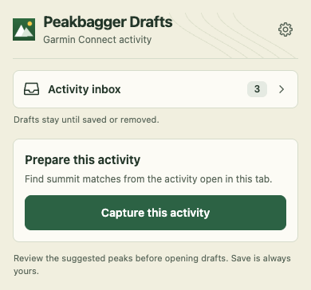

The inbox remains available on every website, before Garmin setup, and during a
capture or connection failure. Credentials and the activity list belong in the
full extension page. The prototype navigates within the page to demonstrate the
handoff; actual tab creation/reuse and popup dismissal remain implementation work.

<details>
<summary>Popup on another website, dark mode and opening-error recovery</summary>

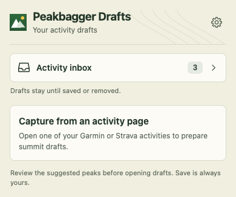

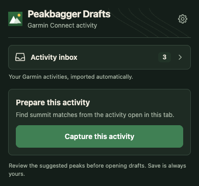

Keep the label and control dimensions stable while opening. If opening fails,
retain focus and show a short error below the same button so it can be retried.

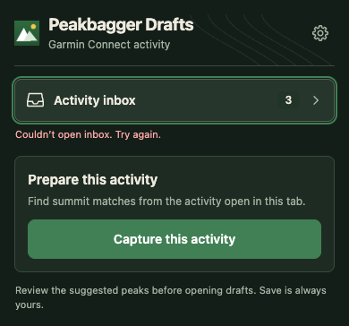

</details>

### Connect a personal key

Keep setup in Capture & reports, with one primary action and a masked key.
Connection leads to an explicit Enable Garmin drafts step; it does not silently
enable scheduled imports. **Get a Garmin API key ↗** sits beside the key-field
label and opens Garmin's key page in a new tab. The field contains only a
read-only demo value; the mock makes no API requests.

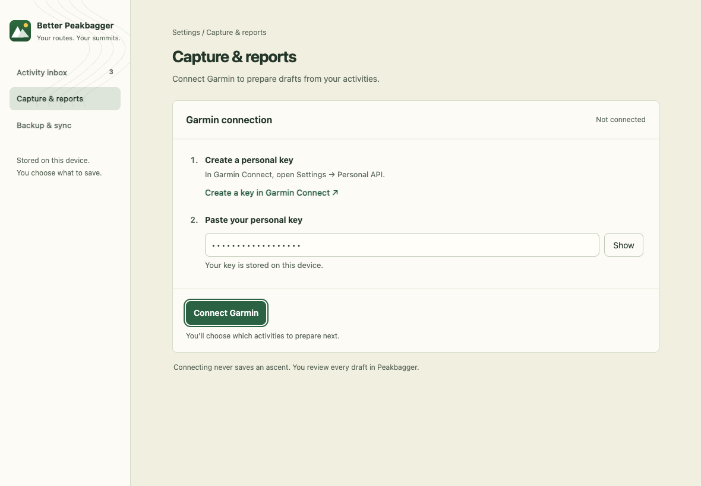

### Recover from an expired key

The expiry-specific scene below is illustrative. Live testing verified key
rejection, not expiry specifically; use the generic **“Garmin needs a new API
key”** state by default. See [authentication findings](experiments/garmin-key-expiry.md).

Only with confirmed expiry, show **“Garmin API key expired. Imports paused;
your drafts are safe.”** with
**Update key**. Keep the inbox and its draft count available. The action opens
the replacement form, with the same direct Garmin link and **Reconnect Garmin**.

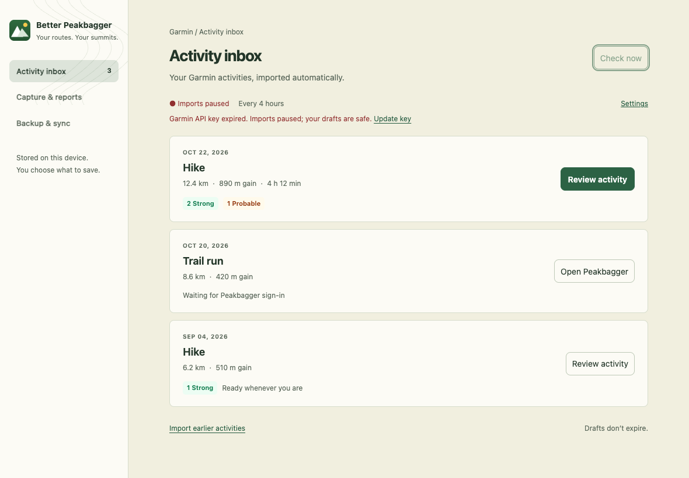

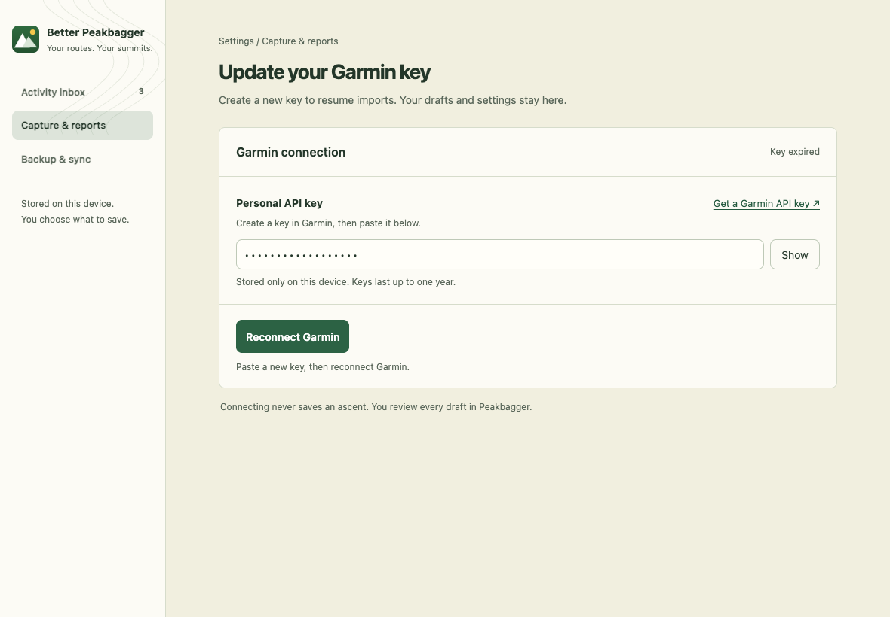

### Set the schedule

The connected state exposes the four-hour default, manual checks, activity
types and history scope in familiar setting rows. Manual only turns scheduled
checks off; Custom reveals an hours field. This image shows the state after
Enable Garmin drafts has been selected.

This earlier rendered mock predates the separate configurable ranges. The
[settings labels and descriptions below](#scan-settings-copy) are the current
design; the range controls still need a rendered mock and visual verification.

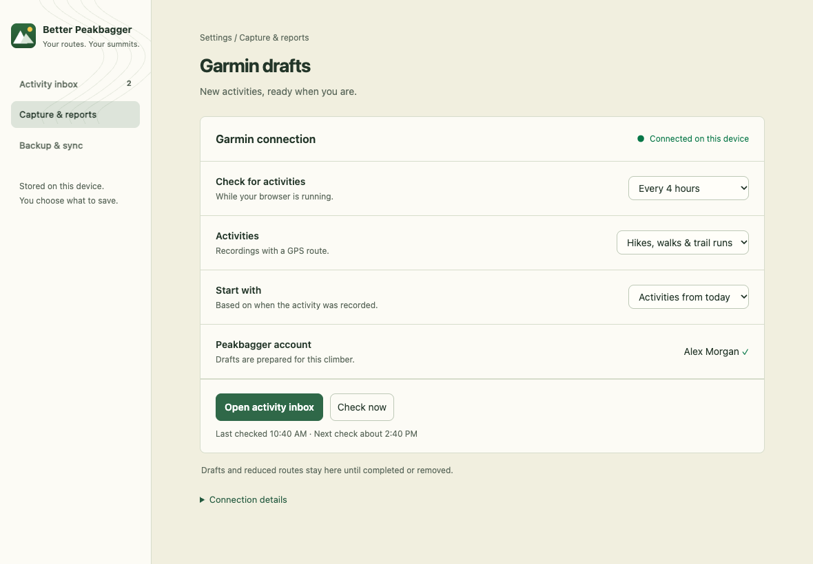

### Keep a durable activity inbox

Use a full page for review. Waiting items explain the next action, and the older
September draft demonstrates that pending work does not disappear after a few
days. A refresh keeps the list in place. Import earlier activities is a separate,
deliberate expansion of the selected history.

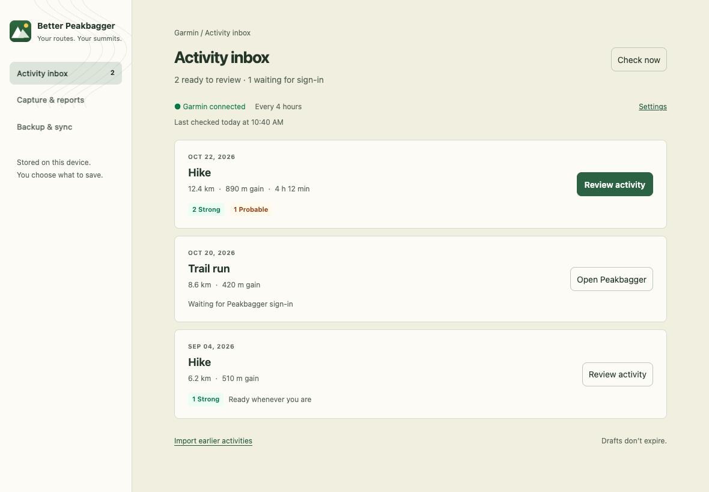

### Review before opening Peakbagger forms

Show the retained route snapshot beside the candidates. Strong matches are
selected and Probable matches require a choice. Refresh is explicit. Open drafts
hands off to Peakbagger; Save remains the user's action there. The route graphic
is a local schematic, not a basemap or a real recording.

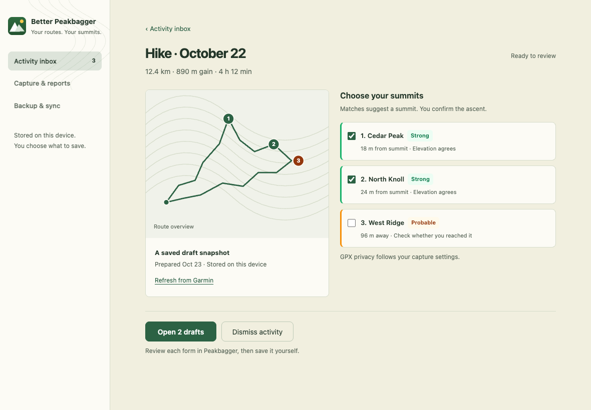

### Include the key only when requested

Extend the existing credential-export checkbox. This image deliberately shows
it checked; the prototype starts unchecked. The included-fields summary changes
without moving Export settings. Retain the existing unencrypted-file disclosure
beside the credential choice.

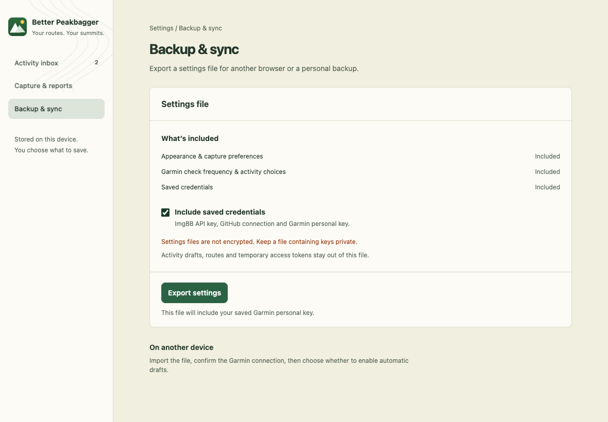

<details>
<summary>Checking, offline recovery, narrow layout and dark mode</summary>

Checking replaces only the reserved feedback text; the heading, Check now
button, list and footer keep their positions.

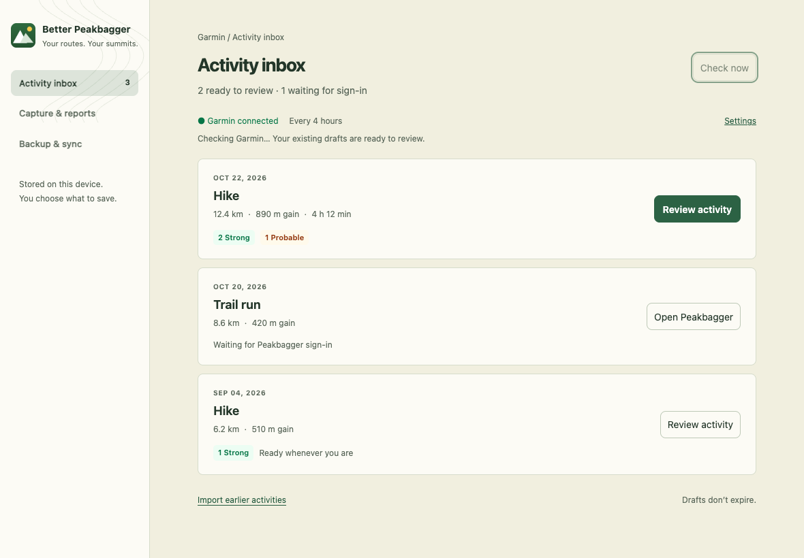

At 390px, navigation wraps above the content and each activity action follows
its details. The offline state preserves every draft and offers the same Check
now action after recovery.

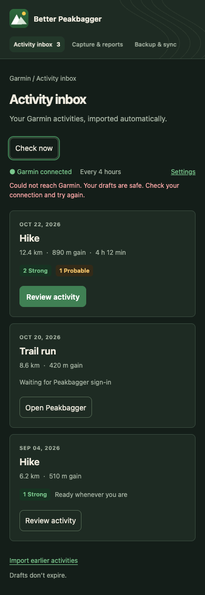

The review becomes a single column. Summit choices and Open drafts remain
available below the route, without horizontal scrolling.

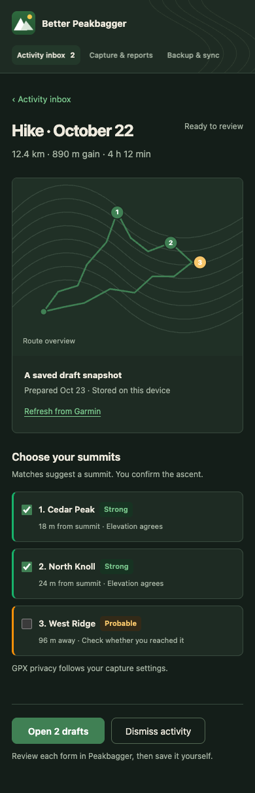

</details>

Mock verification: hidden Chrome for Testing 156.0.8078.4 and Firefox 157.0;
1180 × 900 and 390 × 1000 viewports, both themes. The prototype's inbox preserved
button, heading, list and footer geometry within 1px and kept keyboard focus
through pending, error, retry and success. Connection, schedule, selection and
export interactions were checked; Chromium screenshots were visually inspected.
Enlarged settings were checked at 200% CSS zoom, with wrapping controls. This
used DOM/CSS rendering, with no WebGL or live API calls. Native browser zoom,
permission prompts, window focus and production extension behavior remain
unverified by these mocks.

The popup prototype additionally passed eleven cases per browser, including
390 × 600 and 320 × 600 in both themes; nine badge/copy states; open/error/retry;
duplicate activation; retained keyboard focus; unrelated websites; active/error
captures; and empty/setup/expired-key/rejected-key destinations. Header, inbox
entry, capture section, following content and scroll geometry stayed within 1px through count and open
state updates. A 200% CSS zoom case at 390 × 1000 also exercised opening/error
feedback. Visual inspection caught fragmented words in the enlarged inbox
label; a new assertion failed on that defect and passed after the constrained
layout hid only the decorative inbox icon. The label, count and progress slot
remain readable. See the [enlarged popup](mocks/garmin-api/images/15-popup-enlarged.png).

Key recovery passed eight cases per browser: direct key-page link (navigation
intercepted), expiry, unknown rejection, rejected replacement, offline retry and
successful reconnect. At 1180px and 390px in both themes, feedback preserved
action/panel/heading/following-content geometry within 1px, scroll and focus.
Drafts and schedule/history choices survived replacement, including Manual only;
a rejected replacement preserved a working connection. Enlarged reconnect was
checked at 200% CSS zoom. Actual Garmin expiry responses and authenticated
key-management behavior remain runtime verification gaps.

## Verified API findings

Primary sources, checked October 22–23:

- [Current program tiers](https://developer.garmin.com/gc-developer-program/overview/)
- [Personal API setup](https://developer.garmin.com/gc-developer-program/personal/personal-api/)
- [Personal API FAQ](https://developer.garmin.com/gc-developer-program/personal/personal-faq/)
- [Personal OpenAPI reference](https://developer.garmin.com/gc-developer-program/personal/swagger-docs/)
- [Garmin's Python reference client](https://github.com/garmin/connect-personal-api-python)

| Route | Contract and observed behavior |
| --- | --- |
| `POST /personalapitoken-service/personal-api/personal-api-key/token` | Send `Authorization: ApiKey <key>`. Successful live response was a plain-text JWT, not a JSON token object. |
| `GET /activitylist-service/activities/search/activities` | Bearer authentication; JSON array; offset pagination, date and activity-type filters. A request with `start=0&limit=3&sortOrder=desc` returned three summaries. |
| `GET /activity-service/activity/{activityId}` | Detailed JSON summary and metadata. The live response contained `summaryDTO`, `metadataDTO`, `timeZoneUnitDTO`, and `userProfileId`. This is not a full route-point stream. |
| `GET /download-service/files/activity/{activityId}` | Original activity file in a ZIP. The sampled archive contained one FIT file. The reference does not promise GPX conversion. |

All calls above use `https://personal.connectapi.garmin.com`. Personal access is
pull-only. Keys have a chosen expiry of 30, 90, 180 days, or one year; access
tokens last up to 24 hours. A fresh token is obtained with the key; there is no
refresh-token flow. Deleting the key also invalidates its associated tokens.

The first token attempt, using Python with `Accept: application/json`, returned
406. Garmin's documented curl form succeeded, as did a subsequent complete
read test. This is consistent with content negotiation, but the precise cause
was not isolated. Implement the documented request and handle the token as
text; do not interpret every non-200 response as an invalid key.

**Key expiry:** a valid key returned a 24-hour JWT with no key-expiry date in
the token or response headers.
Malformed and altered keys both returned **401 with an empty body**. These
tests establish rejection, not its cause. Neither the published OpenAPI nor
Garmin's reference client supplies an expiry-specific contract. Default to
**Update key**, without claiming expiry; a genuinely expired key is still needed
to verify that response. [Test results](experiments/garmin-key-expiry.md)

### Live sample, with private values omitted

The successful test made one token request, one three-item list request, one
detail request, and one file request. A preceding diagnostic token request also
succeeded; the initial token attempt returned 406. No wellness endpoints,
Peakbagger requests, remote activity mutations, or draft creation were tested.

| Observation | Result |
| --- | --- |
| Activity list | Array; first item had 77 fields |
| Original ZIP | 227,888 bytes; one entry |
| Uncompressed FIT | 630,073 bytes |
| FIT record messages | 4,284 |
| Records with valid latitude and longitude fields | 4,253 |
| Records containing timestamp / elevation fields | 4,284 / 4,284 |
| Structural scan | Reached the declared FIT data boundary exactly |

The structural scanner established field availability, not complete FIT
semantic correctness: CRCs, pause segmentation, unit conversion, and agreement
with the existing Garmin GPX export were not verified. The 31 records without
usable coordinates demonstrate why a parser must not invent positions or bridge
gaps indiscriminately. Raw response bytes stayed in process memory and were
discarded when the test exited. Only field names, types, counts and sizes were
printed. The public OpenAPI schema was inspected separately.

### Activity dates, upload dates and the scan decision

**Garmin returns activities by when they happened, newest first by default.**
A July hike uploaded today still appears among July activities.

**We found no working upload-time sort.** All eight upload/creation field names
we tested returned empty lists; normal date and distance sorting worked. Garmin
provides an upload timestamp in activity details, but does not document an
uploaded-after search filter. Having the timestamp does not mean the list can
be sorted or filtered by it. Activity-ID ordering was inconclusive too.

**The defaults remain a rolling 30-day scan every four hours.** Users can change
both the recent lookback and the full history range. Checks use activity dates
and stay inside that history range. A separate weekly scan of the full range
catches older activities uploaded late. For example,
a July hike uploaded in October can be found by the weekly scan if July is
included in the chosen history. Known activity IDs prevent duplicate imports.

We successfully retrieved an activity more than five years old. The 30-day
window is our efficiency choice, not Garmin's history limit or a draft expiry.
There is no verified “only uploads since the last import” shortcut.

[Detailed test evidence and remaining uncertainty](experiments/garmin-upload-ordering.md)
are kept separately so the implementation decision stays readable.

### Data shape and projection

Illustrative field shape below uses invented values, not the user's activity:

```json
{
  "activityId": 123456789,
  "activityName": "Example hike",
  "startTimeLocal": "2026-10-22 08:15:00",
  "startTimeGMT": "2026-10-22 15:15:00",
  "activityType": { "typeKey": "hiking" },
  "distance": 12000.0,
  "duration": 14400.0,
  "elapsedDuration": 15300.0,
  "elevationGain": 900.0
}
```

Distances/elevation are meters and durations are seconds. The local timestamp
has no offset; the GMT string also omits a UTC suffix. Parse them explicitly.
Use the recorded route and the existing shared math to derive Peakbagger
fields; Garmin's aggregate distance/gain is useful for preview, not a replacement
for the current per-encounter calculations.

Activity summaries and original files contain more than the feature needs,
including health measurements and account metadata. The documented search
filters do not offer a response-field projection. Immediately discard unwanted
fields; do not promise that Garmin sends only route data. No activity-only key
scope was established by the reviewed public documentation.

## Findings in this repository

| Finding | Evidence | Design consequence |
| --- | --- | --- |
| Existing capture is tied to a clicked activity tab. | `admitCapture`, `startCapture`, and `cleanupRemovedTab` in [background.js](../../src/background/background.js); [provider-page.js](../../src/capture/provider-page.js) | An alarm cannot safely impersonate a toolbar click or manufacture a source tab ID. Introduce a distinct import coordinator. |
| Opening the popup currently starts a capture automatically. | The startup call to `beginCapture(false)` in [popup.js](../../popup/popup.js); header and state layout in [popup.html](../../popup/popup.html) and [popup.css](../../popup/popup.css) | An inbox visit must not start unrelated provider work. Make new capture explicit, while looking up and presenting existing capture progress/results without restarting it. |
| The analysis engine already consumes narrow parsed fields. | `analyzeTrack` in [background.js](../../src/background/background.js), [capture-core.js](../../src/capture/capture-core.js), [gpx-metrics.js](../../src/gpx/gpx-metrics.js) | Reuse scoring, complete corridor lookup, metrics and reduction after adding a FIT-to-analysis adapter. |
| Prepared jobs and tracks expire after 30 minutes. | [Privacy contract](../../PRIVACY.md#activity-capture), [capture architecture](../architecture.md#deep-dive-garminstrava-capture-and-local-gpx-processing) | Add a consented durable inbox snapshot and retain the existing short-lived form handoff. Existing capture retention does not already authorize durable storage. |
| Save verification is currently conditional. | `savedDraftContext` requires `waitForSave`; selected multi-summit drafts use this path in [background.js](../../src/background/background.js). | A universal inbox “Saved” state requires verification for single-summit imports too. Tab creation, Preview, or closing a form is insufficient. |
| Background Garmin access and persistent import history are new permissions/data uses. | [manifest](../../manifest.json), [Privacy](../../PRIVACY.md) | Add a separate optional API-origin grant, consent and documented retention. Preserve the existing toolbar path. |
| Feed export is a separate proposed feature. | [Owned activity feed export plan](activity-feed-export.md) | Share analysis and confidence presentation, but do not make API import depend on provider DOM or combine the implementations. |
| Settings files already have an opt-in credential export and sensitive import confirmation. | [settings-file-routes.js](../../src/background/settings-file-routes.js), [settings-transfer.js](../../src/settings/settings-transfer.js), [settings-backup.js](../../options/settings-backup.js) | Extend the existing checkbox and versioned payload for the Garmin key; preserve omission semantics and keep automated backups credential-free. |

## User workflow

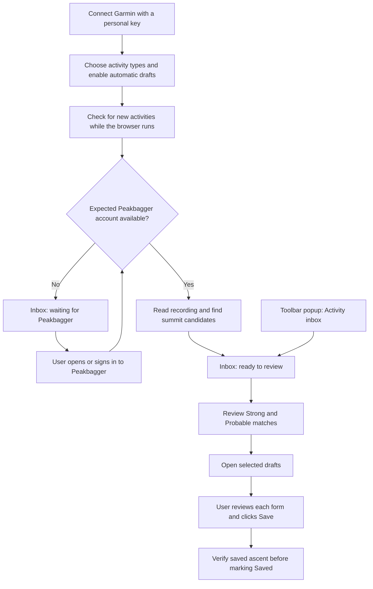

### 1. Connect, in Settings → Capture & reports

Add a **Garmin connection** subsection using the existing panel typography,
colors and controls. Keep credentials out of the small toolbar popup.

```text
Garmin connection
Bring your Garmin activities into your inbox automatically.

Personal API key                       Get a Garmin API key ↗
Create a key in Garmin, then paste it below.
[••••••••••••••••••••••••••••] [Show]

Stored only on this device. Keys last up to one year.
[Connect Garmin]
```

Link directly to
[Garmin's key page](https://connect.garmin.com/app/settings/personalApiToken).
Keep this visible beside the field in both Connect and Update key forms; open
a new tab with `noopener noreferrer` and an accessible new-tab label. Garmin
handles sign-in and key creation. The official setup link was rechecked on
October 23 and redirected signed-out users through sign-in to this destination.
Use a labeled password field with paste enabled, no autocomplete or spellcheck,
and an accessible Show/Hide action. Never read the clipboard automatically.
Request only the API-origin permission from the Connect gesture, then validate
the token and a small activity response. On success clear the input; display
**Connected on this device**, with **Replace key** and **Disconnect**.

#### Key expiry and reconnect

Garmin keys last **30, 90 or 180 days, or one year**, depending on the user's
choice. One year is a maximum, not a promise for every pasted key. Garmin sends
an expiry reminder about a week beforehand. Access tokens last at most 24 hours
and cannot outlive the key. [Garmin FAQ](https://developer.garmin.com/gc-developer-program/personal/personal-faq/)

| Situation | Message | Action |
| --- | --- | --- |
| Expiry is confirmed (not yet verified; do not enable from HTTP 401 alone) | **Garmin API key expired. Imports paused; your drafts are safe.** | **Update key** |
| Credentials rejected, exact reason unknown | **Garmin needs a new API key. Imports paused; your drafts are safe.** | **Update key** |
| A replacement key is rejected | **Garmin didn’t accept this key. Copy the full key or get a new one.** | Keep the field and direct Garmin link available |

Pause Garmin checks after credential rejection, including scheduled retries.
Keep existing drafts reviewable and show the message in the inbox and Settings;
the popup says **“Garmin key expired. Open inbox to reconnect.”** only when
expiry is confirmed. A generic rejection says **“Garmin needs a new key. Open
inbox to reconnect.”** Do not erase the pending count or redirect users away
from drafts.

On an activity 401, exchange the key for a fresh token once and retry once.
A token-exchange 401 requires reconnect, with the generic rejected-key message.
If exchange succeeds but the activity still fails, report an access failure.
An offline response, timeout or rate limit must keep its own recovery message,
not claim key expiry. Persist the paused state across browser restarts. Show an
expiry date/countdown only from authoritative key-expiry information; JWT expiry
is for the access token, and the connection date is not the key's creation date.

**Update key → get a new key in Garmin → paste it → Reconnect Garmin.** Validate
the new key and account before replacing the saved connection. A failed
replacement preserves it. For the same account, retain drafts, import history,
scan ranges and schedule; resume due work once, without enabling automatic
checks in Manual only. Successful replacement invalidates old in-flight work.
A different Garmin account requires an explicit new binding and cannot inherit
the previous account's history or drafts.

### 2. Enable automatic preparation deliberately

After connection, show one compact setup screen:

```text
Garmin drafts
Activities: Hikes, walks and trail runs                     [Change]
Check every: 4 hours                                        [Change]
Recent check range: Last 30 days                            [Change]
Full history range: Oct 23, 2026 → Today                     [Change]
Peakbagger: Signed in as your selected climber

While your browser is running, we check Garmin for new activities
and use their routes to find peaks on Peakbagger. Drafts and their
reduced routes stay on this device until saved or removed.
You decide what to save.

[Enable Garmin drafts]
```

Connection alone does not authorize background route processing. The final
action enables the chosen mode and records the selected Peakbagger account;
Manual only permits user-started imports and creates no discovery alarm. Its
helper text describes Check now instead of automatic checks. The default
activity types are a proposed convenience, not proof of GPS or summits. Offer
other types, including cycling, in Change; validate Garmin's parent/subtype
taxonomy before shipping. Never filter solely on a high elevation-gain value.

#### Scan settings copy

Expose these separately in setup and Settings → Capture & reports. Replace
the vague **Start with** row with **Full history range**; keep frequency and
lookback separate.

| Setting | Default and choices | Short description shown below the label |
| --- | --- | --- |
| **Check every** | **4 hours**; existing interval choices, Custom or Manual only | “How often to check while your browser is running.” |
| **Recent check range** | **Last 30 days**; 7, 14, 30, 60, 90 days or Custom days | “How far back each regular check looks.” |
| **Full history range** | **From connection date to today**; editable start date or All available history | “Checked weekly to find older activities uploaded late.” |

Shared note: **“Ranges use activity dates. Recent checks stay within your full
history range. Changing ranges keeps your existing drafts.”** In Manual only,
use **“How far back Check now looks.”** and **“Used when you choose Check full
history.”** for the two range descriptions.

Show the actual full-history start date, rather than a moving “today” label;
only its end advances with today. If it shortens the recent window, show the
effective range, for example **“Currently checking Oct 23–today.”** Custom
lookback accepts whole days from 1 to 365. A chosen start date must be valid and
not in the future; show validation beside its field. These are product bounds.

Changing either range starts fresh coverage tracking for affected scans.
Expanding full history previews and queues the added dates in bounded batches;
narrowing it stops new imports outside the range without deleting drafts or
duplicate-prevention records. **Import earlier activities** edits this same
full-history setting, rather than creating a second scope.

#### Schedule behavior

Check every **four hours** by default. Offer **Manual only**, **1 hour**,
**4 hours**, **12 hours**, **24 hours**, and **Custom…** with validated whole-hour
intervals from 1 to 168. These are product choices, not published Garmin quotas.
Keep **Check now** available in Settings and the inbox. Manual checks share the
active request and respect provider cooldowns; repeated clicks cannot start
parallel scans. Changing frequency replaces the existing alarm, and a manual
check schedules the next automatic check relative to its completion.

On startup, perform one coalesced check if due, without replaying missed alarms.
Browser closure, sleep and offline periods delay checks; show the last successful
check and the next planned check when automatic mode is enabled. Manual only
disables all scheduled discovery, including background history reconciliation.

The fast check covers recent activity dates, with overlap and catch-up after
long offline periods. A slower scan of the selected date scope finds delayed
uploads outside that window. Explain this under connection details and provide
**Check full history** there; keep the normal inbox action focused on Check now.
The engineering contract below specifies the coverage and its limits.

### 3. An Activity inbox, with a persistent popup button

Use a full extension page for the list and review. The toolbar popup gets a
full-width secondary **Activity inbox** button directly below the brand header
and above the changing capture state. Keep the existing settings gear in the
header. Use the extension's current typography, colors and outline icons;
credentials, settings and the full activity list stay out of this compact surface.

```text
Peakbagger Drafts                                      [Settings]
Garmin Connect activity

[ Inbox icon  Activity inbox                         3  › ]
Your Garmin activities, imported automatically.

Prepare this activity
Find summit matches from the activity open in this tab.
[Capture this activity]
```

**Opening the popup:** read the active-tab context, any existing capture job,
and the local inbox summary. The current startup call to `beginCapture(false)`
must be split so this read-only initialization cannot start a new capture,
fetch a provider recording or run summit lookup. On a supported activity show
**Capture this activity**; clicking it starts the existing explicit capture
transaction. An existing job still shows its progress or results. On other
sites show neutral guidance to open a Garmin or Strava activity, while keeping
the inbox available. An inbox visit never requests Garmin API permission or
requires a Garmin/Peakbagger tab. This is an intentional change to the current
one-purpose popup, required by its new navigation role.

**What the badge means:** count pending activity rows for the selected
Peakbagger account binding, including ready, preparing and waiting/attention
items. Count each activity once regardless of how many summit candidates or
forms it contains. Saved and dismissed activities leave this count. Opening or
reading the inbox does not. Use the same definition in the inbox sidebar; the
mock's three rows therefore show **3**, although only two are ready to review.

Read the count from a small durable local summary; opening the popup must not
fetch Garmin or decode files just to populate it. Hide the zero badge without
removing its layout slot. Show **99+** above 99, with the exact count in the
accessible name. While the local summary is unavailable show **—**, never a
false zero. Keep the last known count while refreshing; connection expiry or a
failed Garmin check must not erase it. Bind asynchronous updates to the selected
account/generation so a switch cannot expose another account's count or items.

**Opening the inbox:** on the button's explicit activation, reuse and focus an
existing eligible extension inbox tab, or create one if absent. Keep one
worker-owned open operation so repeated clicks or concurrent popup requests
cannot create several tabs. Validate the destination as the extension-owned
inbox; include no credentials or private activity data in its URL. Only dismiss
the popup after a confirmed handoff. If opening fails, leave it usable with
**Couldn’t open inbox. Try again.** below the unchanged button. If the popup
closes before acknowledgement, the worker finishes the same operation; a later
attempt looks for its resulting tab before creating another.

Garmin checking, disconnection, expired credentials and capture failures do not
disable the inbox button. Retained drafts remain reviewable. A connected empty
inbox explains there is nothing to review and keeps **Check now** available; an
unconfigured empty inbox offers **Connect Garmin**. Neither state redirects
silently into setup. Avoid OS notifications, an additional toolbar-icon badge,
and unsolicited tab creation in the first version.

**Interaction and accessibility:** use a minimum 44px target (48px in the mock),
a persistent label, and fixed count/indicator slots. A small spinner replaces
the chevron while opening; guard mouse, Enter and Space re-entry while retaining
keyboard focus with `aria-disabled`. Reserve a compact wrapping feedback line
for idle, opening and error copy so neither the entry nor the capture controls
move. Decorative icons/count text stay out of the accessibility tree; name the
button with its contextual count and announce meaningful count/status changes
politely without moving focus. Respect reduced motion. Preserve the native
popup's intrinsic 390px width contract; a fixture's constrained-width workaround
is not a production fix for native popup sizing. At constrained widths, hide
the decorative inbox icon before squeezing the action label into word fragments;
retain the count and opening indicator.

The destination remains the full inbox:

```text
Activity inbox                                  [Check now]
Garmin connected · Last checked 10:40 AM · Every 4 hours

Oct 22 · Hike              2 Strong · 1 Probable      [Review]
Oct 21 · Trail run         Waiting for Peakbagger     [Open Peakbagger]
Oct 20 · Walk              No matching summits        [Details]

[Import earlier activities]                           [Settings]
```

Use the existing activity-name privacy preference: when it is off, show a type
and date, not the Garmin activity name. Keep completed/dismissed items in a
secondary history view. Do not reorder the visible list as individual analyses
finish; queue new arrivals behind a **New activities available** action while
the user is reading. Keep existing rows visible during refresh.

Automatic summit preparation uses a suitable existing Peakbagger tab and
reverifies the expected climber. If none is usable, retain a waiting item and
offer **Open Peakbagger**. No background import opens or focuses a tab. A
challenge, sign-out, or account mismatch pauses preparation without discarding
the queue. Metadata discovery can continue; route download waits for the
Peakbagger gate. The list response can itself contain starting coordinates,
which must be dropped immediately rather than described as never received.

### 4. Review one activity, then open drafts

```text
‹ Activity inbox
Hike · Oct 22

☑ Example North Peak        Strong
  Closest approach and elevation evidence
☑ Example South Peak        Strong
☐ Example Ridge             Probable
  Review this possible summit

GPX privacy follows your existing capture settings.
[Open 2 drafts]                                      [Dismiss]
```

Reuse [match-confidence.js](../../src/capture/match-confidence.js). Strong is
selected initially, Probable is opt-in, and neither label asserts a summit.
Preserve encounter-order suffixes, activity-local dates, multi-peak trip naming,
the per-capture timestamp exception, 3,000-point combined track/waypoint budget,
exactly-once Preview and manual Save. Provide expandable route/metric details.

Before opening, reverify Peakbagger identity and create a fresh 30-minute delivery
transaction from the durable, validated inbox snapshot. Opening a prepared item
does not require a still-valid Garmin key or downloading the recording again.
The snapshot is a point-in-time draft, with its preparation date in Details.
Offer **Refresh from Garmin** explicitly. If refreshing changes the recording
or candidate set, show the changes and require renewed selection; retain the
previous snapshot until refresh succeeds. Never replace an existing form or
replay an uncertain Preview. An expired form handoff requires checking existing
open/save state before offering another form, not silently issuing a new one.
After opening, the primary action becomes **View drafts**. Use **Saved** only
after verifying the persisted ascent. If outcome is uncertain, use **Check save
status**, not **Try again**, and do not create replacement ascents automatically.

### States, recovery and layout stability

| State | User-facing feedback | Recovery |
| --- | --- | --- |
| Confirmed key expiry after one bounded renewal attempt | Garmin API key expired. Imports paused; your drafts are safe. | Update key |
| Credentials rejected, expiry not confirmed | Garmin needs a new API key. Imports paused; your drafts are safe. | Update key |
| Offline or temporary Garmin failure | Could not check Garmin; previous results remain | Check again, respecting backoff |
| Rate-limited | Garmin asked us to wait; show retry time if trustworthy | Automatic resume after cooldown; no hammering Retry |
| No Peakbagger session / account changed | Sign in to the selected Peakbagger account | Open Peakbagger; account changes require explicit rebind |
| Challenge | Peakbagger needs a browser check | Open the relevant check; never automate the challenge |
| Incomplete summit lookup | Could not finish finding peaks | Resume/retry the bounded analysis; never show partial results as complete |
| Missing route / unsupported original format | This activity has no usable route / this file format is not supported | Open activity or use the existing GPX workflow |
| Expired form handoff | Draft is still in your inbox | Check open/save state, then create a fresh handoff from the retained snapshot |
| Local storage capacity reached | Make room to prepare more activities | Pause intake; keep existing drafts and offer review/removal |
| Ambiguous previous Save | Check whether this ascent was saved | Verify status before offering another draft |

The shared error policy should own these states. Keep Check now, Connect and
Open drafts anchored through idle, busy, success, error and retry. Reserve a
small wrapping status area below actions; do not stretch buttons or add large
blank spacers for constant geometry. Use stable labels where possible and a
fixed-size progress indicator beside them. Preserve keyboard focus during busy
states; guard pointer, keyboard and submit re-entry when using `aria-disabled`.
Announce meaningful phase transitions politely and errors accessibly. Never
announce every polled update, move focus after a background check, or auto-scroll.

## Engineering contract

### Credentials and authenticated reads

- Optional host access is exactly `https://personal.connectapi.garmin.com/*`.
  Key requests live in extension-owned code, never provider/Peakbagger scripts
  or a page-world bridge. No cookie permission or Garmin website host grant is
  required for this transport.
- Keep the persistent key in an extension-origin credential store, with narrow
  trusted-page messages for connect/replace/disconnect. Prefer a dedicated
  extension-origin IndexedDB store over assuming `storage.local` is private
  from content scripts. Chrome exposes local storage to content scripts by
  default; changing an entire area's access level requires auditing existing
  users. Verify Firefox behavior too. See [Chrome storage documentation](https://developer.chrome.com/docs/extensions/reference/api/storage).
- This is device-local storage, not an OS keychain or an encryption-at-rest
  guarantee. Exclude credentials and import history from browser sync,
  automated GitHub backup, telemetry, diagnostics, URLs and DOM attributes.
  A manually exported settings file can include the personal key only through
  the existing explicit credential checkbox, as specified below. Never export
  cached access tokens, inbox recordings or import history with settings.
- Cache bearer tokens only in trusted session storage/memory. Coalesce token
  renewal, account for expiry, and allow at most one renewal/retry on a 401.
  Validate the authenticated response; decoded JWT fields alone must not grant
  authority. Avoid retaining identity beyond the minimum connection binding.
- Use fixed allowlisted paths, positive activity IDs, omitted ambient cookies,
  no caching, deadlines, byte limits and redirect rejection. A redirect must
  never forward the Authorization header to an unapproved host.
- A key replacement creates a fresh generation. Bind the observed server-side
  activity owner consistently across list/detail responses; fail closed on
  mismatches. Do not infer ownership from a display name. An empty account is
  a valid connection with no activities, not an ownership error.

### Settings export and import

Reuse **Include saved credentials**, off by default. Update its label to mention
ImgBB, GitHub and Garmin; do not add a second Garmin-only export switch. Retain
the existing explanation that exported files are not encrypted. With the
checkbox off, the background export path must neither read the Garmin credential
store nor serialize any Garmin credential. With it on, include the saved personal
key in the versioned credential payload. The short-lived bearer token is always
omitted. Frequency, activity types and both scan ranges may travel as ordinary
settings; device permission and consent to start background processing do not.

The current schema is version 3 and `cleanApiKeys` recognizes only `imgbb`.
Extend the schema and compatibility tests deliberately: an absent Garmin key
field leaves an existing connection untouched, while explicit `null` represents
a deliberate removal. Importing an older export must never erase the Garmin
connection merely because that format did not know about it. Distinguish missing
credentials from a request to replace them throughout validation and rollback.

On import, use the existing sensitive-file confirmation, naming the Garmin key.
Obtain any missing optional API-origin permission from that user gesture and
validate the new key before committing it. Preserve the previous credential if
validation fails, and use the current snapshot/conditional rollback pattern so
a concurrent Replace key cannot be overwritten by an older import. Bind the
verified account before associating history. On a new device, finish with the
explicit automatic-drafts setup instead of silently enabling an imported alarm.

Relevant boundaries: [background settings-file routes](../../src/background/settings-file-routes.js),
[settings transfer schema](../../src/settings/settings-transfer.js),
[settings import UI](../../options/settings-backup.js), and
[the existing checkbox](../../options/options.html).

### FIT adapter and shared analysis

The existing website adapter reads GPX in the provider page. Preserve that
boundary. The new API route necessarily receives an original file in extension
memory; document this distinct processing path explicitly in Privacy.

Decode only the required position/elevation/time, segment and permitted name /
waypoint fields into the existing analysis contract. Discard heart rate,
cadence, power, temperature, device identifiers and other messages. Preserve
pause/session boundaries, invalid-value sentinels and missing-GPS gaps; do not
turn lap markers into arbitrary breaks or connect multisport legs blindly.
Handle FIT epoch timestamps, semicircle coordinates, altitude scaling, enhanced
altitude, compressed timestamps and malformed definitions with explicit tests.
Retain the original track-point sequence for geometry; time ordering must not
reorder the route.

Check ZIP entry counts, advertised and actual inflated sizes, CRC/integrity,
supported file signatures and CPU/point budgets before accepting a recording.
Never extract archive paths to disk. Reject ambiguity rather than choosing the
first of several plausible recordings. Reuse the existing
[capture resource limits](../../src/capture/capture-resource-limits.js) where
applicable and define compressed/inflated limits explicitly. Original uploaded
formats other than FIT need an explicit adapter or an actionable unsupported
result; a successful ZIP download does not prove a usable track.

### Decoder licensing and selection

Garmin's [JavaScript FIT SDK](https://github.com/garmin/fit-javascript-sdk) uses a
[custom FIT Protocol License](https://github.com/garmin/fit-javascript-sdk/blob/main/LICENSE.txt),
not MIT or Apache. Section 1 grants limited royalty-free use; 2(c) restricts
redistribution except as otherwise permitted, and 2(d) prohibits distribution
that subjects the SDK or derivatives to source-disclosure or modification-rights
requirements. Section 2(f) prohibits benchmarking/competitive analysis, and
section 3 requires interoperable modifications. For this AGPL-3.0-or-later
extension, treat bundling the SDK as a licensing conflict requiring resolution,
not a routine dependency addition. A separate file alone does not establish
compatibility. This is an engineering licensing assessment, not a legal opinion.

Two third-party JavaScript candidates were checked against their actual license
files and tested on October 23. The reproducible
[decoder evaluation](experiments/fit-decoders/README.md) includes 22 independent
synthetic fixtures, 12 public recordings, two authorized private Garmin downloads,
and hidden Chrome/Firefox Worker checks. No runtime dependency was added.

| Candidate | License and technical fit | Recommendation / remaining evidence |
| --- | --- | --- |
| [fit-file-parser](https://github.com/jimmykane/fit-parser) | [MIT](https://github.com/jimmykane/fit-parser/blob/main/LICENSE); pinned npm 6.2.3, published October 20, 2026. Both raw and full paths work in the tested browsers and agree exactly on the selected route fields across 56,465 shared public records and 10,027 private records. | Prefer the raw reader plus an owned activity adapter, after resolving its omitted-field compressed timestamp and legacy protocol compatibility gaps. Raw bundle plus projection: 5,166 bytes minified; full: 296,824 bytes. The full parser's strict mode still accepted a malformed field-width fixture. |
| [fit-decoder](https://github.com/ask77nl/fit-decoder) | [MIT](https://github.com/ask77nl/fit-decoder/blob/main/LICENSE); pinned npm 1.0.5, published February 25, 2021. Browser/Node loading worked, but correct parsing did not follow from file acceptance. | Reject for this integration: confirmed wrong altitude scaling, reduced coordinate precision, leaked byte order between definitions, broken compressed timestamps and incomplete structural validation. A known 1,000 m elevation became 75 m. |

MIT permits reuse and distribution with its copyright/license notices preserved;
the combined application remains subject to this repository's AGPL obligations.
An MIT label does not independently establish the provenance of every bundled
profile table. `fit-file-parser` now documents a static, community-maintained
profile with focused interoperability sources in
[PROFILE.md](https://github.com/jimmykane/fit-parser/blob/main/PROFILE.md); this is
useful evidence, not a completed historical provenance audit.

Prefer `fit-file-parser/raw` once the evaluation's adoption gates are closed: its reader exposes numeric fields,
compressed timestamps, selective message retention and an input-byte limit,
without importing the semantic profile. The adapter must still implement and
test field scaling, sentinels, segment semantics and the small permitted field
mapping. If the full parser is needed, explicitly select
`{ force: false, strict: true }`; its documented defaults allow checksum bypass
and partial recovery. Reject ambiguous concatenated activities rather than
silently using only the first file. Do not automatically retry raw-reader
rejections through the full parser: classify the reason first so a compatibility
fallback cannot bypass integrity checks.

The experimental projection and the earlier structural scanner are not production
activity adapters. Real segmentation/multisport, resource stress, GPX agreement,
fuzzing and extension lifecycle integration remain unproven; see the evaluation's
explicit proof gaps. Browser Worker compatibility does not prove a Chrome MV3
service worker can use the same processing architecture.

An owned route-only decoder is feasible: estimate 1–2 days for a happy-path
prototype, 1–2 weeks for robust protocol handling, and another 1–2 weeks for
production hardening. An adapter over the raw reader is closer to 2–4 days once
reader fixes land. These estimates exclude the API/inbox feature and upstream
response time. Prefer owning the narrow adapter over replacing a whole FIT SDK.
Pin and review license/provenance before adoption. Choosing a third-party decoder
does not settle Garmin Personal API distribution terms; the API agreement and
decoder license are separate questions.

### Discovery, persistence and idempotency

Use a separate durable import record keyed by connection identity and Garmin
activity ID. Keep the analysis engine shared, but give imports a real lifecycle
owner independent of a browser tab. Only when the user opens drafts should a
new short-lived draft transaction bind the inbox, selected peaks, climber,
generation and actual destination tabs.

Retention direction:

| Data | Storage and retention |
| --- | --- |
| Personal key | Device-local credential store until replacement/disconnect |
| Raw ZIP/FIT and full API objects | Transient memory; discard after projection/processing |
| Pending inbox item and sanitized reduced route snapshot | Extension-origin durable storage; no time-based expiry; retain until the activity is completed or explicitly removed; saving one summit must not discard unresolved suggestions |
| Active form-delivery payload | Existing private session storage; 30 minutes; recreated from the durable snapshot only after identity and previous-outcome checks |
| Dismissed/deleted activity tombstones and verified-save receipts | Minimal account/activity/peak/ascent identity and outcome; no route or health data; no automatic expiry; excluded from backup/sync |
| Sync checkpoints and resumable scan state | Device-local; retain with the connection history; never treat incomplete work as a successful scan |

Store one reduced route per activity, referenced by its summit drafts. Apply the
existing 3,000 combined track/waypoint point budget and narrow field allowlist
before persistence. Persist the full-resolution analysis results separately from
the simplified geometry; do not recompute distance/gain from a reduced track.
Never persist raw FIT, full API objects or wellness fields. Serialize a fresh,
validated Preview payload from the stored fields; do not persist arbitrary XML
or reuse an old form payload as authority.

Disclose persistent reduced-route storage during enablement and update Privacy
before shipping. Display generic type/date unless the current name preference
permits names. Apply tighter current privacy settings again at opening, and
scrub retained optional fields when the user disables their retention. Relaxing
a preference cannot recover discarded data without an explicit Garmin refresh.
Keep per-capture timestamp exceptions explicit when opening drafts.

Use item and byte budgets rather than a time-to-live: initially cap preparation
at 200 pending activities and choose a measured byte budget before implementation.
When a budget/quota is reached, pause preparation visibly and preserve every
existing item. Discovery must also respect its metadata budget; retain the scan
position without claiming the remainder was checked. An activity is complete
when every suggestion is saved/dismissed, or the user explicitly marks it done;
unselected Probable matches remain unresolved. Removing or completing an item
frees its snapshot. Dismiss retains the snapshot during its offered Undo window,
then keeps only a small tombstone so the next scan does not recreate it. Restoring
after that window requires a fresh import. Uninstalling or clearing extension data
still removes these local drafts; no cross-device inbox backup is proposed.

**Disconnect** cancels work, deletes the key/tokens and removes API permission,
but keeps prepared drafts and minimal history. State this beside the action.
Offer **Delete local Garmin data** separately with a concrete count of drafts
to be removed; this also disconnects and clears scan/history state. **Forget
import history**, if offered separately, must explain that old activities may
be proposed again. Neither action deletes Peakbagger ascents or Garmin records.
Deleting the Garmin key itself requires Garmin's key-management page. Retained
items remain bound to their original source and Peakbagger account; switching
accounts must not silently reassign them.

#### Checkpoints, IDs and tombstones

These are separate records with separate purposes:

| Record | Meaning | What it cannot prove |
| --- | --- | --- |
| Import start date / selected date ranges | The user's chosen activity-date scope | When an activity reached Garmin |
| Last successful check time and covered range | When a complete scoped discovery pass finished; used for scheduling/catch-up | That Garmin has no later upload or edit with an older activity date |
| Account + activity ID and imported revision | Seen/prepared state, preventing repeated downloads and duplicate inbox items | That every other activity was scanned |
| Per-activity or per-peak tombstone | A user dismissed/deleted an item, or an ascent was verified saved | A global timestamp beyond which older records are irrelevant |
| In-progress offset and scan generation | Bounded work that can resume after interruption | A committed completion checkpoint or a stable Garmin snapshot |

For example, a July hike uploaded in October is invisible to a query filtering
activity start after the previous October check. A watermark alone misses it.
The initial proposal uses this discovery strategy:

1. Every four hours (or the chosen interval), scan the configured **Recent check
   range** (default 30 days) within the configured **Full history range**. After
   a long offline period, widen the range to cover the time since the last
   completed pass, with overlap.
2. Deduplicate by source account and activity ID before requesting files. Skip
   durable prepared items and tombstones. An interrupted analysis resumes; it
   is not marked completed just because its summary was seen.
3. Spread a full metadata reconciliation of the configured **Full history range**
   over scheduled checks, targeting once a week. A large account or provider
   backoff may take longer; show its coverage/progress separately from the recent check. This
   finds delayed uploads with old dates inside the user's scope without
   downloading every original recording again.
4. **Check full history** runs the scoped metadata reconciliation on demand.
   **Import earlier activities** extends scope with a date range or all available
   history. Neither bypasses tombstones without an explicit Restore/re-import
   decision and duplicate review.

The weekly scan finds unseen IDs; it does not guarantee detecting every edit to
an existing activity. Compare available summary fields, fetch details when a
known item needs refreshing, and expose Refresh from Garmin. A route-only edit
with unchanged list fields has no documented automatic delta signal. Never
present a retained snapshot as continuously synchronized. Absence from one page
or scan is not proof of deletion and must not erase an inbox draft.

Pagination must finish its declared range before committing a successful
checkpoint. Use small pages and bounded request budgets; yield/resume large
scans. Offset pagination can shift during concurrent uploads, so deduplicate,
overlap pages and recheck the leading page before completion; restart affected
scans if it changes. Periodic reconciliation remains necessary because the API
does not promise snapshot isolation. A failed page leaves the old committed
checkpoint intact. Never equate maximum activity ID or last start date with a
complete set of new/modified activities. Historical imports use the same rules.

Upload-time checkpoints are **not part of this design**. Revisit them only if
Garmin provides a verified upload sort/filter; the
[research note](experiments/garmin-upload-ordering.md#requirements-for-a-future-upload-checkpoint)
records the requirements. Until then, keep the date scans and ID deduplication
above.

Allow one active import analysis at a time initially and reuse the existing
origin-wide Peakbagger scheduler/cooldown. Never persist a retry loop that
ignores user cancellation, revoked permission, a new key, or a different
Peakbagger account. Reconcile alarms at startup and worker wakeup; a service
worker timer is not a scheduler. [Browser alarms](https://developer.chrome.com/docs/extensions/reference/api/alarms)
can be delayed by sleep and need lifecycle handling.

Prevent duplicates across repeated polls and the existing Garmin toolbar/feed
path with a shared source identity receipt. Strava mirrors, manually entered
ascents and re-imports after history is explicitly forgotten require conservative
duplicate review. Same date plus peak alone is not proof of a duplicate. A route
change creates a revision to review, never an automatic second set of ascents.

## Business alternative

The current tier overview and the Personal API test support this comparison:

| Tier | Delivery | History | Capacity | Fit here |
| --- | --- | --- | --- | --- |
| Personal | Pull | Date-range search; an original recording more than five years old was retrieved; universal limit not established | Own data | Simplest local prototype; user supplies and renews a key |
| Business Starter | Push only | Not included | Limited, numerical limit not published on the overview | Hosted receiving service and a supported multi-user connection flow |
| Business Enterprise | Push or Ping/Pull | “1 month +” | Unlimited | Negotiated integration for scale/history/support |

Use the current
[Starter access request form](https://www.garmin.com/en-US/forms/StarterGarminConnectDeveloperAccess/).
Garmin explicitly includes individual developers and startups in the business
audience, so a large company is not the stated prerequisite. Approval of this
specific project is unproven. The form returned 403 to the research fetch; its
exact fields, current prices, numerical Starter cap and approval timeline were
not verified. Older indexed FAQs describe a previous program; do not carry
their fee/timing claims into the new tiers.

Prepare the following application information: project website and privacy
policy, maintainer/organization contact, expected user counts, requested Activity
API access, data-flow/retention explanation, and the purpose of user-reviewed
Peakbagger draft creation. Ask Garmin specifically about:

1. Distributed noncommercial local clients using each user's personal key.
2. Sending a user-approved, reduced track and derived ascent data to Peakbagger.
3. Current Starter cost, capacity, activity formats, attribution and history.
4. Supported OAuth authorization flow, PKCE/public-client support and whether a
   browser-only business client is viable; do not embed a business client secret
   in the extension.
5. Push delivery requirements, authenticated callbacks, retries, duplicate events,
   revocation/deletion handling and the Enterprise escalation path.

For Starter, the likely architecture is Garmin authorization → hosted callback
receiver → short-lived per-user activity queue → authenticated extension pull →
local analysis and review. This is an architectural inference from push-only
delivery, not verified portal documentation. Keep business secrets and callback
verification on the server. Use applicable Garmin attribution in the UI and
resolve any obligations for exported data with Garmin.

A hosted receiver can collect Garmin uploads while the browser is closed. It
does not automatically solve Peakbagger's browser-session requirement or enable
unattended Peakbagger Save. A server receiving raw activity data also changes the
product's operating cost, deletion duties and public privacy contract.

No application, outreach, agreement acceptance or business account creation was
performed during this research.

## Delivery sequence and evidence required

1. Resolve distribution terms and decoder licensing; capture synthetic schema
   fixtures without retaining the supplied key or personal recording.
2. Implement Connect and an explicit one-activity import first. Prove direct
   optional-origin requests in real Chrome and Firefox, owner binding, FIT
   fidelity and the existing draft pipeline before adding background work.
3. Add the inbox, persistent reduced snapshots and minimal receipts. Add the
   toolbar popup's **Activity inbox** button, account-bound local count, safe tab
   reuse and explicit capture initialization together. Verify inbox access on
   unrelated sites, without a Garmin connection, during capture and after
   connection failures; opening the popup/inbox must not start a new capture.
   Verify restart, no automatic inbox expiry, short-lived form handoffs, privacy
   changes, capacity limits, disconnect, single- and multi-summit Save
   reconciliation, and cross-entry-point duplicate behavior.
4. Add opt-in scheduled discovery/preparation with bounded catch-up, rate-limit
   handling, four-hour default, editable frequency and both configurable scan
   ranges, manual-only behavior,
   account/key replacement, permission revocation and cancellation. Cover
   late uploads, shifted pagination, incomplete scans and history reconciliation.

Extend the existing settings-file tests for checkbox off/on, legacy exports,
absent versus null keys, invalid/expired imported keys, permission refusal and
concurrent replacement. Prove that automated backups and browser settings sync
never include the key, and a restored preference cannot silently enable import.

Keep each implementation unit separately verified and committed. Runtime
settings, manifest/build wiring, Privacy and store disclosures must describe
the new behavior when it is implemented.

The UI verification matrix must cover 390px popup, narrow inbox and desktop
inbox; light/dark themes and enlarged text; connect success/error/permission
denial; slow and repeated sync; no results; long activity/error labels; expired
keys; frequency/range changes and manual checks; storage-full, disconnect-with-drafts,
and credential-file import; Peakbagger sign-out/challenge; open/reopen/save
recovery. Compare action, heading, following-content and scroll geometry across
states. Test keyboard
focus and duplicate activation in both browsers. Use masked HTTPS fixtures
and hidden real browsers under the repository's non-interruption rules. Before
implementation, confirm the selected harness can load the target UI.

For credentials, verify confirmed expiry versus unknown rejection, one bounded
token renewal, paused retries after restart, and network errors that do not
claim expiry. Rejected replacements must preserve a working connection; a
same-account replacement must keep drafts, ranges and Manual only. Verify the
direct Garmin key link in both setup and recovery forms.

For range settings, verify presets/custom-day bounds, explicit-date/all-history
choices, effective-range clipping, Manual only descriptions, and changing scope
during a scan. Expanded ranges must receive new coverage; narrowed ranges must
retain drafts and duplicate-prevention records. Keep both preferences in the
shared settings schema and settings export/import without silently enabling sync.

For the popup specifically, cover counts 0, 1, 99, 100+ and unknown; retained
counts during checking/reconnect; account switches; supported and unrelated
tabs; active capture progress and long results; worker suspension; concurrent
opens; closing the popup during a tab handoff; and opening failure/retry. Prove
that tab reuse preserves the inbox's current review/scroll position, opens its
existing browser window only on user activation, and never starts capture.
Check entry, header, capture controls, following content and scroll geometry at
390 × 600 and constrained 320px, both themes, with enlarged text and slow count
updates. Native extension popup sizing and tab/window focus need separate
verification: the documentation prototype is an ordinary page and cannot prove
those browser-chrome behaviors.

Evidence status: live Garmin token/list/detail/ZIP reads, FIT field presence,
and a separate oldest-activity/original-file read were verified. Pinned third-party
decoders were exercised against public, synthetic and private inputs; browser
Worker bundles were checked in hidden Chrome and Firefox. The
[decoder evaluation](experiments/fit-decoders/README.md) records defects, bundle
sizes, an owned-decoder estimate and the remaining adoption gates.
Browser extension networking, production FIT decoding, full summit/draft
integration and scheduled operation have not been implemented or verified.
The documentation prototype was rendered and exercised as described under
[Visual workflow mocks](#visual-workflow-mocks); those results establish only
the mock's layout and simulated behavior. They do not prove production
integration, native permission/focus behavior or the future extension UI.
