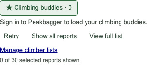
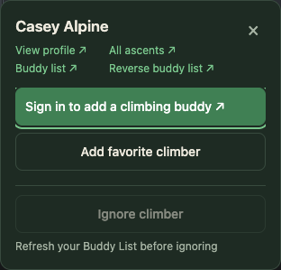

# Signed-out Peakbagger users: feature gates and remediation plan

Status: **A1–A4 implemented and verified locally. Live/session and native-UI proof gaps remain explicit below.**

## Findings first

Most gates are appropriate. Public planning and local extension tools should
remain usable without a Peakbagger account. Actions that create or change
Peakbagger records need a verified account, with ownership checks where relevant.
The main problems are inconsistent identity detection and recovery when an
account-dependent feature is unavailable.

| ID | Priority | Finding | Evidence level |
| --- | --- | --- | --- |
| A1 | P2 | An active Buddy filter offers Retry while signed out, without a direct sign-in action; keyboard Retry loses focus. | Reproduced on the built extension in hidden Chrome. |
| A2 | P2 | Three account readers disagree on malformed or conflicting identity evidence. | Reproduced using the actual pure parser and extracted worker function. No unauthorized remote write demonstrated. |
| A3 | P2 | A saved Buddy cache can block signed-out Ignore with recovery that does not identify the relevant account; a prior Saved message can conceal the reason. | Reproduced in the card and worker-policy source. The conservative protection itself is intentional. |
| A4 | P2 | Open My Ascents uses an extension-side login request without the page-session fallback used elsewhere, so an unverified session can be reported as signed out. | Source-grounded conditional defect; live cookie-isolation reproduction remains open. |

No new P0/P1 defect or successful account-write bypass was established. This is
a focused audit, not a release audit or proof of every anonymous Peakbagger
endpoint.

## Scope and evidence

The audit started on `main` at `0a3884085ad8f8e71e298af1ba0c39ea7f047d27`,
version 4.0.2. An existing Garmin-plan edit was preserved. Concurrent documentation
commits advanced the tree to `e9f4fc9a489b9ef4fff52e7006c90522f4d377c1` during
the review; source references below describe the audited runtime.

Inspected the real manifest and bundle ownership, settings defaults, account
parsers, activity capture and upload admission, public maps/GPX sources,
weather/snow startup, editors, climber-list reads and mutations, GitHub backup,
Photo Topos entry points, and relevant tests and maintained contracts. Proposed
Garmin inbox/feed-export and media-hosting plans are not shipped capabilities.

Hidden Chrome for Testing **156.0.8078.4** loaded the real unpacked `dist/` in
an isolated disposable profile. HTTPS fixtures used a real Peakbagger hostname
with a per-run certificate. Public-page fixtures retained native surrounding
HTML, but removed the signed-in navigation and owner Buddy controls before
delivery. An explicit test link supplied a stable card trigger. External browser
requests were blocked. Page delivery, provider sessions, and server responses
were fixtures; extension storage, manifest injection, and local Favorite writes
were real. Weather, snow and Sun & Moon were disabled in this focused render;
their availability below is source-grounded, not visually verified here.

This audit also checked Peakbagger's public
[home page](https://www.peakbagger.com/) and
[login page](https://www.peakbagger.com/climber/login.aspx) through web retrieval.
They describe registration for ascent logging and trip-report publishing. That
is supporting product context, not an authenticated or anonymous browser test
of every resource.

## Current feature inventory

“No extension login gate” means the extension does not require a Peakbagger
identity. It still needs the native page/data to be available. Sending a request
with `credentials: include` does not itself make a public feature login-only.
Peakbagger can independently redirect, challenge, or restrict its endpoints.

| Feature | Current signed-out behavior / gate | Assessment |
| --- | --- | --- |
| Theme, units, layout preferences, settings import/export | No Peakbagger login gate; device/browser settings. | Correct. Keep available. |
| Peak planning links | No Peakbagger login gate; supported peak/location and configured links. | Correct. External destinations may have their own requirements. |
| 2D map enhancements, overlays, resizing and 3D terrain | No Peakbagger login gate; native map, settings, supported data and optional permissions apply. 3D is off by default. | Correct. A feature toggle or missing map is not an account gate. |
| Climbed/unclimbed peak colors | Reflect Peakbagger's native markers/feed. Unknown state is supported when personal status is unavailable. | Correct. Keep anonymous markers useful; never call unknown status “unclimbed.” |
| Summit forecast, ascent-day weather, SNOTEL, Sun & Moon | No Peakbagger login gate; location/date/data coverage and per-feature settings apply. | Correct. Service failures must not become sign-in requirements. |
| Saved-ascent GPX charts, analysis, route styling and map synchronization | No extension identity/ownership gate; needs a valid saved track supplied by Peakbagger. | Correct for publicly available tracks. This audit did not prove anonymous access to every native GPX endpoint. |
| Send saved GPX to Gaia, onX, AllTrails or CalTopo | No Peakbagger owner gate. Requires the exact same-ascent GPX link, valid returned GPX, optional destination access and destination readiness. | Correct. A mapping-service login is separate from Peakbagger login. |
| Beta / report / GPS / external-link filters and list sorting | No Peakbagger login gate on supported loaded tables. | Correct. Preserve ordinary filters when Buddy data is unavailable. |
| Custom favorites: add/remove, manage, filter, import/export | No Peakbagger login gate; custom source must be selected, and membership/capacity/storage rules apply. | Correct. A signed-out keyboard save was verified. |
| Local ignored climbers and report conceal/reveal | No global Peakbagger login gate. Favorites, cached buddies, pending Buddy intents and pending sync can block additions. Signed-in card Ignore also checks the live Buddy List. | Local availability is correct. Account-mismatched cached protection needs clearer explanation (A3). |
| Climber hover card and public profile/ascent navigation | Available signed out. Card retains local actions; Buddy mutation becomes a sign-in link. Buddy mode already offers **Use custom favorites…**. | Good existing capability separation; preserve it. |
| Buddy-based favorites filter and refresh | Default source is Buddy List. Site-page cache is accepted only for a matching signed-in owner; no owner means unavailable. An active saved filter remains active. | Account gate and cache separation make sense. Improve recovery (A1). |
| Add/remove Peakbagger climbing buddy | Signed-in owner, fresh matching profile, supported native control/form, trusted action, and post-write confirmation. | Correct. Do not relax to make the signed-out card writable. |
| Garmin / Strava activity capture into ascent drafts | Provider login/ownership first, then verified Peakbagger identity before fetching the provider GPX. | Correct for the shipped ascent-drafting workflow. Signed-out standalone GPX export would be a separate product change. |
| Local GPX Process and multi-peak drafts on Add Ascent | Recognized native form, current selection, verified Peakbagger identity, and matching form CID. | Correct. Keep raw-file privacy and identity checks. A standalone file analyzer is not the current product surface. |
| Trip-report / biography editor and save-integrated photo uploads | Editor mounts on the native writable form rather than using a separate global login flag. Peakbagger controls access to that form and Save. | Sensible form dependency. A stale open form is not proof of a still-valid server session. |
| Photo Topos, local photo library and local project download/import | Standalone extension surface has no Peakbagger login gate. ImgBB upload requires its own configured key/permission. Inserting into a report needs a valid return context. | Correct. Do not gate standalone authoring on Peakbagger. |
| GitHub connection and settings/climber-list/photo recovery backup or sync | GitHub connection, permission, repository and feature-specific controls; no Peakbagger identity requirement for these independent files. | Correct. Peakbagger sign-out must not disconnect GitHub or remove local data. |
| Individual and full-profile ascent backup | Owner edit affordance / owner list plus validated persisted edit data, backup setting, GitHub authorization/repository. | Correct for the own-history backup contract. Public report viewing does not imply permission to back up someone else's full editable record. |
| Open My Ascents and deletion-mirroring confirmation | Worker checks current Peakbagger identity. Deletion additionally needs explicit same-tab intent and complete owner-list evidence. | Identity requirement is right; navigation's transport/recovery needs A4. Deletion safeguards must stay intact. |

Key source anchors:

- `manifest.json` and `scripts/build-config.mjs` define page coverage and loaded
  bundles; there is no global login switch around public content scripts.
- `src/settings/settings-schema.js` (lines 78–137) defines display gates and
  the default Buddy source.
- `src/maps/peak-map.js` (lines 64–76) and
  `src/terrain/terrain-frame-runtime.js` (lines 160–169) preserve unknown markers.
- `src/ascent/ascent-gaia.js` (lines 23–31) and
  `src/gpx/saved-gpx-source.js` validate source availability/identity, not ownership.
- `src/reports/report-editor.js` (lines 45–51) requires the native textarea/form.
- `src/background/background.js` (lines 1694–1735 and 2742–2786) checks the
  account before provider export or upload draft preparation.
- `src/ascent/ascent-backup.js` (lines 333–344),
  `src/profile/profile-backup-core.js` (lines 38–75), and
  `src/profile/profile-backup.js` (lines 551–558) restrict ascent backups to owners.
- Independent GitHub file operations and ownership boundaries are maintained in
  [the backup contract](../github-ascent-backup.md); device-wide list behavior is
  maintained in [the climber-list contract](../climber-lists.md).

## A1 — Buddy-filter recovery is not actionable and drops keyboard focus

**Reproduction.** Open a signed-out peak with the default Buddy source and
activate the climber filter, or revisit with that preference saved. The built
extension shows **0 of 30 selected reports shown**, a sign-in instruction, Retry,
Show all reports, View full list and Manage climber lists. The only link in the
toolbar is the manager; no link opens sign-in. Keyboard Retry repeats the same
signed-out result and loses focus.

Retry's rectangle before/after two Enter activations was identical:
`x=328.53125, y=399.828125, width=47.0625, height=32` CSS pixels at
1000 × 760, while `document.activeElement === retry` became false. A disposable
assertion requiring retained focus failed with `false !== true` on this current,
unfixed bundle. It reached the user-visible focus defect, not a setup timeout.

**Root cause.** `src/favorites/favorite-source.js` (lines 21–30) emits a string
error for missing owner identity. `src/favorites/peak-report-filter.js`
(lines 79–82 and 110–124) gives all such failures generic Retry. During Retry,
the source read clears the error before publishing the same missing-owner
failure; rendering temporarily hides the focused recovery control. The full
ascent-list filter has the same generic source/retry pattern in
`src/ascent/ascent-filter.js` (lines 1371 and 1424–1427); its focus defect has
not been independently browser-reproduced here.

**Smallest safe fix.** Retain a typed source-unavailable reason. For missing
account identity, offer **Sign in to Peakbagger** and **Use custom favorites…**,
alongside the existing public-content escape. Keep the saved filter preference,
matching-owner cache rule and distinction between unavailable and valid empty
lists. Do not silently switch sources or treat every account-check failure as
confirmed sign-out. During transient retry, keep the active action mounted,
visible and focused; do not restore focus if the user moves away.

**Acceptance.** Cover peak reports and full ascent lists: first use, persisted
active filter, signed out, valid empty list, unknown identity, challenge, timeout,
account switch and BFCache. Assert recovery targets and zero Buddy writes while
signed out. In Chrome and Firefox, drive Enter/Space through error → retry →
error/success, including slow reads. Measure action/heading/following-content
geometry and scroll at desktop/narrow sizes, light/dark themes and 200% zoom.
Retain the current-bundle focus failure as pre-fix regression evidence.

## A2 — Identity readers have different trust and consistency rules

**Reproduction.** The following HTML was supplied to the actual page parser,
the worker's exact extracted `peakbaggerLogin` function with a stubbed successful
HTML response, and `freshAccountCid` with equivalent link evidence:

| Evidence | Page `ownerClimberId` | Worker `peakbaggerLogin` | Strict fresh-page reader |
| --- | --- | --- | --- |
| No account links | null | null | null |
| Off-site “My Home Page”, CID 17 | 17 | "17" | null |
| Peakbagger My Home Page CID 17 + My Ascents CID 29 | 29 | "17" | null |
| Peakbagger My Home Page CID 0 | 0 | "0" | null |

**Root cause.** `src/profile/profile-backup-core.js` (lines 26–31) chooses the
first matching label in a fixed precedence and parses its CID without checking
origin, path, positivity, uniqueness or agreement. The worker's HTML regex in
`src/background/background.js` (lines 524–540) applies different precedence and
also accepts these examples. `src/peakbagger/peakbagger-account.js`
(lines 13–55) already rejects invalid links and conflicting identity evidence
for the fresh-page shortcut.

This demonstrates inconsistent admission/presentation decisions. It does not
prove that an ordinary signed-out Peakbagger page currently emits these links,
that source HTML controls the server's authorization, or that an unauthorized
Buddy/ascent/backup write can succeed. Positive page evidence must also remain
distinct from a fresh server session check.

**Smallest safe fix.** Extend the existing pure account module to own shared
link validation and consistent identity evidence. Add thin DOM/HTML adapters;
do not copy another regex/schema into each feature. Represent verified identity,
confirmed sign-out and unverified state separately. Preserve both supported
Peakbagger hosts where appropriate: the fresh-capture optimization intentionally
uses only the canonical host, while existing public fixtures include the bare
host. Do not blindly impose its exact two-link requirement on every legacy
surface without checking supported navigation variants. A persistent native
**Log In** menu link alone is not proof of sign-out; signed-in fixtures contain it.

**Acceptance.** Shared cases for relative/canonical/bare-host links, conflicting
CIDs, duplicate params, CID zero/negative/non-safe values, wrong path/origin,
login-only, user-authored lookalike links, missing navigation, and supported
legacy markup. Any unverifiable account mutation stays closed, while public
features and local preferences remain usable. Re-run capture, Buddy, profile,
draft and backup tests plus the real-manifest Chrome check.

## A3 — Cached Buddy protection needs account-specific recovery

**Reproduction.** Sign out, select custom favorites and retain a valid Buddy
cache belonging to a previously signed-in account. For a cached member, card
state is `buddy=false` but `ignoreDisabled=true`; the explanation is **Refresh
your Buddy List before ignoring**. The card has no refresh action tied to that
original account. In the tested sequence, adding/removing a custom Favorite
first left **Saved.** visible, suppressing even that explanation. Reopening
the card exposed the refresh instruction.

**Root cause.** `src/favorites/climber-card-state.js` (lines 53–79) intentionally
protects every saved Buddy member from Ignore, even when cache ownership cannot
be presented as current membership. `src/background/climber-list-policy.js`
(lines 48–78) enforces the same policy in the worker. Card painting in
`src/favorites/climber-hover-card.js` (lines 162–173) lets the prior success
notice hide the current availability reason.

**Smallest safe fix.** Preserve conservative protection, but prioritize the
current blocking reason over stale Saved feedback. Identify it as a saved Buddy
list from another/unverified account and offer a clear original-account
sign-in/refresh route. Keep local removals usable. Do not silently erase a cache,
expire unresolved Buddy intents, or bypass membership protection to enable Ignore.

**Owner choice D1.** Device-wide ignores/favorites and protection by a previous
account's cache are documented policy, not a newly discovered account bypass.
If signed-out users should be allowed to discard historical cache protection,
design an explicit device-local action with a preview and documented membership
consequences first. It must never clear an unresolved server-write intent.
Keep this policy unchanged in the initial fixes.

**Acceptance.** Signed out/account B with account A's cache; matching owner;
fresh/stale caches; favorite add/remove preceding the block; pending and expired
unresolved Buddy intents; safe Unignore; and account changes during refresh.
Check current explanations and keyboard focus at desktop/narrow sizes in both
browsers. No silent cache, favorite, ignore or server-membership changes.

## A4 — Backup navigation uses a different session transport

**Evidence.** `src/background/github-routes.js` (lines 124–146) calls the worker's
default `peakbaggerLogin()` and turns missing identity into a sign-in instruction.
The default request in `src/background/background.js` (lines 524–540) is an
extension-side request. `options/github.js` (lines 415–436) presents that result
to the user. In contrast, activity capture uses a Peakbagger-page transport,
and `options/favorites.js` (lines 410–430) explicitly falls back to a site tab
when extension-side cookies/clearance cannot verify an otherwise usable session.

**Failure condition.** If the extension request sees a login page while the
first-party browser tab is authenticated, Open My Ascents incorrectly tells the
user to sign in again. The existing integration test covers a truly missing
account but does not model these two different session views. Source tracing
establishes the inconsistent path; this audit did not reproduce the cookie
condition in a live signed-in browser, so that practical proof remains open.

**Smallest safe fix.** Reuse the bounded page-session/account verification
transport for this explicit navigation, or give an honest unverified-state
recovery when that transport is unavailable. Preserve foreground focus, tab
leases, challenge/rate-limit classification and canonical target validation.
Do not widen a page bridge into a general authenticated-fetch API. Review the
deletion-confirmation caller separately before changing a shared login helper:
deletion must still require fresh authoritative identity and complete-list proof.

**Acceptance.** Stub an extension-side signed-out response with a valid site
session, and the reverse; confirm identity is resolved only through current
trusted evidence. Test true sign-out, challenge, timeout, account conflict,
missing/closed helper and expired lease. Live read-only validation of the
cookie-isolation condition remains required if it can be reproduced. No backup
or deletion write should be performed merely to test navigation recovery.

## Implementation order and commit boundaries

1. **A2: shared identity evidence.** One focused account-parser commit, preserving
   legacy-host coverage and fail-closed writes. This supplies trustworthy typed
   evidence for recovery without a global login requirement.
2. **A1: filter recovery and focus.** One focused source/filter UI commit with
   the pre-fix focus assertion and Chrome/Firefox state/geometry coverage.
3. **A3: explain cached protection.** One focused card/profile feedback commit.
   Keep D1's policy unchanged; include current-blocking-reason precedence.
4. **A4: My Ascents session verification.** One focused navigation/transport
   commit; preserve deletion authority and prove helper teardown.
5. **Requirements and signed-out smoke coverage.** One documentation/coverage
   commit: put a concise account-requirements table in maintained user docs,
   distinguish Peakbagger/provider/GitHub/ImgBB requirements, and add a small
   signed-out real-extension matrix. Reuse existing verification tooling rather
   than creating a parallel harness.

For each implementation commit, run focused checks before committing. Worker
or content-script startup changes require `npm run verify -- chrome`; final
cross-browser behavior needs `npm run verify -- browsers`. Run the full suite
once after the fixes. Broaden GPU/terrain verification only if map rendering or
its data contracts change. Do not treat a static signed-out screenshot as
proof of pending/error transitions, focus, or terrain rendering.

## Initial audit verification and limits (before implementation)

- `npm run build` succeeded before bundle-based checks.
- Focused existing suites passed **431 tests**: 66 across favorite source/card/
  policy/hover/Ignore/peak-filter, profile-backup-core and saved-GPX tests; 345
  across background capture, options favorites, GitHub backup integration and
  ascent map handoff; 20 across Peakbagger page/request tests. These are selected
  suites, not the complete test suite or release gate.
- The disposable source probe reproduced A2's four rows and A3's cache-state
  distinction. It used no remote writes.
- Hidden real-extension Chrome inspected the light peak toolbar at 1000 × 760
  and 375 × 900; light climber cards at 1000 × 760; and the cached-protection
  card in dark mode at 375 × 900. Settled screenshots are retained here.
- Keyboard Retry → same signed-out error preserved its rectangle and lost
  focus (A1). Custom Favorite → confirmed save preserved the 278 × 42 action
  at x=29/y=548.078125, scroll=1100 and focused action. This is a narrow
  transition measurement, not whole-page stability proof.
- Browser-probe setup attempts initially used an ineffective interception
  pattern, then encountered an expected card dismissal on resize and an
  ambiguous diagnostic selector. Those were corrected; they are not product
  findings. The subsequent focus assertion failed on the actual defect; the
  final observation run recorded it while completing the remaining states.
- WebGL was not exercised, and no hardware-renderer claim is made. No visible
  browser was opened; native focus/Space/window placement was not visually
  established. User profiles and logins were not changed.
- Teardown closed each owned context and HTTPS server and deleted its exact
  disposable profile/certificate paths. A final process-command inspection found
  no remaining audit script or test-profile browser process. Documentation link
  checks passed (3 tests), and `git diff --check` passed.
- Firefox signed-out rendering, browser zoom/enlarged text, slow/error local
  writes, full surrounding-page geometry/scroll across every transition,
  screen-reader output, live anonymous GPX access and live cookie isolation
  remain unverified. No new runtime regression test has been committed in this
  documentation-only audit.

## Closure ledger

### Live reproduction and implementation evidence — October 23

- Read-only Chrome 156 inspection confirmed the native signed-in navigation on
  an existing Peakbagger tab. A separate anonymous context loaded the live
  Rainier page with only the global Log In link; no user session was changed.
- A hidden full Chrome for Testing 156.0.8078.4 profile loaded the real extension
  against the live signed-out page. Cloudflare initially challenged it; reusing
  only the anonymous context's clearance cookie with its exact User-Agent allowed
  the read. No Peakbagger authentication cookies were transferred. Activating
  Climbing buddies hid all 30 loaded reports, offered only the manager link in
  its recovery row, and keyboard Retry left focus on BODY (A1).
- On that live page, a controlled prior-account cache in the disposable profile
  disabled Ignore and displayed the generic refresh instruction (A3). No Buddy,
  ascent, provider-export or GitHub write was performed.
- The A4 comparison did not establish a false sign-out: fresh first-party and
  extension account requests were both refused by Cloudflare. Its conditional
  transport regression therefore needed the deterministic coverage recorded
  below; no live cookie-isolation reproduction is claimed.
- A2's new regression assertion failed on the original reader with an off-site
  CID accepted as 17. The shared reader now scopes evidence to native account
  navigation before the page heading, validates all account links consistently,
  and rejects conflicting, off-site, duplicate/invalid/non-safe identities.
  Both HTTPS hosts and the existing profile-mode link variant remain supported;
  the fresh-page shortcut retains its stricter canonical/corroborated contract.
  The page helper version was advanced so an already-open page cannot retain
  the old evidence collector. Synthetic fixtures now include the native bar.
  Verification: 411 focused tests, targeted ESLint, and hidden real-manifest
  Chrome verification passed. A2's parser rejection is not a demonstrated
  successful remote authorization bypass.
- The final real-manifest Firefox run exposed an A2 compatibility regression:
  Firefox's content-script Xray boundary denied iteration of the native
  `URLSearchParams.keys()` result, preventing profile controls from mounting.
  The shared validator now collects keys through `forEach`. A focused test
  reproduced the same TypeError before the fix and passed afterward (11 account/
  profile tests). The real unpacked extension then passed in hidden Chrome
  156.0.8078.4 and Firefox 158.0.1, including profile/Buddy flows; both verifiers
  reported successful teardown. This is why ordinary renderer stubs were not
  sufficient proof of Firefox compatibility.
- A1 now keeps a typed account-unavailable reason, offers sign-in and custom
  favorites, and preserves the selected filter. Retry coalesces activation and
  retains its error/action while the read is pending. Controls precede the
  changing status; focused recovery remains usable after completion. Full-list
  callbacks are installed before the initial missing-account result, and its
  settings snapshot follows later source changes. The missing-link assertion
  failed before the fix; a current-list source-switch regression also exposed
  the stale settings snapshot. Verification: 73 focused tests, targeted ESLint,
  and `npm run verify -- signed-out` passed 64 cases in hidden Chrome
  156.0.8078.4 and Firefox 157.0. Both native peak/full-list fixtures were checked
  at widths 1000/375 and height 900, light/dark, CSS zoom 1/2, through held
  retry → repeated error → success and duplicate Enter/Space activation.
  Retry/error action, toolbar, heading, document height and scroll stayed stable;
  success kept the action and focus while allowing the result/status to change.
  Chrome light/dark desktop/narrow screenshots were visually inspected. This
  focused renderer uses explicit storage/network stubs and shipped bundles;
  native browser zoom, WebGL and live account-write behavior are not established.
- A3 identifies a previous account's saved Buddy List, offers **Open saved
  account**, and keeps its blocking explanation visible after a local Favorite
  save. The same explanation/recovery appears on profiles. Cache membership and
  unresolved intent protection are unchanged; the recovery opens a public
  profile and never retries a write or discards a cache. The hidden-explanation
  assertion failed before the fix. Verification: 49 focused tests and targeted
  ESLint passed; `node scripts/verify-climber-transitions.mjs
  --checks=cached-account` passed 24 hidden Chrome/Firefox variants at widths
  390/768/1280, height 900, light/dark and normal/doubled text. Local Favorite
  pending/completion preserved action geometry, native content, scroll and
  keyboard focus; account recovery and wrapped explanations fit the viewport.
  Chrome and Firefox screenshots were visually inspected. These renderer cases
  use explicit operation/storage stubs, not live Buddy writes.
- A4 now verifies explicit My Ascents navigation through the bounded first-party
  page transport. Only a newly navigated owned helper can use fresh account-bar
  evidence; an existing tab requires a fresh page-owned account read. Leases,
  request scheduling/cooldowns and helper teardown are reused. Confirmed login
  forms offer sign-in, while missing/invalid identity and provider challenges
  stay distinct and offer **Open Peakbagger**. Deletion confirmation retains
  its separate fresh authority. The worker-signed-out/page-signed-in regression
  failed before the fix and now passes; eight focused My Ascents tests cover
  sender gates, typed errors, no provider export, inactive helpers and cleanup.
  Hidden real-manifest Chrome also verifies the different session views through
  the actual worker/page helper. This is controlled transport proof, not a live
  reproduction of browser cookie isolation.
  The Settings transition check passed eight Chrome/Firefox renderer variants
  at 390/1280 × 900, light/dark, each with normal/doubled control text: held
  request, repeated keyboard activation, unverified error, recovery URL and
  retry/completion. Pending action bounds, error reading position and keyboard
  focus stayed stable. Narrow light/dark screenshots were visually inspected.
  Replies/storage were explicit stubs; native browser zoom was not exercised.
- Final verification used an isolated snapshot of `d25dd7d4` plus only these
  fixes, preserving concurrent Garmin implementation in the shared checkout.
  All **3,337 tests** passed. Full ESLint/build/web-ext lint passed with the
  eight documented upstream/cross-browser warnings; the final account and
  verifier edits also passed targeted ESLint. Real-manifest hidden Chrome
  156.0.8078.4 and Firefox 158.0.1 passed at 1000 × 760 (plus their existing
  narrow/header cases), with teardown reported by both. An earlier Firefox
  BFCache probe did not restore a document; both final probes did.
- Step 5 is complete: maintained docs now include account requirements and
  recovery behavior. Both real-manifest browser gates run the same anonymous
  peak fixture with Buddy/custom sources, verify sign-in/custom recovery,
  preserve public reports, hide the Buddy write action and persist a keyboard
  Favorite through the actual worker/storage APIs. The fixture's Buddy read and
  mutation counters remain unchanged. This complements the renderer matrices;
  it is a controlled HTTPS fixture, not live endpoint authorization proof.
  The initial Chrome smoke setup referred to a tab a prior check had closed;
  it now creates its own Settings tab. The final Chrome/Firefox gates and full
  lint passed. Documentation, fixture contracts and script inventory passed
  14 focused checks in the isolated snapshot. `git diff --check` passed.

### Fixed and verified

A1: actionable filter recovery, retry focus/stability and live source switching.
A2: shared account validation and adapters.
A3: truthful cached-account feedback and public-profile recovery.
A4: first-party My Ascents verification, honest recovery and helper cleanup.
Local evidence and its boundaries are recorded above.

### Intentionally not changed

- Login, provider ownership and matching-draft identity before capture/delivery.
- Owner-only ascent backup, fresh Buddy mutation validation and deletion proof.
- Matching-owner Buddy caches, persisted filter preference, and unavailable
  versus valid-empty list semantics.
- Public browsing/local tools without a global Peakbagger login requirement.
- Device-wide local lists and conservative historical-cache protection (D1).
- Independent GitHub/ImgBB/mapping-service authorization; manual Peakbagger Save.

### Changed but not fully proven

- A4's live cookie-isolation condition remains unproven: Cloudflare refused both
  fresh account views during reproduction. A later optional post-fix live probe
  timed out connecting to the existing browser protocol before loading a test
  profile. No account-write bypass or live Buddy/ascent write was attempted.
- The implemented 64 filter and 24 cached-account renderer variants cover their
  recorded states only. Native browser zoom, screen-reader output, visible
  focus/Space/window placement, every BFCache/account-switch race, and anonymous
  access to every native GPX endpoint remain outside the demonstrated proof.
- Concurrent Garmin changes were preserved and excluded from the final snapshot;
  the checks above do not certify that unfinished feature or the combined tree.
